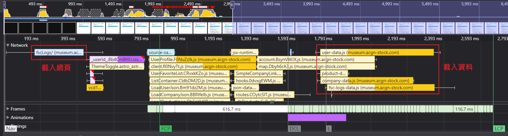

import Gallery from '../../components/Gallery.astro';

本文記錄 [ACGN 股市歷史博物館](https://museum.acgn-stock.com/)從 SSR 架構轉型為 SSG 的完整過程，使用 Astro 建構靜態頁面，搭配 React、Firestore 與 CDN 快取策略，成功將近 7 萬頁內容靜態化。過程中包含資料結構跨賽季差異處理、HTML 體積控制、虛擬捲動體驗提昇、Build 時間改善等實務挑戰，同時大幅降低伺服器營運成本並提升頁面載入表現。

一切的開頭是將近八年前的[提案](https://museum.acgn-stock.com/round1/ruleDiscuss/view/edT83mJR9iRhnwaCc/)。

## 事前準備

### 目標設定

1. 統一所有賽季所使用的域名，將原本 subdomain 的處理方式改為 subpath 來處理，減少新增賽季時的操作成本。
2. 全部頁面靜態產生，也就是 SSG (static site generation)，充分利用 CDN cache，減少伺服器端運算成本需求。
3. 增加前後賽季的頁面關聯，方便使用者在賽季間移動做對照。

### 解決方案選擇

使用 Astro 來產生靜態頁面，搭配 Preact 做互動效果，Tailwind CSS 做視覺排版處理，以及 Firestore 存放使用者相關的資訊，加上 ESLint、Prettier、lint-staged、commitlint 和 husky 輔助開發。

## 開發過程

- 10/8
  - 專案初始化

- 10/12
  - 增加賽季首頁 (*/\<round_name>/*)

- 10/13
  - 增加教學頁 (*/\<round_name>/tutorial/*)

- 10/14
  - 增加金管會執行紀錄頁 (*/\<round_name>/fscLogs/*)

- 10/15
  - 增加金管會持股頁 (*/\<round_name>/fscStock/*)

- 10/17
  - 增加季度報告頁 (*/\<round_name>/seasonalReport/\<season_id>/*)
  - 增加規則討論列表頁 (*/\<round_name>/ruleDiscuss/*)

- 10/19
  - 增加規則討論內容頁 (*/\<round_name>/ruleDiscuss/view/\<rule_id>/*)

- 10/21
  - 增加違規案件列表頁 (*/\<round_name>/violation/*)
  - 增加違規案件內容頁 (*/\<round_name>/violation/view/\<case_id>/*)
  - 增加公告列表頁 (*/\<round_name>/announcement/*)

- 10/22
  - 增加公告內容頁 (*/\<round_name>/announcement/view/\<announcement_id>/*)
  - 增加公告否決投票頁 (*/\<round_name>/announcement/reject/\<announcement_id>/*)
  - 增加廣告宣傳列表頁 (*/\<round_name>/advertising/*)
  - 增加季度產品列表頁 (*/\<round_name>/productCenter/season/\<season_id>/*)
  - 增加公司產品列表頁 (*/\<round_name>/productCenter/company/\<company_id>/*)

- 10/23
  - 增加最萌亂鬥大賽頁 (*/\<round_name>/arenaInfo/\<season_id>/*)

- 10/27
  - 增加帳號資訊頁 (*/\<round_name>/accountInfo/\<user_id>/*)

- 10/28
  - 增加股市總覽頁 (*/\<round_name>/company/*)

- 11/1
  - 增加公司資訊頁 (*/\<round_name>/company/detail/\<company_id>/*)
  - 開始將所有頁面逐一調整為靜態產生
  - 開始導入 Playwright 做 E2E test，檢查所有靜態產生的頁面是否正確

- 11/4
  - 增加 404 頁 (*/404/*)

- 11/5
  - 完成所有頁面的靜態產生處理
  - 完成所有頁面的 E2E test 撰寫

- 11/6
  - 增加首頁 (*/*)
  - 增加 Open Graph 標籤資訊

- 11/7
  - 增加 Schema.org 結構化資料
  - 增加 Google Tag Manager 設定

- 11/8
  - 增加 robots.txt
  - 增加 Sitemap
  - 增加 Lighthouse test
  - 完成第六季之後的賽季資料呈現

- 11/12
  - 增加第五季賽季的資料呈現
  - 增加第四季賽季的資料呈現

- 11/13
  - 增加第三季賽季的資料呈現
  - 增加第二季賽季的資料呈現

- 11/15
  - 增加第一季賽季的資料呈現

- 11/17
  - 使用 React 取代 Preact 作為頁面互動處理

- 11/19
  - 導入 React Virtuoso，針對大量資料的顯示處理，從 Infinite Scroll 調整為 Virtualized View，提昇捲動的流暢度

- 11/25
  - 增加 Island Component 的載入顯示效果

- 11/28
  - 調整 log 相關的資料載入處理，減少靜態產生頁面的大小，降低 FCP(First Contentful Paint) 秒數

## 特殊處理

### 賽季與賽季間差異的處理

針對所有的賽季資料處理，依照變動的複雜程度，分為第六季之後與第六季之前兩大類，前者變動差異較小，且賽季數量較多，所以優先從這一類開始處理。處理完畢後，剩餘的依賽季先後順序，由後往前逐一處理。

第六季以前，公司名稱和 ID 尚未綁定，會使公司在不同賽事季度切換的功能失靈，須額外撰寫[程式](https://github.com/erase2004/museum-tools/blob/main/src/scripts/fix-company-id-inconsistency.ts)來處理這問題，讓第六季以前的公司 ID，在不同賽季間盡可能相同。

<figure>
<video controls loop muted preload="metadata" src="https://media.aniya.moe/videos/acgn-museum-ssg/round-switch-01.mp4"></video>
<figcaption>在不同賽季間切換瀏覽「初音未來」這家公司的資訊</figcaption>
</figure>

以下是個別賽季的重要差異紀錄

- 第五至六季

<table>
<tbody>
<tr><td>變動內容</td><td>調整內容</td><td>調整參考</td></tr>
<tr><td><em>companyArchive</em> 中 <em>name</em> 欄位名稱調整為 <em>companyName</em></td><td>調整對應欄位名稱</td><td><a href="https://github.com/erase2004/museum-tools/blob/main/src/mongo-scripts/043-rename-name-to-companyName-in-companyArchive.js">mongo script</a></td></tr>
</tbody>
</table>

- 第四至五季

<table>
<tbody>
<tr><td>變動內容</td><td>調整內容</td><td>調整參考</td></tr>
<tr><td>最萌亂鬥大賽重寫</td><td>1. 藉由 <em>arena</em> 的 <em>winnerList</em> 欄位資訊，更新對應 <em>arenaFighters</em> 的 <em>rank</em> 欄位 2. 計算個別 <em>arenaFighters</em> 的總投資金額，並更新到 <em>totalInvestedAmount</em> 欄位上</td><td><a href="https://github.com/erase2004/museum-tools/blob/main/src/mongo-scripts/040-arena-rewrite.js">mongo script</a></td></tr>
<tr><td>增加產品補貨設定</td><td>增加 <em>replenishBaseAmountType</em> 和 <em>replenishBatchSizeType</em> 欄位，並設定為預設值</td><td><a href="https://github.com/erase2004/museum-tools/blob/main/src/mongo-scripts/039-default-product-replenish-options.js">mongo script</a></td></tr>
<tr><td>增加公司創立人資訊</td><td>分成兩類來處理： 1. 第一季，抓「創立得股」的 <em>log</em> 作為資料參考 2. 第二至四季，抓「創立公司」的 <em>log</em> 作為參考</td><td><a href="https://github.com/erase2004/museum-tools/blob/main/src/mongo-scripts/037-add-company-founder.js">mongo script</a></td></tr>
</tbody>
</table>

- 第三至四季

<table>
<tbody>
<tr><td>變動內容</td><td>調整內容</td><td>調整參考</td></tr>
<tr><td>增加產品分級資訊</td><td>針對 <em>type</em> 為「裏物」的產品設定 <em>rating</em> 為「18禁」</td><td><a href="https://github.com/erase2004/museum-tools/blob/main/src/mongo-scripts/035-product-rating.js">mongo script</a></td></tr>
<tr><td>增加賽季順序資訊</td><td>依照賽季開始時間排序，由早到晚逐一更新 <em>ordinal</em> 欄位</td><td><a href="https://github.com/erase2004/museum-tools/blob/main/src/mongo-scripts/034-add-ordinal-to-season.js">mongo script</a></td></tr>
<tr><td>稅制調整</td><td>將 <em>zombie</em> 欄位名稱調整為 <em>zombieTax</em></td><td><a href="https://github.com/erase2004/museum-tools/blob/main/src/mongo-scripts/032-tax-seperate.js">mongo script</a></td></tr>
</tbody>
</table>

- 第二至三季

<table>
<tbody>
<tr><td>變動內容</td><td>調整內容</td><td>調整參考</td></tr>
<tr><td>使用者權限系統調整</td><td>將原先 <em>profile.isAdmin == true</em> 的使用者，增加「fscMember」至 <em>profile.roles</em> 的欄位資訊中</td><td><a href="https://github.com/erase2004/museum-tools/blob/main/src/mongo-scripts/024-advanced.permission-system.js">mongo script</a></td></tr>
</tbody>
</table>

- 第一至二季

<table>
<tbody>
<tr><td>變動內容</td><td>調整內容</td><td>調整參考</td></tr>
<tr><td>新的公司營利分配設定</td><td>1. 調整 <em>companies</em> 中 <em>seasonalBonusPercent</em> 的欄位名稱 2. 調整「營利分紅」的 <em>log</em> 中的欄位名稱</td><td><a href="https://github.com/erase2004/museum-tools/blob/main/src/mongo-scripts/022-new-profit-distribution-method.js">mongo script</a></td></tr>
<tr><td>新的產品系統</td><td>1. 調整 <em>users</em> 的 <em>profile.vote</em> 欄位名稱 2. 調整 <em>products</em> 中 <em>votes</em> 的欄位名稱  3. <em>products</em> 依照 <em>overdue</em> 資訊更新對應的 <em>state</em> 數值 4. 使用預設值設定 <em>products</em> 的 <em>price</em>、<em>totalAmount</em>、<em>stockAmount</em> 和 <em>availableAmount</em> 數值</td><td><a href="https://github.com/erase2004/museum-tools/blob/main/src/mongo-scripts/017-new-product-system.js">mongo script</a></td></tr>
</tbody>
</table>

### 從 SSR 模式轉換到 SSG 模式

剛開始開發頁面，是用 SSR 的方式做渲染，要逐步調整為 SSG 並移除後端 runtime 的需求時，需要進行以下調整：

1. 原先呼叫 API endpoint 拿 JSON 資料的形式，要調整為直接拿輸出結果的 JSON 檔案
   - 參考：[https://github.com/erase2004/acgn-stock-museum/commit/2ccf92f09c50e35d2bfe5d53a472d1cbe4690daf](https://github.com/erase2004/acgn-stock-museum/commit/2ccf92f09c50e35d2bfe5d53a472d1cbe4690daf)
2. 使用者相關的資料寫入 Firestore
   - 參考：[https://github.com/erase2004/museum-tools/commit/5563b5f6a7ece39b2053998ec9c2a666b0c1a318](https://github.com/erase2004/museum-tools/commit/5563b5f6a7ece39b2053998ec9c2a666b0c1a318)
3. 使用 Firebase Client SDK 來取代 Server Action 的呼叫，處理使用者的登入
   - 參考：[https://github.com/erase2004/acgn-stock-museum/commit/27c72421eec2f6ee98b7027f35d7e8ed414c33e4](https://github.com/erase2004/acgn-stock-museum/commit/27c72421eec2f6ee98b7027f35d7e8ed414c33e4)

針對調整 1，因為沒有 CDN 服務的設定權限，為了要使資料能夠被 CDN 給 cache 住，於是把輸出檔案格式調整為 js，前端頁面則改用 dynamic import 的方式，載入這些 js 檔案內的資料，這個 [workaround](https://github.com/erase2004/acgn-stock-museum/commit/fb37b5ebb968b74e3623d2a01087060c69d7b35d#diff-26f2657b8098d190d7437f39efd508db32e84d5b3130a698e16c743200922f4a) 額外帶來輸出檔案的總大小減少約 33% 左右的附加效果。

參考：[Cloudflare Default Cache Behavior](https://developers.cloudflare.com/cache/concepts/default-cache-behavior/#default-cached-file-extensions)

### component props 中大量的資料導致輸出的 HTML 檔案的大小肥大

由於網頁是用 SSG 的方式產生，所有的內容必須在 build 時就輸出成檔案，預設行為是 component 和傳入 component 的 props 會寫入到同一個 HTML 檔案上，當傳入 props 的資料量很大時，會使輸出的檔案大小變大，最終導致網頁在使用者端的載入速度表現 (FCP) 變差。改善方式也很簡單，將 props 中相同結構的資料清單抽出來，用獨立的檔案存放，讓 component 在網頁上被渲染後，再發一個請求去抓這檔案來做呈現，如此一來，build 輸出的檔案大小便可縮小，也能讓使用者更快看到網頁畫面。

<figure>

<figcaption>改善後的金管會紀錄頁的 performance 表現，網頁的載入時間被縮短，使用者可以更快看到網頁的初始畫面</figcaption>
</figure>

<figure>
<video controls loop muted preload="metadata" src="https://media.aniya.moe/videos/acgn-museum-ssg/fcp-01.mp4"></video>
<figcaption>先載入網頁，再載入後需的資料</figcaption>
</figure>

### 過多的資料清單導致捲動卡頓

由於顯示的資料清單數量龐大，原先無限滾動的處理的方式，會使顯示數量約在 1000 筆左右開始，明顯有畫面卡頓，甚至是當掉的情況，因此將處理方式調整為 virtualized window，藉此來控制畫面渲染的 DOM 元件數量，避免問題的發生。

在選擇套件來達成目的時，找到 [virtua 的整理](https://github.com/inokawa/virtua?tab=readme-ov-file#comparison)，針對這些套件驗證了以下的需求：

1. 支援呈現項目的高度是可變的
2. 支援 table 的呈現模式
3. 支援 grid 的呈現模式
4. 在 table 或 grid 的呈現模式下，有進一步客製化的空間

最後確定了 [react-virtuoso](https://github.com/petyosi/react-virtuoso) 可以滿足所有需求。

Tip: react-virtuoso 可以藉由 *totalListHeightChanged* 的參數，來[實現自動容器高度](https://github.com/petyosi/react-virtuoso/issues/37#issuecomment-2788229595)

<figure>
<video controls loop muted preload="metadata" src="https://media.aniya.moe/videos/acgn-museum-ssg/virtualized-view-01-1.mp4"></video>
<figcaption>股市總覽頁總共有 3000 多筆資料，使用 virtualized window 技巧後，不論滾動多少，都能維持流暢的體驗</figcaption>
</figure>

### Build 速度最佳化

由於 build 輸出的頁面數量將近 70000 筆，整個 build 過程耗時約 40 分鐘起跳，為了減少 build 所需時間，參考了[別人的部份作法](https://www.reddit.com/r/astrojs/comments/1n8fntg/astro_build_speed_optimization_from_9642s_to/)，途中，有嘗試過把頁面所需的資料，用 JSON 檔案的方式先輸出，然後再用 [Content Collection](https://docs.astro.build/zh-tw/guides/content-collections/) 去讀取，希望藉由建立 build cache，加速未來 build 的速度，然而，實際上資料量太大，Content Collection 無法成功[將所有的資料寫入記憶體](<https://docs.astro.build/en/guides/content-collections/ https://github.com/withastro/astro/issues/12888>)，導致無法進行 build，最終，在用上 bun 和調整 Astro config 的方式，使 build 所需時間壓到 30 分鐘多。

### 時間格式化呈現統一在使用者端處理

時間的呈現統一依照使用者的時區做處理，build 時寫入 timestamp 數值而非字串，在使用者端，component 使用 timestamp ，依照使用者時區轉換成對應的字串呈現在網頁上。

## 達成成果

- 統一所有賽季所使用的域名，將原本 subdomain 的處理方式改為 subpath 來處理，減少新增賽季時的操作成本。

現在所有的賽季都是用 */\<round_name/* 路徑的方式來區隔，免除以往需要額外設定域名對應、nginx server 的處理。

- 全部頁面靜態產生，也就是 SSG (static site generation)，充分利用 CDN cache，減少伺服器端運算成本需求。

1.

因為全部頁面都是靜態產生的，免除以往部署後端服務和資料庫的資源需求，伺服器的硬體需求可以更低，另外，網站也從 DigitalOcean 搬移至 OCI Cloud Free Tier，伺服器的開銷也從每月 $28.8 降至 $0。

- 增加前後賽季的頁面關聯，方便使用者在賽季間移動做對照。

提昇歷史博物館的功能，與股票市場做區隔。

<Gallery
	images={[
		{ src: import('../../assets/images/acgn-museum-ssg/company-ssr.png'), alt: '股票市場公司頁的 PageSpeed Insights 測試結果', caption: '股票市場公司頁' },
		{ src: import('../../assets/images/acgn-museum-ssg/company-ssg.png'), alt: '歷史博物館公司頁的 PageSpeed Insights 測試結果', caption: '歷史博物館公司頁' },
	]}
/>

1.

## 待改善的部份

### 自動化 CI/CD 流程

目前 build、test 和 deploy 都是人工操作，希望可以把整個流程自動化，目前尚須解決 build 所需的賽季資料的存放問題。

### 提昇 Build 速度

雖然三個月才一次 build，但一次需要 30 分鐘起跳的時間，仍希望可以加速，目前想到的方法有：

1. 用性能更好的硬體設備
2. 將博物館首頁和賽季頁面拆分開來，新增賽季時，僅產生新增賽季的頁面

### 提昇無障礙體驗流暢度

使用 shadcn/ui 之類的 UI Library 來取代 daisyUI，用更少的力氣實作符合 a11y 的體驗。
