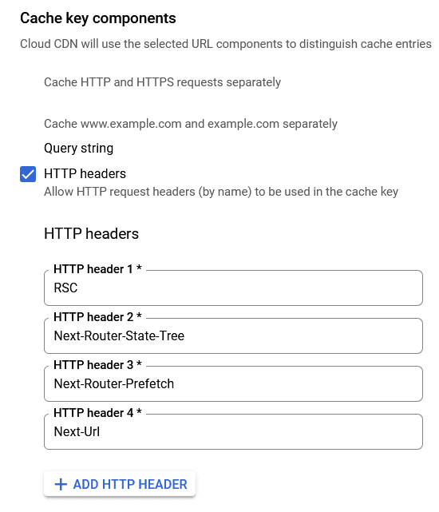
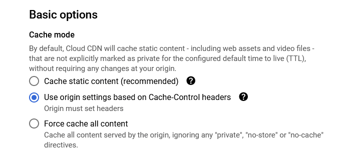
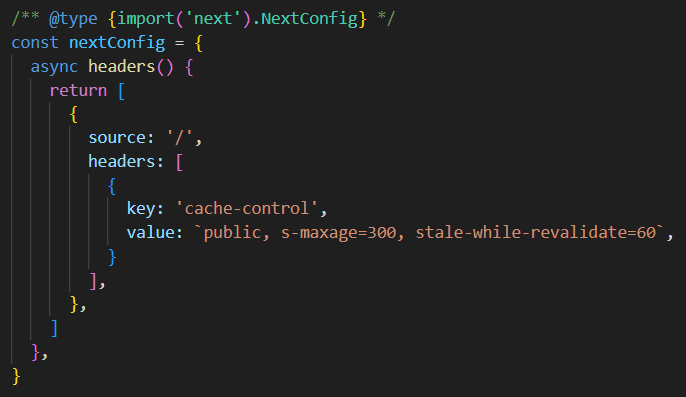
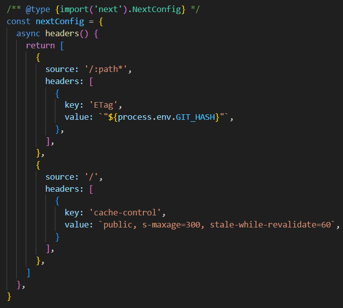
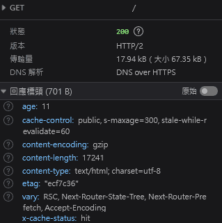

## 前言

Next.js 在 App Route 上不少的改動，導致傳統在 Page Route 上的 Cloud CDN cache 設定無法適用，因此撰寫這篇文章，分享目前適用於 App Route 的設定策略，供所有開發人員參考。

## 本文

筆者將針對 Next.js App Route 環境下，需要讓 CDN Cache 正確運作的運作的設定，分成以下幾個部份來分別說明。

### 在 Cloud CDN 上的設定

Next.js 在 App Route 時，response 會帶含有數值為 *RSC*、*Next-Router-State-Tree*、*Next-Router-Prefetch 和 Next-Url* 的 Vary header [^1]，由於這幾個數值並非 Cloud CDN 預設可被作為 cache key 的 header [^2]，導致 response 無法被 CDN 給 cache，幸好，Cloud CDN 提供設定 custom cache key 的方式 [^3]，大家可以藉由將 *RSC*、*Next-Router-State-Tree*、*Next-Router-Prefetch* 和 *Next-Url* 增加至 custom cache header，來使 response 可以被 cache，設定如下圖所示

<figure>

<figcaption>在 CDN 項目中，增加相關 header 至 cache key components 底下的設定</figcaption>
</figure>

而在 CDN cache mode 選擇上，則是設定 <mark>USE_ORIGIN_HEADERS</mark> 的方式，將 cache 設定的主導權交給 Next.js server 而非 CDN，這麼做的原因主要是避免新的版本部屬後，舊有版本的 CDN cache 依舊存在，使得使用者藉由舊版本的頁面，存取到存在於舊版本，但不存在於新版的資源，進而導致頁面發生錯誤的情況。[^4]

<figure>

<figcaption>在 CDN 項目中 cache mode 的選擇</figcaption>
</figure>

---

### **在 Next.js server 上的設定**

由於 cache 設定的主導權下放到 server，因此，server 端需要在 response 時，帶有適當的 Cache-Control header[^5]，當 response 經由 CDN 回傳給使用者時，才會被 CDN 給 cache 住。為了達成這樣的目標，須先確保 Next.js 版本在 14.2.13 以上[^6]，接著，依照官方文件的教學[^7]，在 next config 中設定輸出的 header 資訊。

<figure>

<figcaption>首頁 cache 5 分鐘，並給予一分鐘的更新緩衝時間</figcaption>
</figure>

除了 Cache-Control header，也需要增加 ETag header[^8]，讓 server 版本更新後，CDN 可以藉由 ETag 資訊的變動，來更新既有 cache 的內容[^9]。順道一題，Next.js 雖然預設會輸出 ETag header，但在 dynamic route 的情況下，卻不會輸出 ETag header[^10]，為了讓所有路徑都能夠輸出 ETag 資訊，在 next config 中，使用 git commit hash 資訊，來設定 ETag header 到所有的路徑上，設定如下圖所示：

<figure>

<figcaption>在所有路徑上，使用 git commit hash 為數值，來設定 ETag header</figcaption>
</figure>

以上設定妥善後，便可得到 CDN cache 頁面的結果，同時，在新的版本部屬後，也能避免發生 version skew 的情況。

<figure>

<figcaption>首頁被 CDN cache 住的情況</figcaption>
</figure>

## 結語

Next.js 在 App Route 之後，逐漸與開發者兼雲端服務商 Vercel 的環境綁定，導致在其環境之外要進行 self hosting 時，需要進行許多額外的設定，這導致 [OpenNext](https://opennext.js.org/) 這樣的專案誕生，然而， OpenNext 目前支援的 Cloud Provider 並不包含 GCP，因此，筆者僅能藉由自行查找網路資訊，盡可能歸納出適用於 GCP 上的設定。

## 額外補充

前面有提到，Next.js Vary Header 有三個特殊的數值，關於它們的實際用途，可以從官方的回答[^11]，或者 stackoverflow 上的討論[^12]，歸納出以下資訊：

- *Next-URL* 會作為在 Intercepting Routes[^13] 情境下，server 用來決定要回傳的內容使用。
- *Next-Router-State-Tree* 會作為 Partial Rendering[^14] 情境下，server 決定要回傳的渲染範圍使用
- *Next-Router-Prefetch* 用來辨別該 request 是不是來自 prefetch 的情況

[^1]: Vary header 的數值，代表會作為 content negotiation 機制所示的 header key，更多可以參考 [Vary - HTTP | MDN](https://developer.mozilla.org/en-US/docs/Web/HTTP/Reference/Headers/Vary)
[^2]: [Non-cacheable content base on origin headers | Cloud CDN](https://cloud.google.com/cdn/docs/caching#non-cacheable_content)
[^3]: [Including request headers | Cloud CDN](https://cloud.google.com/cdn/docs/caching#http-headers-cookies)
[^4]: [Introducing Skew Protection | Vercel](https://vercel.com/blog/version-skew-protection)
[^5]: [Response Directives | Cache-Control - HTTP | MDN](https://developer.mozilla.org/en-US/docs/Web/HTTP/Reference/Headers/Cache-Control#response_directives "Response Directives | Cache-Control - HTTP | MDN")
[^6]: [Comment | Cache-Control is not appended to Dynamic Routing in Next.js 14.2.12 | GitHub](https://github.com/vercel/next.js/issues/70213#issuecomment-2362507714)
[^7]: [next.config.js Options: headers | Next.js](https://nextjs.org/docs/14/pages/api-reference/next-config-js/headers)
[^8]: [ETag - HTTP | MDN](https://developer.mozilla.org/en-US/docs/Web/HTTP/Reference/Headers/ETag)
[^9]: [Use conditional requests for validation | Cloud CDN](https://cloud.google.com/cdn/docs/caching#response-headers-validate)
[^10]: [Comment | ETags in Next.js App Router | GitHub](https://github.com/vercel/next.js/discussions/74915#discussioncomment-11982685)
[^11]: [Comment | RSC and CDN interaction makes next.js inefficient for highload projects | GitHub](https://github.com/vercel/next.js/issues/65335#issuecomment-2121343642)
[^12]: [Answer | How to identify Nextjs prefetch request in the middleware | stack overflow](https://stackoverflow.com/a/76313026)
[^13]: [Routing: Intercepting Routes | Next.js](https://nextjs.org/docs/app/building-your-application/routing/intercepting-routes)
[^14]: [Partial Rendering | Next.js](https://nextjs.org/docs/app/building-your-application/routing/linking-and-navigating#4-partial-rendering)
