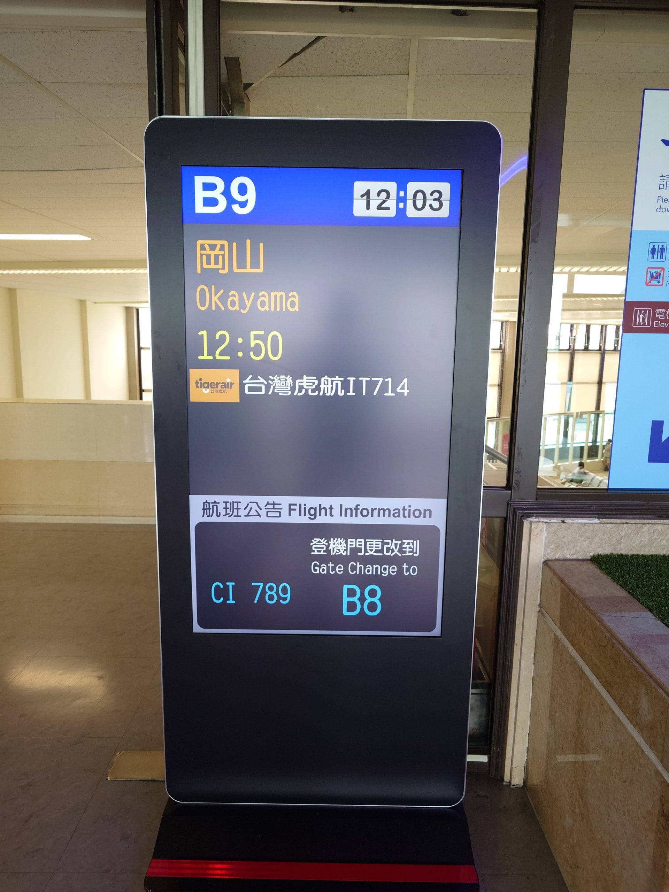
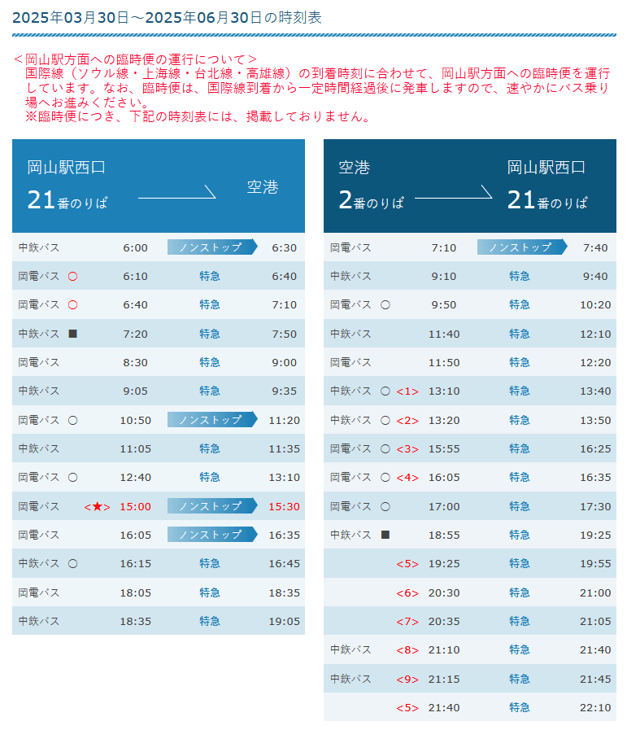
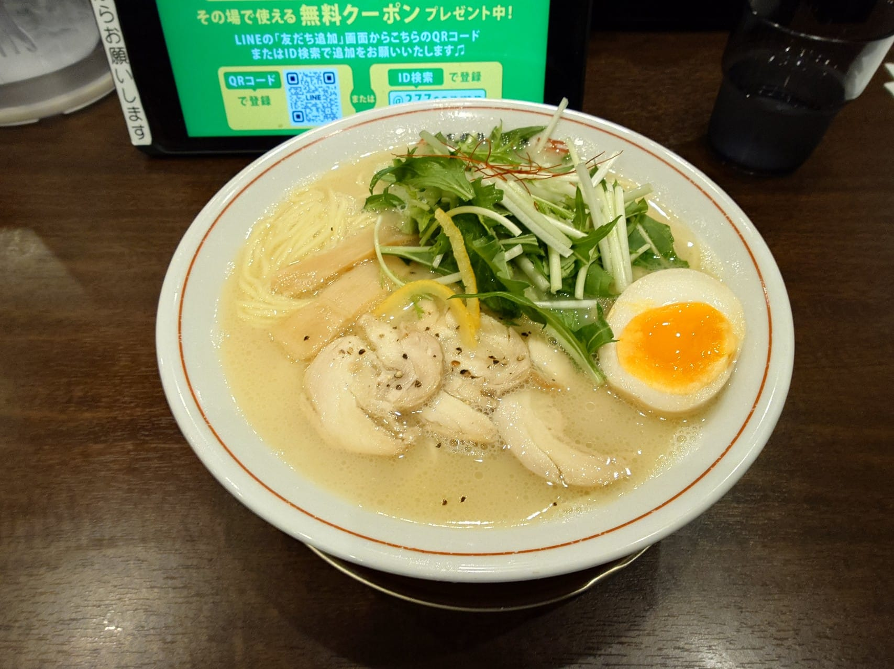
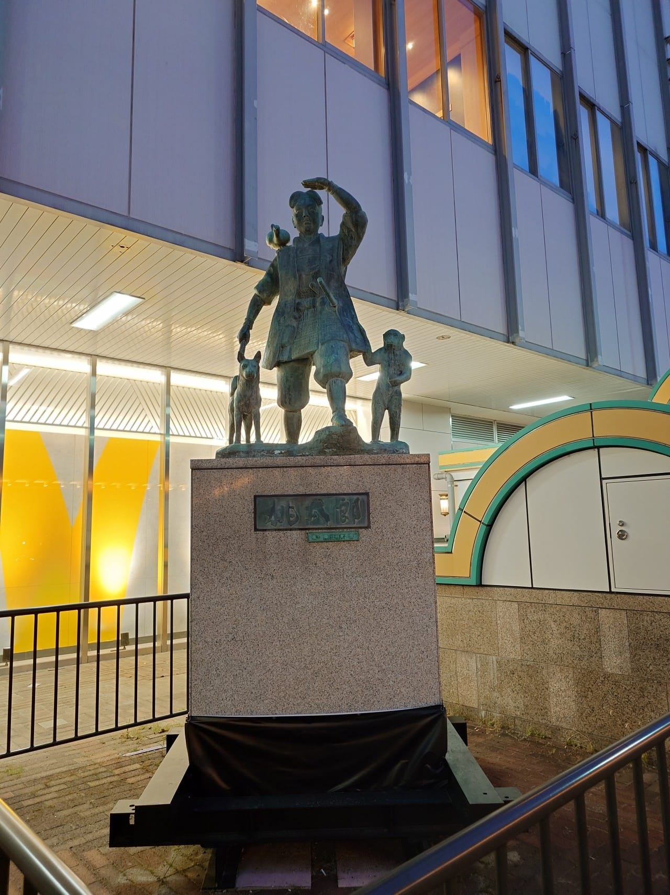
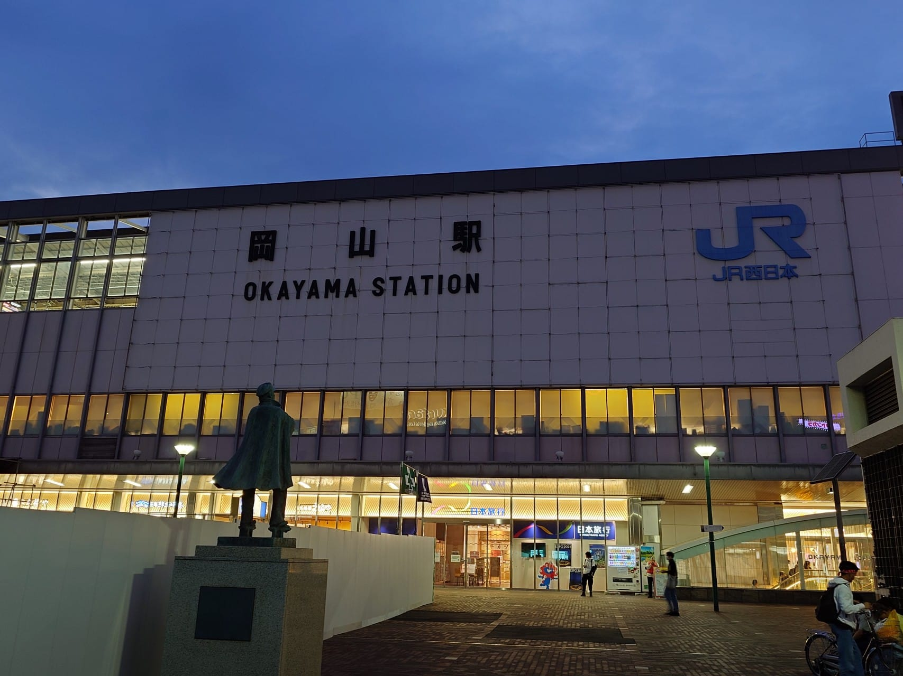
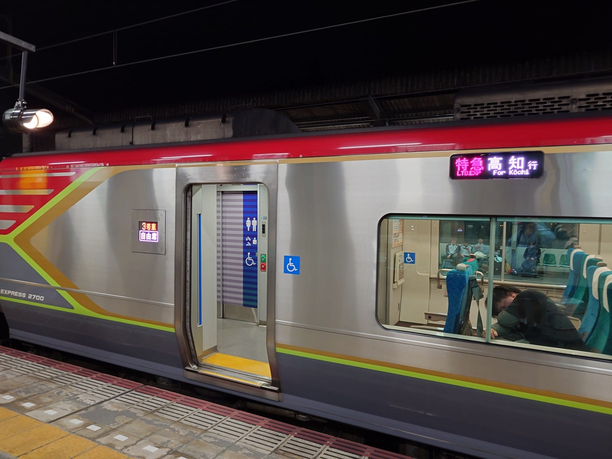
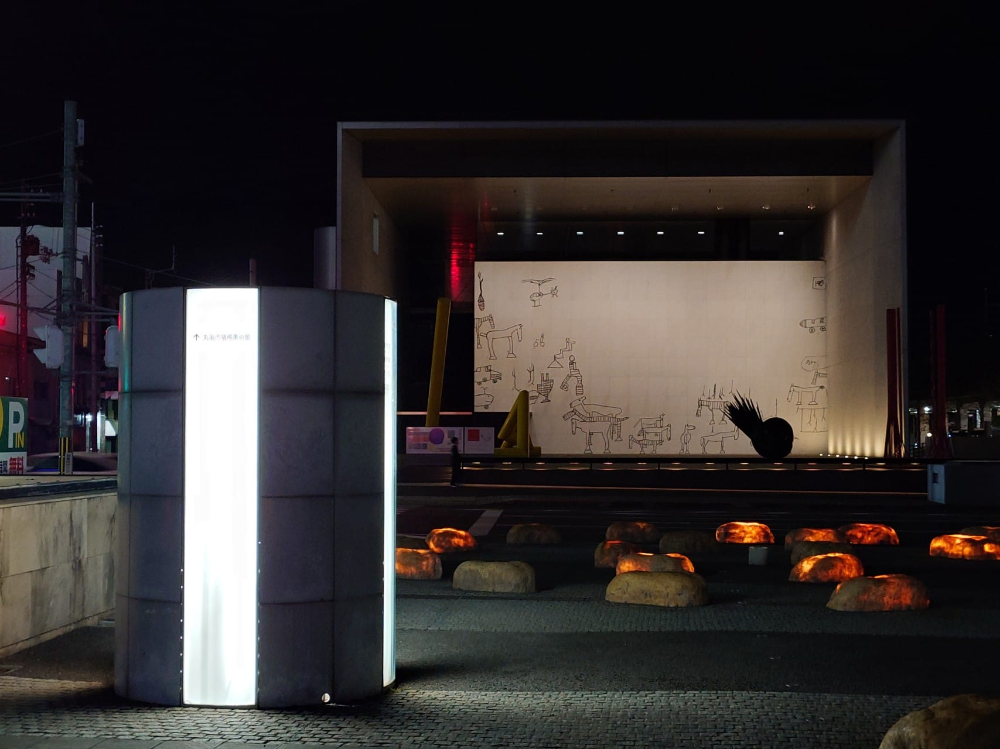
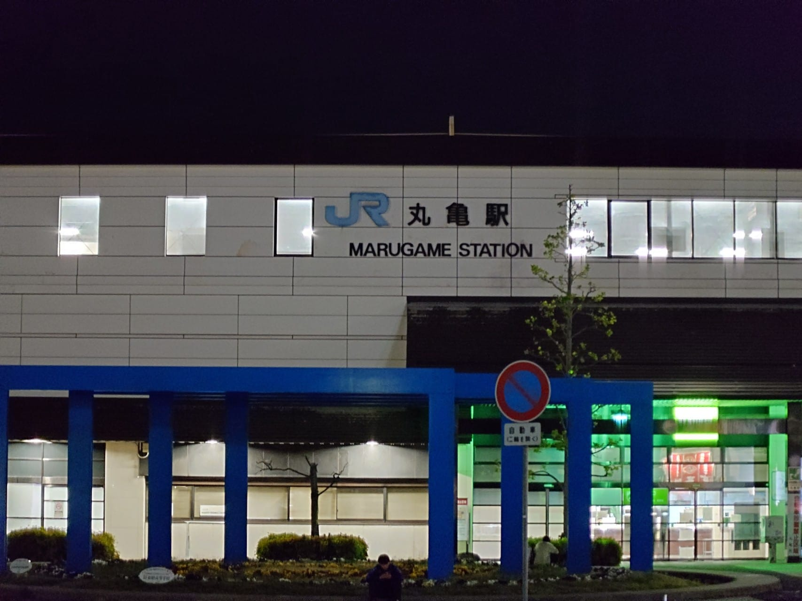

旅遊第一天，我從台灣搭乘飛機飛往岡山機場，接著在 JR 岡山站搭乘電車前往丸龜，最後入住東橫 INN 丸龜站。

在旅途開始的前一天，瀨戶內海區域出現的濃霧情況`wp-unconverted: <sup data-fn="1e48c1c2-1de0-4d5a-b471-78275c7b96cb" class="fn"><a id="1e48c1c2-1de0-4d5a-b471-78275c7b96cb-link" href="#1e48c1c2-1de0-4d5a-b471-78275c7b96cb">1</a></sup>`，導致上午有部份的船班取消`wp-unconverted: <sup data-fn="90a4d1a6-dfde-447f-bc32-0c2a21365cd6" class="fn"><a id="90a4d1a6-dfde-447f-bc32-0c2a21365cd6-link" href="#90a4d1a6-dfde-447f-bc32-0c2a21365cd6">2</a></sup>`，因為有裝[官方的 App](https://setouchi-artfest.jp/access/app/#app-info)，所以知道這情況，有初步構想了遇到濃霧，導致船班取消的行程調整備案，不過還好整趟旅程都很幸運，都沒遇到這狀況，備案也就沒有被執行。

這次從台灣前往日本的航班是搭乘虎航 IT 714，從 TPE 飛往 OKJ，表定起飛時間是中午 12:50，不過實際起飛時間是 13:11`wp-unconverted: <sup data-fn="28257d8f-f6c9-4778-b739-89daf541ca2f" class="fn"><a id="28257d8f-f6c9-4778-b739-89daf541ca2f-link" href="#28257d8f-f6c9-4778-b739-89daf541ca2f">3</a></sup>`。午餐已經在機場內解決了，所以進到機艙坐下後，就是戴上耳塞和眼罩，想辦法睡到降落，由於這個航班在中午時段，似乎有不少人有預購機內餐，使得休息的過程中，不時可以聞到熱騰騰食物的氣味。

<figure>



<figcaption>航班的資訊看板要到 12:00 時，才更新為 IT714</figcaption>
</figure>

由於是坐在靠窗的位置，飛機即將降落時，從窗外看出去的景色是一堆小山丘，推測岡山機場可能是在丘陵地上開闢的。飛機降落後到滑行到停機坪的時間其實很短，從窗外看到的機場大樓和停機坪數量，猜測比高松機場還小，後續查找相關資料`wp-unconverted: <sup data-fn="7166e23e-cb87-4bf8-b391-ada10d45842d" class="fn"><a id="7166e23e-cb87-4bf8-b391-ada10d45842d-link" href="#7166e23e-cb87-4bf8-b391-ada10d45842d">4</a></sup>` `wp-unconverted: <sup data-fn="87524452-247c-46d2-b9e4-c86a2cbe5155" class="fn"><a id="87524452-247c-46d2-b9e4-c86a2cbe5155-link" href="#87524452-247c-46d2-b9e4-c86a2cbe5155">5</a></sup>`，也證實這個猜測是正確的。

飛機停妥到機艙門開啟，允許乘客解開安全帶，拿取行李下飛機前，已經有不少人解開安全帶要拿行李，於是，空服員便廣播請乘客坐下，稍安勿躁，在我搭過這麼多次飛機的經驗中，這是第一次聽到空服員廣播這內容（笑。

下飛機後，跟著人群走沒多久就到入境審查的地方，如果有要上廁所的話，唯一的廁所也在這附近。入境審查區排隊的人潮似乎一個時段只會有一個國際線航班的乘客，所以也不需要趕著下飛機。在隊伍中排隊等待處理的過程中，注意到其中一團遊客的成員中，有位年輕人穿著印著 New Power Party（時代力量） 的 T-shirt，嗯...。

通過入境審查後，接著就是去領取行李，岡山機場的國際線只有一個行李轉盤，一個時段似乎也只有一個國際航班的行李，因此等待行李的時間也很短，很快就能拿到自己行李。拿了行李，並且通過海關審查後，左轉走出去就是國際線出入境大廳，在出入境大廳，會有熱情的工作人員引導遊客到接駁巴士的搭乘處，進到出入境大廳後，右轉出去就是接駁巴士的搭乘處，前往 JR 岡山站接駁巴士已經在此等候，巴士車票可以在搭車處旁邊購買，會有工作人員協助處理，或者用交通 IC 卡上下車都刷卡處理，工作人員也會告知刷卡的方式。

前往 JR 岡山站的接駁巴士雖然有表定的發車時間，但實際發車時間似乎是和飛機航班做綁定的，換句話說，如果飛機延後抵達，巴士也會延後發車，這或許就能解釋為什麼在入境後，便有接駁巴士可以搭，而且接駁巴士的發車時間也與公告上的時間對不上的情況。因為這樣的設計，其實下飛機到入境整個過程根本不需要趕，就跟著人潮順順走過去就好了。

<figure>



<figcaption>往返岡山機場與 JR 岡山站的接駁巴士時刻表</figcaption>
</figure>

使用 ICOCA 感應上車，找個靠窗的位置坐下後，等待巴士發車。在巴士發車後，前往 JR 岡山站的路上，我觀賞窗外的景色，由於櫻花季已經結束了，在這個春末夏初時期，雖然可看到少許開花的樹木，但我想那不是櫻花。另外，車上的不少乘客難忍心中的雀越，自然得將心情用口語表達出來，使得車上略顯吵雜，而在這些對話中，我從後方乘客的談話內容，拼湊出他似乎準備用筆記型電腦來刷 LeetCode，好喔 ...。

巴士抵達終點站，用 ICOCA 感應下車後，我拖著行李前往岡山站的東出口，準備要執行聖地巡禮，結果到了東出口，發現這一帶都在施工，聖地巡禮只能作罷，只好就近找店家解決晚餐，最後是在岡山一番街 B1F 的[らぁ～めん京](https://sun-ste.com/okayama-ichibangai/shopping/?c=shop_view&pk=1725871110)解決今天的晚餐，也是這次旅行的第一餐。

<figure>



<figcaption>らぁ～めん京的鶏しおらぁ～めん</figcaption>
</figure>

```html title="wp-unconverted: core/gallery"
<!-- wp:gallery {"linkTo":"none","align":"center"} -->
<figure class="wp-block-gallery aligncenter has-nested-images columns-default is-cropped"><!-- wp:image {"id":500,"sizeSlug":"large","linkDestination":"none"} -->
<figure class="wp-block-image size-large"></figure>
<!-- /wp:image --><figcaption class="blocks-gallery-caption wp-element-caption">原本要在岡山站東出口拍的桃太郎像，出自<a href="https://oshibudo.com/" target="_blank" rel="noopener" title="">推しが武道館いってくれたら死ぬ</a>第三集</figcaption></figure>
<!-- /wp:gallery -->
```

<figure>



<figcaption>實際拍到的桃太郎像，由於站前正在施工，桃太郎像被搬至旁邊，被用鐵欄杆圍住</figcaption>
</figure>

<figure>



<figcaption>岡山站東出口外正在施工的樣子</figcaption>
</figure>

晚餐用餐完畢後，我到附近的 7-11 超商的櫃台，請店員協助活動門票的付款，付款方式使用玉山&nbsp;Wallet 所搭配的日本 PayPay，第一次在日本使用這個支付方式，結帳時，心中不免緊張，還好有成功結帳，玉山 Wallet App 跳出 PayPay 的聲音。

接下來，我回到岡山站，準備搭乘列車前往丸龜站，在售票機購買車票後，便進站到月台上搭車，搭乘的車次是 20:05 發車的特急南風號列車，該列車開往高知，途中會經過丸龜站，因為列車是使用 [JR 四國 2700 系柴聯車](https://www.jr-shikoku.co.jp/01_trainbus/lp/2700/)，行駛時，引擎聲音較電聯車大上不少，如果要在台灣可以感受柴聯車行駛的聲響，只剩下在[花東行駛的 DR3100 型](https://zh.wikiversity.org/wiki/%E5%8F%B0%E9%90%B5DR3100%E5%9E%8B%E6%9F%B4%E8%81%AF%E8%BB%8A#%E9%85%8D%E5%B1%AC%E6%A9%9F%E5%8B%99%E6%AE%B5%E5%8F%8A%E9%81%8B%E7%94%A8%E8%BB%8A%E6%AC%A1)了。

<figure>



<figcaption>開往高知的特急南風號</figcaption>
</figure>

列車抵達丸龜站，我出了丸龜站閘門後，便前往接下來幾天的住宿地點—東橫 INN 丸龜站前。途中，在明天要拍照的地點，先進行演練；接著，注意到丸龜站旁[豬熊弦一郎現代美術館](https://www.mimoca.jp/)有趣的外牆，最後，抵達旅館。在櫃台的自助報到機上，經過一番折騰，輸入完整的英文聯絡地址後，完成入住手續，拿到房卡。

<figure>



<figcaption>夜晚的豬熊弦一郎現代美術館</figcaption>
</figure>

<figure>



<figcaption>夜晚的 JR 丸龜站</figcaption>
</figure>

進到房間，稍微整理行李，接著離開旅館，走到附近的ドン・キホーテ，購買接下來幾天的飲用水和零食，這家ドンキ不知道是不是有人在裡面偷小便，裡面有股尿臭味。完成採買後，直接返回旅館，結束今天的行程。

---

```html title="wp-unconverted: core/footnotes"
<!-- wp:footnotes /-->
<ol class="wp-block-footnotes"><li id="1e48c1c2-1de0-4d5a-b471-78275c7b96cb"><a href="https://weathernews.jp/s/topics/202504/190065/" target="_blank" rel="noopener" title="">瀬戸内海で濃霧発生　昼頃にかけて視界不良に注意</a></li><li id="90a4d1a6-dfde-447f-bc32-0c2a21365cd6"><a href="https://www.shikokukisen.com/news/traffic-info/entry-925.html" target="_blank" rel="noopener" title="">【2025/4/19 運航見合せ】全航路（2025/4/19 08:30現在） 四国汽船株式会社</a></li><li id="28257d8f-f6c9-4778-b739-89daf541ca2f"><a href="https://zh-tw.flightaware.com/live/flight/TTW714/history/20250420/0500Z/RCTP/RJOB" target="_blank" rel="noopener" title="">IT714 (TTW714) Tigerair 航班跟蹤和歷史資料 2025年 04月 20日 (TPE / RCTP-OKJ / RJOB) - FlightAware</a></li><li id="7166e23e-cb87-4bf8-b391-ada10d45842d"><a href="https://www.okayama-airport.org/about#about" target="_blank" rel="noopener" title="">岡山桃太郎空港について</a></li><li id="87524452-247c-46d2-b9e4-c86a2cbe5155"><a href="https://www.takamatsu-airport.com/assets/docments/doc_footer_20180327-02.pdf" target="_blank" rel="noopener" title="">マスタープラン | 高松空港株式会社</a></li></ol>
```
