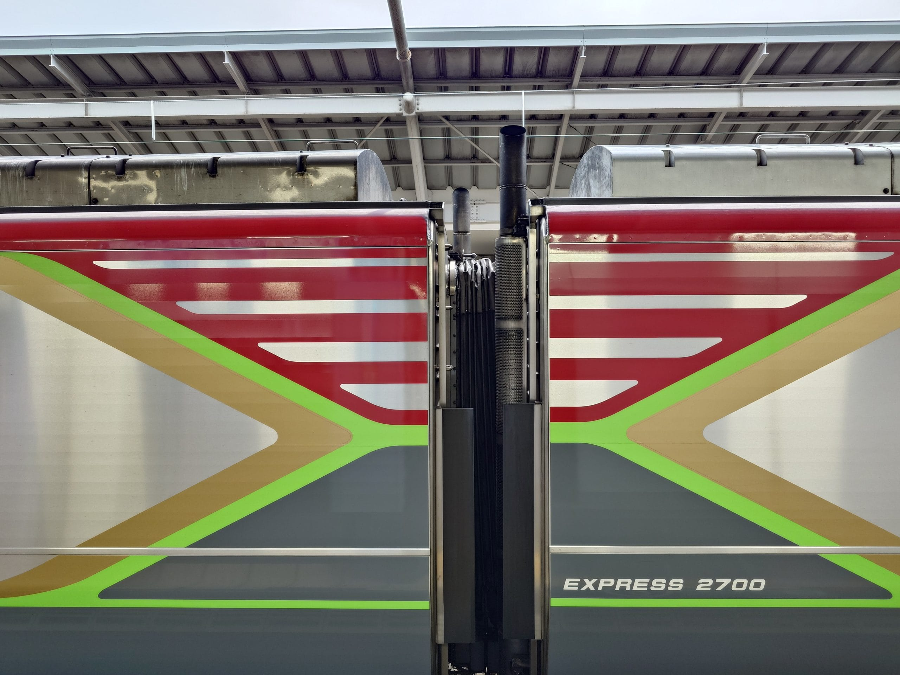
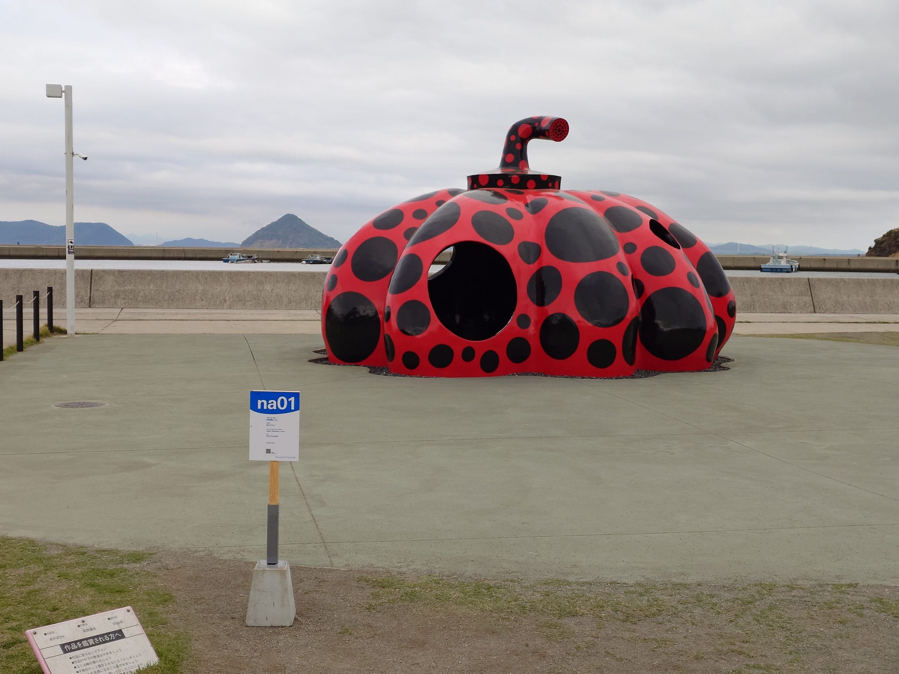
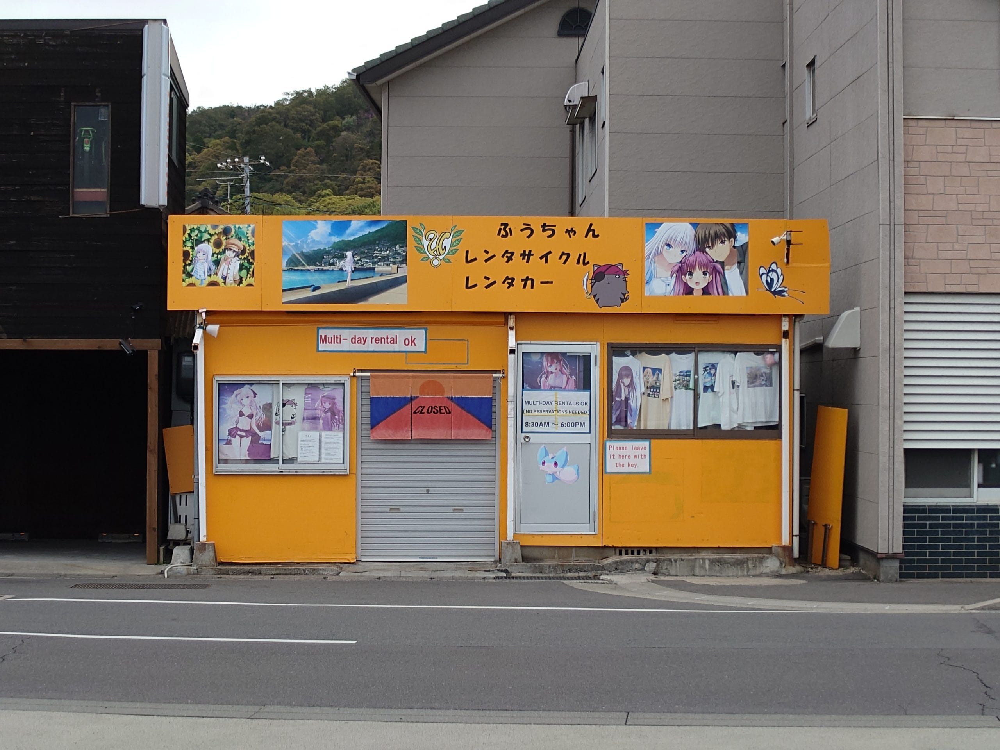
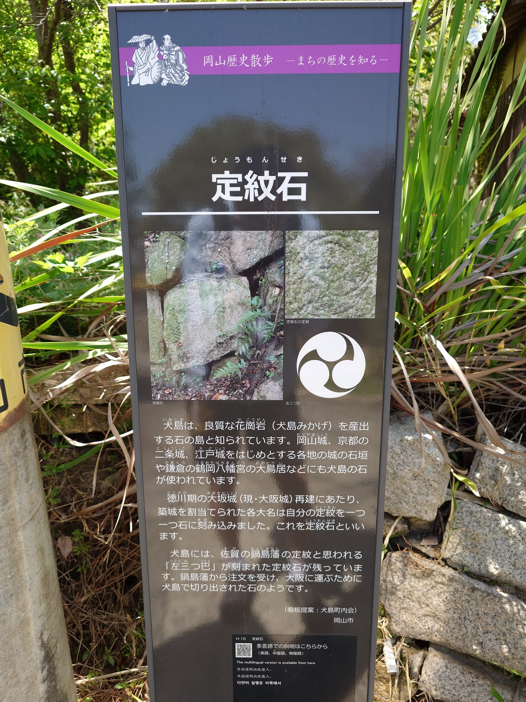
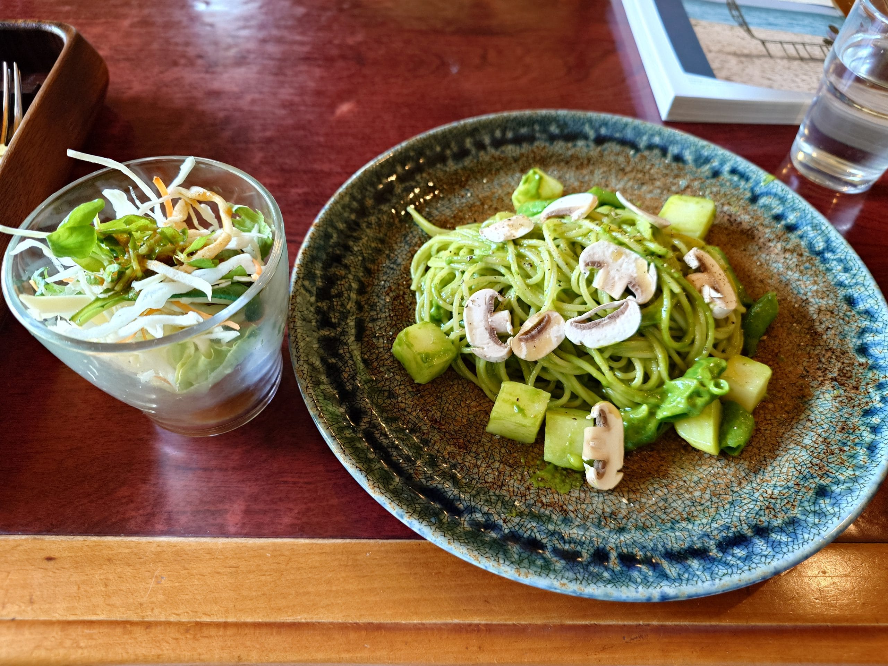
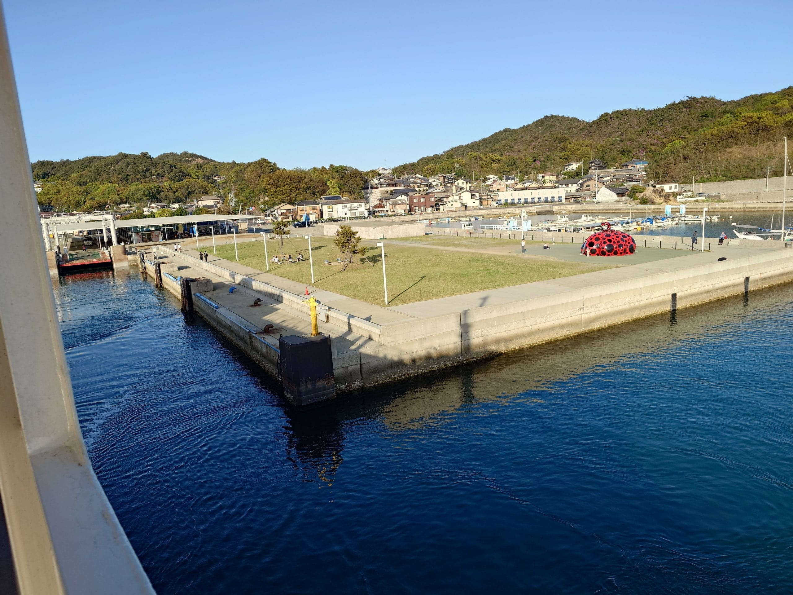

旅遊第二天，一大早我從丸龜搭電車到高松，在高松港搭船前往直島，在直島轉搭船前犬島，用走路的方式在犬島上穿梭。下午時，我搭船回到直島，再轉搭船回到高松港，最後從高松搭電車回到丸龜。

為了搭上早上 6:42 前往高松的列車，以順利銜接上 7:20 從高松港前往直島的高速船，今天一大早約 6:00 就起床了。簡單梳洗與整理後，穿上薄外套，背著背包，穿上運動鞋就直接離開旅館，前往 JR 丸龜站了。途中，依照昨晚試拍的位置，用[メモグラ App](https://mp.ex.nii.ac.jp/index.html.ja) 拍了第一張聖地巡禮的照片。

```html title="wp-unconverted: jetpack/image-compare"
<!-- wp:jetpack/image-compare {"imageBefore":{"id":1226,"url":"https://i0.wp.com/aniya.moe/wp-content/uploads/2025/05/ydmk705.jpg?ssl=1","alt":"","width":1920,"height":1080},"imageAfter":{"id":554,"url":"https://i0.wp.com/aniya.moe/wp-content/uploads/2025/05/pi_20250421_063159.jpg?ssl=1","alt":"","width":1920,"height":1080},"caption":"\u003ca href=\u0022https://yuyuyu.tv/season1/\u0022 target=\u0022_blank\u0022 rel=\u0022noopener\u0022 title=\u0022\u0022\u003e結城友奈は勇者である\u003c/a\u003e中出現的公車站"} -->
<figure class="wp-block-jetpack-image-compare"><div class="juxtapose" data-mode="horizontal"></div><figcaption><a href="https://yuyuyu.tv/season1/" target="_blank" rel="noopener" title="">結城友奈は勇者である</a>中出現的公車站</figcaption></figure>
<!-- /wp:jetpack/image-compare -->
```

進到丸龜站，在搭車前，先到超商買了些飯糰和黑咖啡作為今天的早餐。接著，進了閘門後，在月台上等待列車的到來。搭上列車，找個位置坐下，在抵達高松站前，在車內邊觀賞車窗外的景色，邊享用今天的早餐。

<figure>



<figcaption>特急しまんと 也是使用 JR 四國 2700 柴聯車，照片的上方有柴聯車才有的排氣管</figcaption>
</figure>

抵達高松站後，快步前往附近的高松港，購買船票，然後在乘船處等候搭船。上船找了位置坐下後，沒多久，船就出發前往直島。在航行過程中，我坐在船艙內靠走道的位置，額頭前方就是螢幕，螢幕上顯示著即時船舶位置圖，我的視線大都在螢幕上。

航行約 30 分後，船抵達直島的宮浦港，下船後，由於距離售票亭開始服務的時間還有不少時間，我先在宮浦港附近散步，順便進行聖地巡禮。

<figure>



<figcaption>宮浦港內直島知名的「<a href="https://setouchi-artfest.jp/artworks/detail/eb4b590a-7f2b-4fe7-ba24-c3fade979a1f">紅南瓜</a>」，為常設作品，作者為<a href="https://setouchi-artfest.jp/artists/detail/ceead043-ce9a-4ece-89d6-89f2673d080e">草間彌生</a></figcaption>
</figure>

<figure>



<figcaption>宮浦港附近的電動單車出租店 - <a href="https://x.com/naoshima_fuchan">ふうちゃんレンタサイクル</a></figcaption>
</figure>

```html title="wp-unconverted: jetpack/image-compare"
<!-- wp:jetpack/image-compare {"imageBefore":{"id":1237,"url":"https://i0.wp.com/aniya.moe/wp-content/uploads/2025/05/minato-2.jpg?ssl=1","alt":"","width":1200,"height":675},"imageAfter":{"id":562,"url":"https://i0.wp.com/aniya.moe/wp-content/uploads/2025/05/pi_20250421_084628.jpg?ssl=1","alt":"","width":1920,"height":1080},"caption":"Summer Pockets 裡的鳥白島的港口"} -->
<figure class="wp-block-jetpack-image-compare"><div class="juxtapose" data-mode="horizontal"></div><figcaption>Summer Pockets 裡的鳥白島的港口</figcaption></figure>
<!-- /wp:jetpack/image-compare -->
```

```html title="wp-unconverted: jetpack/image-compare"
<!-- wp:jetpack/image-compare {"imageBefore":{"id":1246,"url":"https://i0.wp.com/aniya.moe/wp-content/uploads/2025/05/Snipaste_2025-05-14_10-23-45.png?ssl=1","alt":"","width":1192,"height":671},"imageAfter":{"id":564,"url":"https://i0.wp.com/aniya.moe/wp-content/uploads/2025/05/pi_20250421_075909.jpg?ssl=1","alt":"","width":1920,"height":1080},"caption":"Summer Pockets 裡的鳥白島的港口，該圖實際是由兩個景所合成，分為港口部份與後面的山脈，對照的照片僅符合港口部份"} -->
<figure class="wp-block-jetpack-image-compare"><div class="juxtapose" data-mode="horizontal"></div><figcaption>Summer Pockets 裡的鳥白島的港口，該圖實際是由兩個景所合成，分為港口部份與後面的山脈，對照的照片僅符合港口部份</figcaption></figure>
<!-- /wp:jetpack/image-compare -->
```

```html title="wp-unconverted: jetpack/image-compare"
<!-- wp:jetpack/image-compare {"imageBefore":{"id":565,"url":"https://aniya.moe/wp-content/uploads/2025/05/si_20250418_220750_2.jpg","alt":"","width":1920,"height":1080},"imageAfter":{"id":566,"url":"https://aniya.moe/wp-content/uploads/2025/05/pi_20250421_075612.jpg","alt":"","width":1920,"height":1080},"caption":"Summer Pockets PV1 裡的鳥白島的港口"} -->
<figure class="wp-block-jetpack-image-compare"><div class="juxtapose" data-mode="horizontal"></div><figcaption>Summer Pockets PV1 裡的鳥白島的港口</figcaption></figure>
<!-- /wp:jetpack/image-compare -->
```

```html title="wp-unconverted: jetpack/image-compare"
<!-- wp:jetpack/image-compare {"imageBefore":{"id":568,"url":"https://i0.wp.com/aniya.moe/wp-content/uploads/2025/05/si_20250418_220750_37.jpg?ssl=1","alt":"","width":1612,"height":1137},"imageAfter":{"id":1216,"url":"https://i0.wp.com/aniya.moe/wp-content/uploads/2025/05/pi_20250421_081248-1.jpg?ssl=1","alt":"","width":1532,"height":1080},"caption":"Summer Pockets 動畫 PV 主視覺圖裡的懷舊零食鋪"} -->
<figure class="wp-block-jetpack-image-compare"><div class="juxtapose" data-mode="horizontal"></div><figcaption>Summer Pockets 動畫 PV 主視覺圖裡的懷舊零食鋪</figcaption></figure>
<!-- /wp:jetpack/image-compare -->
```

```html title="wp-unconverted: envira/envira-gallery"
<!-- wp:envira/envira-gallery {"galleryId":572,"title":"直島 \u0026#8211; イワタコンフェクト","columns":"0","row_height":200,"margins":"custom","custom_margins":8,"lazyload_enabled":1,"lightbox_theme":"base","images":[{"status":"active","src":"https://aniya.moe/wp-content/uploads/2025/05/20250421_081608666-scaled.jpg","title":"店家外面的照片","link":"https://aniya.moe/wp-content/uploads/2025/05/20250421_081608666-scaled.jpg","alt":"","caption":"","thumb":"","id":571,"height":224.4360902255639,"width":298.5},{"status":"active","src":"https://aniya.moe/wp-content/uploads/2025/05/20250421_081320309-scaled.jpg","title":"店家內部的照片，可以看到有 Summer Pockets 的週邊與繪圖","link":"https://aniya.moe/wp-content/uploads/2025/05/20250421_081320309-scaled.jpg","alt":"","caption":"","thumb":"","id":570,"height":224.4360902255639,"width":298.5}]} -->
<div class="wp-block-envira-envira-gallery">[envira-gallery id='572']</div>
<!-- /wp:envira/envira-gallery -->
```

<sup>*該懷舊零食鋪實際店家的名稱是「イワタコンフェクト」，已於 2023 年 1 月停業，從店外，可以看到店內還有 Summer Pockets 相關的週邊與繪圖。*</sup>

---

售票亭差不多開始服務前，我回到宮浦港，加入售票亭前的排隊隊伍，等待購買船票。買好船票後到乘船處等待搭船，接著就上船，坐在船後半部開放的位置上，等待船出發前往犬島，途中經過豐島。

船開始航行後，我感受著略為寒冷的海風，張望四周的大海與島嶼的景色，注意到直島北半部有著我所不熟悉的樣貌，看到許多工業化設施，這是與南部倍樂生區域或東部本村區域有著明顯對比的景色。

```html title="wp-unconverted: envira/envira-gallery"
<!-- wp:envira/envira-gallery {"galleryId":578,"title":"直島 \u0026#8211; 北半部工業化設施","columns":"0","row_height":200,"margins":"custom","custom_margins":8,"lazyload_enabled":1,"lightbox_theme":"base","images":[{"status":"active","src":"https://aniya.moe/wp-content/uploads/2025/05/20250421_162937246-scaled.jpg","title":"直島北半部工業化設施，有儲存槽、渡輪、和工廠等","link":"https://aniya.moe/wp-content/uploads/2025/05/20250421_162937246-scaled.jpg","alt":"","caption":"","thumb":"","id":576,"height":224.4360902255639,"width":298.5},{"status":"active","src":"https://aniya.moe/wp-content/uploads/2025/05/20250421_163120930-scaled.jpg","title":"直島北半部工業化設施，有工廠、吊車，以及山坡被開採的痕跡","link":"https://aniya.moe/wp-content/uploads/2025/05/20250421_163120930-scaled.jpg","alt":"","caption":"","thumb":"","id":577,"height":224.4360902255639,"width":298.5}]} -->
<div class="wp-block-envira-envira-gallery">[envira-gallery id='578']</div>
<!-- /wp:envira/envira-gallery -->
```

<sup>*直島北半部的工業化設施，除了工廠之外，還有港口和貨輪之類，推測為[三菱マテリアル(株)](https://www.mmc.co.jp/corporate/ja/ "三菱マテリアル(株)")所擁有，於返程時拍攝。*</sup>

抵達犬島後，依照工作人員的指示，我先拿取回程船班的號碼牌，並且完成回程船票的購買，接著，前往犬島知名的建築物—[精錬所美術館](https://benesse-artsite.jp/art/seirensho.html)，在排隊進去美術館時，幸運遇到導遊正在給他的團員介紹美術館，我在遠方靜靜聆聽導遊的講解，等候進去美術館。

```html title="wp-unconverted: envira/envira-gallery"
<!-- wp:envira/envira-gallery {"galleryId":586,"title":"犬島 1","columns":"0","row_height":140,"margins":"custom","custom_margins":8,"lazyload_enabled":1,"lightbox_theme":"base","images":[{"status":"active","src":"https://aniya.moe/wp-content/uploads/2025/05/20250421_101232859-scaled.jpg","title":"犬島港的防波堤上寫著「犬島」兩個字","link":"https://aniya.moe/wp-content/uploads/2025/05/20250421_101232859-scaled.jpg","alt":"","caption":"","thumb":"","id":584,"height":145.6140350877193,"width":193.7},{"status":"active","src":"https://aniya.moe/wp-content/uploads/2025/05/20250421_101559399-scaled.jpg","title":"犬島的票務中心，裡面同時販售週邊商品與提供餐飲服務","link":"https://aniya.moe/wp-content/uploads/2025/05/20250421_101559399-scaled.jpg","alt":"","caption":"","thumb":"","id":585,"height":145.6140350877193,"width":193.7},{"status":"active","src":"https://aniya.moe/wp-content/uploads/2025/05/20250421_104130590-scaled.jpg","title":"在票務中心與精鍊美術館之間的道路","link":"https://aniya.moe/wp-content/uploads/2025/05/20250421_104130590-scaled.jpg","alt":"","caption":"","thumb":"","id":583,"height":145.6140350877193,"width":193.7}]} -->
<div class="wp-block-envira-envira-gallery">[envira-gallery id='586']</div>
<!-- /wp:envira/envira-gallery -->
```

工作人員在帶領我進去美術館前，先提醒我留意腳邊，接著，再用燈光微弱的手電筒，帶領我進去美術館，當我整個人完全進到美術館後，他輕輕的把大門給關上，留下我獨自往前前進。

進到美術館後，首先會是看起來筆直且昏暗的通道，身後是燃燒中的太陽，而身前似乎是湛藍的天空，我小心翼翼得往天空的方向前進。當逐漸接近天空時，發現其實是面反射鏡，於是我調整方向，持續朝下一個天空前進。在多次調整方向後，我來到分岔路，其中一條，最終導向了天空的來源，原來是將天空導引進通道的反光鏡，我在此處停留一會兒，靜靜的感受從太陽方向輕輕吹過來的風。

接著，我從分岔路的另一邊走過去，來到了廣大但昏暗的空間，空間的中央懸掛著一個拆解開來的房間，房間下方有一小池積水。在這空間其中一側的牆的縫隙處，透出強烈的光線，該牆上也有一扇門，我朝著門走過去，來到一個小空間，小空間裡有樓梯，我順著樓梯走上去，樓梯的終點是類似陽台的構造，從陽台看出有一堆懸掛在半空中的門，彷彿通往許多不同世界的入口。

然後，走下樓梯，離開小空間，穿越大空間，輕輕打開一扇門，來到下一個空間，在這空間中，兩側是鏡子，靠近鏡子的底下各有一組紅色的雷射光朝彼此的方向射出，射出許許多多的文字，在這昏暗的空間中，鏡子與這兩組雷射光的搭配，讓人置身與許多的文字當中，產生令人震撼的效果。

最後，輕輕打開下一扇門，來到明亮的空間，左邊是大片透明玻璃，上方一大片遮陽，前方有一個沒有牆的小屋，小屋裡面掛滿了許多似乎用金屬雕刻而成的文字，文字內容有像是天皇、戰爭之類較為沈重的詞語，而右上方有一條可以讓陽光透進來的縫隙，當陽光從縫隙穿透進來，打到文字上反射時，這些文字彷彿在過往歷史中閃閃發光，整個房間給人一種悲壯的感覺。

在離開美術館前，我在影像區觀看官方的解說，搭配從導覽聽到的內容，回想整個體驗的過程，深深讚嘆[三分一博志](https://setouchi-artfest.jp/artists/detail/1eae8416-0d3c-4759-8b1a-797cd4c2b1fe)和[柳幸典](https://setouchi-artfest.jp/artists/detail/8a6eeec7-af56-45d2-8687-f6595fd16a1c)兩位作者，將原本是高耗能的煉銅場，藉由遺產、建築、藝術和環境四個元素，將其轉變為使用自然資源，減少對環境負擔的藝術品。

```html title="wp-unconverted: envira/envira-gallery"
<!-- wp:envira/envira-gallery {"galleryId":598,"title":"犬島精鍊美術館","columns":"0","row_height":140,"margins":"custom","custom_margins":8,"lightbox_enabled":1,"lazyload_enabled":1,"isotope":1,"lightbox_theme":"base","images":[{"status":"active","src":"https://aniya.moe/wp-content/uploads/2025/05/20250421_104301802-scaled.jpg","title":"犬島精鍊美術館正門","link":"https://aniya.moe/wp-content/uploads/2025/05/20250421_104301802-scaled.jpg","alt":"","caption":"","thumb":"","id":597,"height":100,"width":75},{"status":"active","src":"https://aniya.moe/wp-content/uploads/2025/05/20250421_104433381-scaled.jpg","title":"犬島精鍊美術館","link":"https://aniya.moe/wp-content/uploads/2025/05/20250421_104433381-scaled.jpg","alt":"","caption":"","thumb":"","id":595,"height":100,"width":133},{"status":"active","src":"https://aniya.moe/wp-content/uploads/2025/05/20250421_112935247-scaled.jpg","title":"犬島精鍊美術館","link":"https://aniya.moe/wp-content/uploads/2025/05/20250421_112935247-scaled.jpg","alt":"","caption":"","thumb":"","id":596,"height":100,"width":133},{"status":"active","src":"https://aniya.moe/wp-content/uploads/2025/05/20250421_113153528-scaled.jpg","title":"煉銅場廢棄的煙囪","link":"https://aniya.moe/wp-content/uploads/2025/05/20250421_113153528-scaled.jpg","alt":"","caption":"","thumb":"","id":593,"height":100,"width":75},{"status":"active","src":"https://aniya.moe/wp-content/uploads/2025/05/20250421_113451044-scaled.jpg","title":"廢棄的發電站","link":"https://aniya.moe/wp-content/uploads/2025/05/20250421_113451044-scaled.jpg","alt":"","caption":"","thumb":"","id":594,"height":100,"width":133}]} -->
<div class="wp-block-envira-envira-gallery">[envira-gallery id='598']</div>
<!-- /wp:envira/envira-gallery -->
```

---

離開美術館後，我開始前往家計畫系列的作品。首先是「[F 邸／Biota (Fauna/Flora)](https://setouchi-artfest.jp/artworks/detail/f5317320-aea0-4c73-8149-28f34df4766e)」，作者[名和晃平](https://setouchi-artfest.jp/artists/detail/a39f3955-3473-445d-bb91-12a2d0ccd09f)使用石膏雕塑出生命爆發的張力。然後是[「石職人の家跡／太古の声を聴くように、昨日の声を聴く](https://setouchi-artfest.jp/artworks/detail/86b57829-4c8d-47dc-b1d6-1b6781c33666)」；接著是「[S 邸／コンタクトレンズ](https://setouchi-artfest.jp/artworks/detail/0b98b9e6-8b8e-47da-8f6c-74da8d18e745)」和「[A 邸／イエロー フラワー ドリーム](https://setouchi-artfest.jp/artworks/detail/6ffabea9-6009-4b87-8d0c-5f7d243ff290)」。在 S 邸和 A 邸都有椅子，觀賞者可以坐在椅子上去感受作品，在 S 邸時，透明牆壁中無數大大小小的圓盤，彷彿水中的氣泡，而在 A 邸時，從裡面往外看，隔板皆成一條線，彷彿不存在的樣子。繼續往前走，會有未被列在項目中的「[中の谷東屋](https://maps.app.goo.gl/B8EjFnCQQFwunGUH7)」，它是一座屋頂佈滿了細小且有規律的孔洞，屋頂下放置數個兔子耳朵椅子的涼亭，供來往的人休息。

```html title="wp-unconverted: envira/envira-gallery"
<!-- wp:envira/envira-gallery {"galleryId":611,"title":"犬島 \u0026#8211; 家計畫區域","columns":"0","margins":"custom","custom_margins":8,"lightbox_enabled":1,"lazyload_enabled":1,"isotope":1,"lightbox_theme":"base","images":[{"status":"active","src":"https://aniya.moe/wp-content/uploads/2025/05/20250421_115513370-scaled.jpg","title":"S 邸／コンタクトレンズ","link":"https://aniya.moe/wp-content/uploads/2025/05/20250421_115513370-scaled.jpg","alt":"","caption":"","thumb":"","id":608,"height":55.53168635875402,"width":73.9},{"status":"active","src":"https://aniya.moe/wp-content/uploads/2025/05/20250421_115518260-scaled.jpg","title":"S 邸／コンタクトレンズ","link":"https://aniya.moe/wp-content/uploads/2025/05/20250421_115518260-scaled.jpg","alt":"","caption":"","thumb":"","id":607,"height":55.53168635875402,"width":73.9},{"status":"active","src":"https://aniya.moe/wp-content/uploads/2025/05/20250421_115613486-scaled.jpg","title":"在椅子的位置拍攝 S 邸／コンタクトレンズ","link":"https://aniya.moe/wp-content/uploads/2025/05/20250421_115613486-scaled.jpg","alt":"","caption":"","thumb":"","id":609,"height":55.53168635875402,"width":73.9},{"status":"active","src":"https://aniya.moe/wp-content/uploads/2025/05/20250421_115836740-scaled.jpg","title":"A 邸／イエロー フラワー ドリーム","link":"https://aniya.moe/wp-content/uploads/2025/05/20250421_115836740-scaled.jpg","alt":"","caption":"","thumb":"","id":606,"height":55.53168635875402,"width":73.9},{"status":"active","src":"https://aniya.moe/wp-content/uploads/2025/05/20250421_120137084-scaled.jpg","title":"中の谷東屋","link":"https://aniya.moe/wp-content/uploads/2025/05/20250421_120137084-scaled.jpg","alt":"","caption":"","thumb":"","id":610,"height":55.53168635875402,"width":73.9},{"status":"active","src":"https://aniya.moe/wp-content/uploads/2025/05/20250421_120214071-scaled.jpg","title":"太陽光穿過屋頂的孔洞，打在地面上","link":"https://aniya.moe/wp-content/uploads/2025/05/20250421_120214071-scaled.jpg","alt":"","caption":"","thumb":"","id":605,"height":55.53168635875402,"width":73.9},{"status":"active","src":"https://aniya.moe/wp-content/uploads/2025/05/20250421_120223338-scaled.jpg","title":"佈滿細小且有規律孔洞的屋頂","link":"https://aniya.moe/wp-content/uploads/2025/05/20250421_120223338-scaled.jpg","alt":"","caption":"","thumb":"","id":604,"height":55.53168635875402,"width":73.9}]} -->
<div class="wp-block-envira-envira-gallery">[envira-gallery id='611']</div>
<!-- /wp:envira/envira-gallery -->
```

<figure>



<figcaption>關於犬島上定紋石的傳說</figcaption>
</figure>

接下來，在前往「[くらしの植物園](https://setouchi-artfest.jp/artworks/detail/30478873-0218-4700-b2f0-4e442b020597)」的路上，經過「[犬島ハウスプロジェクト」](https://maps.app.goo.gl/KoMNuPvHPKFejL5f8)，這是一座美術館，在海邊的白色小屋的左下角，有隻狗的大型雕塑的上半身鑽出來，使整間看起來很像一間狗窩，十分可愛。

```html title="wp-unconverted: envira/envira-gallery"
<!-- wp:envira/envira-gallery {"galleryId":620,"title":"犬島 \u0026#8211; ハウスプロジェクト","columns":"0","row_height":140,"margins":"custom","custom_margins":8,"lightbox_enabled":1,"lazyload_enabled":1,"isotope":1,"lightbox_theme":"base","images":[{"status":"active","src":"https://aniya.moe/wp-content/uploads/2025/05/20250421_121343997-scaled.jpg","title":"犬島ハウスプロジェクト","link":"https://aniya.moe/wp-content/uploads/2025/05/20250421_121343997-scaled.jpg","alt":"","caption":"","thumb":"","id":618,"height":145.6140350877193,"width":193.7},{"status":"active","src":"https://aniya.moe/wp-content/uploads/2025/05/20250421_121407887-scaled.jpg","title":"犬島ハウスプロジェクト","link":"https://aniya.moe/wp-content/uploads/2025/05/20250421_121407887-scaled.jpg","alt":"","caption":"","thumb":"","id":619,"height":145.6140350877193,"width":193.7},{"status":"active","src":"https://aniya.moe/wp-content/uploads/2025/05/20250421_121518229-scaled.jpg","title":"犬島ハウスプロジェクト","link":"https://aniya.moe/wp-content/uploads/2025/05/20250421_121518229-scaled.jpg","alt":"","caption":"","thumb":"","id":617,"height":145.6140350877193,"width":193.7}]} -->
<div class="wp-block-envira-envira-gallery">[envira-gallery id='620']</div>
<!-- /wp:envira/envira-gallery -->
```

稍微往前走就是「くらしの植物園」，這裡除了種了花花草草，也有飼養一些牲畜，看起來是一座小型農場。

```html title="wp-unconverted: envira/envira-gallery"
<!-- wp:envira/envira-gallery {"galleryId":626,"title":"犬島 \u0026#8211; くらしの植物園","columns":"0","row_height":200,"margins":"custom","custom_margins":8,"lightbox_enabled":1,"lazyload_enabled":1,"isotope":1,"lightbox_theme":"base","images":[{"status":"active","src":"https://aniya.moe/wp-content/uploads/2025/05/20250421_121800911-scaled.jpg","title":"鸚鵡","link":"https://aniya.moe/wp-content/uploads/2025/05/20250421_121800911-scaled.jpg","alt":"","caption":"","thumb":"","id":622,"height":135.81730769230768,"width":180.6},{"status":"active","src":"https://aniya.moe/wp-content/uploads/2025/05/20250421_122123745-scaled.jpg","title":"鸚鵡","link":"https://aniya.moe/wp-content/uploads/2025/05/20250421_122123745-scaled.jpg","alt":"","caption":"","thumb":"","id":625,"height":135.81730769230768,"width":101.9},{"status":"active","src":"https://aniya.moe/wp-content/uploads/2025/05/20250421_121855771-scaled.jpg","title":"雞","link":"https://aniya.moe/wp-content/uploads/2025/05/20250421_121855771-scaled.jpg","alt":"","caption":"","thumb":"","id":623,"height":135.81730769230768,"width":101.9},{"status":"active","src":"https://aniya.moe/wp-content/uploads/2025/05/20250421_122319614-scaled.jpg","title":"雞","link":"https://aniya.moe/wp-content/uploads/2025/05/20250421_122319614-scaled.jpg","alt":"","caption":"","thumb":"","id":624,"height":135.81730769230768,"width":180.6}]} -->
<div class="wp-block-envira-envira-gallery">[envira-gallery id='626']</div>
<!-- /wp:envira/envira-gallery -->
```

離開「くらしの植物園」往南走，會來到廣闊的海邊，堤防上有作品—[INUJIMAアートランデブー](https://setouchi-artfest.jp/artworks/detail/15bf40a0-dbf1-44dd-8901-04dd34a65b68)，這是一個可以讓人坐在上面眺望海景的長椅。

```html title="wp-unconverted: envira/envira-gallery"
<!-- wp:envira/envira-gallery {"galleryId":632,"title":"犬島 \u0026#8211; INUJIMAアートランデブー","columns":"0","row_height":140,"margins":"custom","custom_margins":8,"lightbox_enabled":1,"lazyload_enabled":1,"isotope":1,"lightbox_theme":"base","images":[{"status":"active","src":"https://aniya.moe/wp-content/uploads/2025/05/20250421_122653297-scaled.jpg","title":"INUJIMAアートランデブー","link":"https://aniya.moe/wp-content/uploads/2025/05/20250421_122653297-scaled.jpg","alt":"","caption":"","thumb":"","id":629,"height":145.6140350877193,"width":193.7},{"status":"active","src":"https://aniya.moe/wp-content/uploads/2025/05/20250421_122713028-scaled.jpg","title":"INUJIMAアートランデブー","link":"https://aniya.moe/wp-content/uploads/2025/05/20250421_122713028-scaled.jpg","alt":"","caption":"","thumb":"","id":631,"height":145.6140350877193,"width":193.7},{"status":"active","src":"https://aniya.moe/wp-content/uploads/2025/05/20250421_122727809-scaled.jpg","title":"坐在長椅上所看到的景色","link":"https://aniya.moe/wp-content/uploads/2025/05/20250421_122727809-scaled.jpg","alt":"","caption":"","thumb":"","id":630,"height":145.6140350877193,"width":193.7}]} -->
<div class="wp-block-envira-envira-gallery">[envira-gallery id='632']</div>
<!-- /wp:envira/envira-gallery -->
```

往回走，在中の谷東屋前的分岔路走另一條路，會來到家計畫的「[C 邸／無題（C邸の花）](https://setouchi-artfest.jp/artworks/detail/99350a5c-1365-4b5f-a7c1-a4121dcdb454)」，這地方是從原本島上的集會所改建，變成藝術品的展示場所。志工爺爺似乎覺得我是中文使用者，所以用中文跟我講解注意事項，他流暢的中文令我印象深刻。

時間已經是中午 12 點，我前往附近的 [Uki Cafe](https://maps.app.goo.gl/66u6LhAXYrhMDcmF6)，由於店家內用空間已經滿了，我在預約表上填寫資訊後，便在店門外等待。輪到我可以用餐時，店員引導我到位置上，坐下後，我跟店員點選餐點，接著，裝取店家免費提供的飲用水來喝，店家提供的飲用水是用一大塊冰塊融化而成的，喝起來味道十分奇特，不太像是純水製成的冰塊。

<figure>



<figcaption>食材是來自店家自己所種植的蔬菜的 ほうれん草のヴィーガンジェノベーゼパスタ，該餐點附帶小份的沙拉</figcaption>
</figure>

用餐完畢後，我前往最後一個家計畫的作品—[I 邸／Self-loop](https://setouchi-artfest.jp/artworks/detail/b2dad6e5-bd17-45cf-adb8-3f4cf167355f)。結束後，我往犬島港的方向前進，來到[山神社](https://maps.app.goo.gl/yMWyL4t2YAP1gEdm9)附近時，由於距離離開還剩下很多時間，我看了一下 Google Map，決定往[海水浴場](https://maps.app.goo.gl/upDd3YhrgFigJTNb6 "海水浴場")的方向前進。

在前往海水浴場的路上，留意到一間小屋的外牆上的海報，海報上有「台湾」兩個字。到了海水浴場後，我在海水浴場閒晃一會，拍了幾張照片，然後在海水浴場找到似乎是精鍊美術館另一側的入口，我從此入口進去，成功走到美術館的入口外，接著繼續往前走，經過美術館的大門，回到票務中心。

```html title="wp-unconverted: envira/envira-gallery"
<!-- wp:envira/envira-gallery {"galleryId":638,"title":"犬島 2","columns":"0","row_height":140,"margins":"custom","custom_margins":8,"lightbox_enabled":1,"lazyload_enabled":1,"lightbox_theme":"base","images":[{"status":"active","src":"https://aniya.moe/wp-content/uploads/2025/05/20250421_133752943-scaled.jpg","title":"上面有「台湾」兩字的海報","link":"https://aniya.moe/wp-content/uploads/2025/05/20250421_133752943-scaled.jpg","alt":"","caption":"","thumb":"","id":639,"height":205.30035335689044,"width":154},{"status":"active","src":"https://aniya.moe/wp-content/uploads/2025/05/20250421_134834787-scaled.jpg","title":"犬島海水浴場","link":"https://aniya.moe/wp-content/uploads/2025/05/20250421_134834787-scaled.jpg","alt":"","caption":"","thumb":"","id":640,"height":205.30035335689044,"width":273},{"status":"active","src":"https://aniya.moe/wp-content/uploads/2025/05/20250421_135143950-scaled.jpg","title":"犬島に生きる石","link":"https://aniya.moe/wp-content/uploads/2025/05/20250421_135143950-scaled.jpg","alt":"","caption":"","thumb":"","id":641,"height":205.30035335689044,"width":154}]} -->
<div class="wp-block-envira-envira-gallery">[envira-gallery id='638']</div>
<!-- /wp:envira/envira-gallery -->
```

船班到達前，我在票務中心這一帶四處閒晃，看了票務中心裡販賣的週邊，裡面除了常見的明信片或 T-shirt 之外，也有代表犬島特色的銅製品，例如：銅盤、銅塊；到靠近海邊草地上的椅子上，撐著雨傘坐下，靜靜的看向前方的海面，由於晴空萬里，映照出來的海面十分湛藍；發現了港口附近有[民宿](https://maps.app.goo.gl/p6srvy71qscyotDe7)，民宿前有無人商店，無人商店裡販售著泡麵、毛巾等。在船班到達前 30 分鐘左右，港口開始出現排隊人潮，我加入排隊隊伍，等候船的到來。

搭上回程的船，船航行約一小時，途中停留在豐島的家浦港，最終抵達直島的家浦港。下船後，加緊腳步前往售票處，購買下午 5:00 前往高松港的渡輪船票。上了渡輪後，我到甲板層找個位置休息。在渡輪航行過程中，由於是傍晚時刻，海面反射出來的陽光一閃一閃的，十分美麗。

<figure>



<figcaption>從渡輪上拍攝的宮浦港，黃色柱子的旁邊是 Summer Pockets 女主角—鳴瀬しろは—所站立的的位置</figcaption>
</figure>

```html title="wp-unconverted: envira/envira-gallery"
<!-- wp:envira/envira-gallery {"galleryId":645,"title":"直島返回高松的渡輪上","columns":"0","row_height":140,"margins":"custom","custom_margins":8,"lightbox_enabled":1,"lazyload_enabled":1,"lightbox_theme":"base","images":[{"status":"active","src":"https://aniya.moe/wp-content/uploads/2025/05/20250421_171524349-scaled.jpg","title":"往瀨戶大橋方向的海面上出現一閃一閃的光芒","link":"https://aniya.moe/wp-content/uploads/2025/05/20250421_171524349-scaled.jpg","alt":"","caption":"","thumb":"","id":646,"height":100,"width":133},{"status":"active","src":"https://aniya.moe/wp-content/uploads/2025/05/20250421_172923259-scaled.jpg","title":"從渡輪的後方拍攝海面上一閃一閃的光芒","link":"https://aniya.moe/wp-content/uploads/2025/05/20250421_172923259-scaled.jpg","alt":"","caption":"","thumb":"","id":647,"height":100,"width":133},{"status":"active","src":"https://aniya.moe/wp-content/uploads/2025/05/20250421_174424855-scaled.jpg","title":"高松港旁的香川県立アリーナ與高松シンボルタワー","link":"https://aniya.moe/wp-content/uploads/2025/05/20250421_174424855-scaled.jpg","alt":"","caption":"","thumb":"","id":648,"height":100,"width":133},{"status":"active","src":"https://aniya.moe/wp-content/uploads/2025/05/20250421_174810987-scaled.jpg","title":"高松港玉藻防波堤赤灯台","link":"https://aniya.moe/wp-content/uploads/2025/05/20250421_174810987-scaled.jpg","alt":"","caption":"","thumb":"","id":649,"height":100,"width":75},{"status":"active","src":"https://aniya.moe/wp-content/uploads/2025/05/20250421_174831110-scaled.jpg","title":"燈塔、夕陽與海面上的金色波浪","link":"https://aniya.moe/wp-content/uploads/2025/05/20250421_174831110-scaled.jpg","alt":"","caption":"","thumb":"","id":650,"height":100,"width":75}]} -->
<div class="wp-block-envira-envira-gallery">[envira-gallery id='645']</div>
<!-- /wp:envira/envira-gallery -->
```

<figure>
<video controls preload="metadata" src="https://media.aniya.moe/videos/travel-setonaikai-2025-day2/20250421_172759284.mp4"></video>
</figure>

<sup>*影片：從渡輪後方拍攝一閃一閃的海面*</sup>

抵達高松港後，我開始在高松市區四處亂逛，尋找晚餐的解答，從高松站前走到丸龜町一帶，最後決定找安定的[ガスト](https://maps.app.goo.gl/NjBkt5BdKYC3Jh1G8)解決。

```html title="wp-unconverted: envira/envira-gallery"
<!-- wp:envira/envira-gallery {"galleryId":655,"title":"在高松市區亂逛","columns":"0","row_height":140,"margins":"custom","custom_margins":8,"lightbox_enabled":1,"lazyload_enabled":1,"lightbox_theme":"base","images":[{"status":"active","src":"https://aniya.moe/wp-content/uploads/2025/05/20250421_180533895-scaled.jpg","title":"夕陽下的高松站前","link":"https://aniya.moe/wp-content/uploads/2025/05/20250421_180533895-scaled.jpg","alt":"","caption":"","thumb":"","id":656,"height":170.38123167155425,"width":226.6},{"status":"active","src":"https://aniya.moe/wp-content/uploads/2025/05/20250421_193242656-scaled.jpg","title":"高松丸亀町壱番街前ドーム広場","link":"https://aniya.moe/wp-content/uploads/2025/05/20250421_193242656-scaled.jpg","alt":"","caption":"","thumb":"","id":657,"height":170.38123167155425,"width":226.6},{"status":"active","src":"https://aniya.moe/wp-content/uploads/2025/05/20250421_193305021-scaled.jpg","title":"掛在高松丸亀町壱番街前ドーム広場的星宇航空的廣告","link":"https://aniya.moe/wp-content/uploads/2025/05/20250421_193305021-scaled.jpg","alt":"","caption":"","thumb":"","id":658,"height":170.38123167155425,"width":127.8}]} -->
<div class="wp-block-envira-envira-gallery">[envira-gallery id='655']</div>
<!-- /wp:envira/envira-gallery -->
```

```html title="wp-unconverted: jetpack/image-compare"
<!-- wp:jetpack/image-compare {"imageBefore":{"id":687,"url":"https://aniya.moe/wp-content/uploads/2025/05/si_20250418_220749_5.jpg","alt":"","width":1280,"height":720},"imageAfter":{"id":688,"url":"https://aniya.moe/wp-content/uploads/2025/05/pi_20250421_180623.jpg","alt":"","width":1920,"height":1080},"caption":"出自推しが武道館いってくれたら死ぬ第 11 集，高松站前的畫面"} -->
<figure class="wp-block-jetpack-image-compare"><div class="juxtapose" data-mode="horizontal"></div><figcaption>出自推しが武道館いってくれたら死ぬ第 11 集，高松站前的畫面</figcaption></figure>
<!-- /wp:jetpack/image-compare -->
```

---

晚餐後，我直接回高松站，搭乘列車前往丸龜站，回到旅館。進到旅館房間後，打開電視，開啟節目表，確定有要看的節目後，先行洗澡。洗澡完後，邊看其他節目，邊整理行李，等待要看的節目的時間到來，其中，看了一個持續一小時的商品促銷節目，節目的呈現手法和台灣購物頻道簡直如出一轍。

晚上 11:00，要看的節目開始了，首先是<em>[ざつ旅](https://zatsutabi.com/)</em>第三集，這次主角來到高松，這麼剛好我今天也到過高松，彷彿我們在同一個地方插身而過，如此巧合令我驚訝。ざつ旅結束後接著是 Summer Pockets 第三集，看的過程中，心中多了幾個可以跑的點，不過先擱置一旁，等明天晚上在處理。兩個節目結束後便熄燈就寢。

```html title="wp-unconverted: envira/envira-gallery"
<!-- wp:envira/envira-gallery {"galleryId":690,"title":"在東橫 INN 丸龜站前的房間裡看電視節目","columns":"0","row_height":150,"margins":"custom","custom_margins":8,"lightbox_enabled":1,"lazyload_enabled":1,"lightbox_theme":"base","images":[{"status":"active","src":"https://aniya.moe/wp-content/uploads/2025/05/20250421_221517422-scaled.jpg","title":"持續一小時的商品促銷節目","link":"https://aniya.moe/wp-content/uploads/2025/05/20250421_221517422-scaled.jpg","alt":"","caption":"","thumb":"","id":691,"height":188.33333333333334,"width":141.3},{"status":"active","src":"https://aniya.moe/wp-content/uploads/2025/05/20250421_230133681-scaled.jpg","title":"ざつ旅的 OP 畫面","link":"https://aniya.moe/wp-content/uploads/2025/05/20250421_230133681-scaled.jpg","alt":"","caption":"","thumb":"","id":692,"height":188.33333333333334,"width":141.3},{"status":"active","src":"https://aniya.moe/wp-content/uploads/2025/05/20250421_233028390-scaled.jpg","title":"Summer Pockets 第三集的畫面，久島鴎拖著行李箱走在鳥白島的海邊","link":"https://aniya.moe/wp-content/uploads/2025/05/20250421_233028390-scaled.jpg","alt":"","caption":"","thumb":"","id":693,"height":188.33333333333334,"width":141.3},{"status":"active","src":"https://aniya.moe/wp-content/uploads/2025/05/20250421_233216244-scaled.jpg","title":"Summer Pockets 第三集的提供畫面，吐舌的久島鴎好可愛","link":"https://aniya.moe/wp-content/uploads/2025/05/20250421_233216244-scaled.jpg","alt":"","caption":"","thumb":"","id":694,"height":188.33333333333334,"width":141.3}]} -->
<div class="wp-block-envira-envira-gallery">[envira-gallery id='690']</div>
<!-- /wp:envira/envira-gallery -->
```
