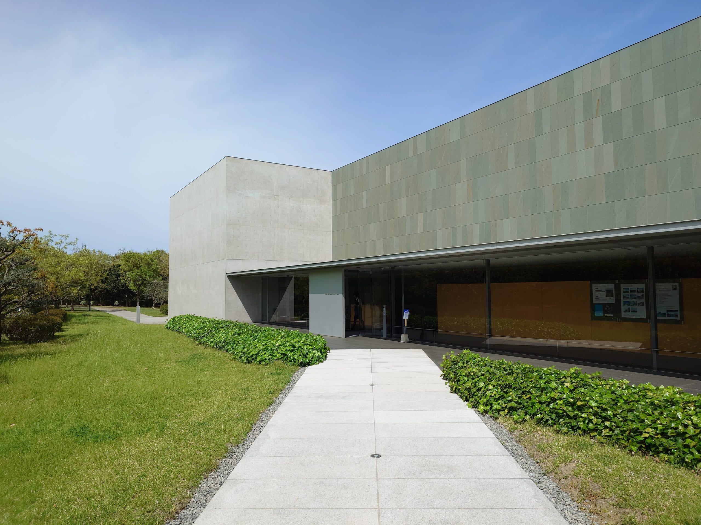

旅遊第三天，早上，我從丸龜搭電車坂出站，接下來，藉由公車和走路，穿梭於瀨戶藝春會期限定的沙彌島和瀨居島的景點。下午，搭乘公車回到坂出站，接著，搭乘電車到高松，最後入住東橫 INN 高松站前。

今天早上只要在坂出站搭上 8:35 的公車，又丸龜到坂出僅隔兩站，列車通勤時間約 10 分鐘，相較於昨天到高松站有較多的餘裕，因此，起床時間可以設定為 6:30 之後。起床後簡單梳洗，然後到旅館一樓大廳享用免費的早餐，用餐結束後回到房間整理一下行李，接著拖著行李到旅館大廳，在自動化櫃台辦理退房手續，最後前往丸龜站準備搭車。

搭車時間為 8 點多，這時間有不少的學生和上班族，列車上略顯擁擠。抵達坂出站，出站後，將行李寄放在投幣式寄物櫃，接著就去等待公車。

```html title="wp-unconverted: envira/envira-gallery"
<!-- wp:envira/envira-gallery {"galleryId":706,"title":"坂出站","columns":"0","row_height":140,"margins":"custom","custom_margins":8,"lightbox_enabled":1,"lazyload_enabled":1,"lightbox_theme":"base","images":[{"status":"active","src":"https://aniya.moe/wp-content/uploads/2025/05/20250422_082158716-scaled.jpg","title":"在公車站旁的鴿子","link":"https://aniya.moe/wp-content/uploads/2025/05/20250422_082158716-scaled.jpg","alt":"","caption":"","thumb":"","id":707,"height":205.30035335689044,"width":154},{"status":"active","src":"https://aniya.moe/wp-content/uploads/2025/05/20250422_082207472-scaled.jpg","title":"在公車站旁的鴿子","link":"https://aniya.moe/wp-content/uploads/2025/05/20250422_082207472-scaled.jpg","alt":"","caption":"","thumb":"","id":708,"height":205.30035335689044,"width":154},{"status":"active","src":"https://aniya.moe/wp-content/uploads/2025/05/20250422_082631005-scaled.jpg","title":"坂出站","link":"https://aniya.moe/wp-content/uploads/2025/05/20250422_082631005-scaled.jpg","alt":"","caption":"","thumb":"","id":709,"height":205.30035335689044,"width":273}]} -->
<div class="wp-block-envira-envira-gallery">[envira-gallery id='706']</div>
<!-- /wp:envira/envira-gallery -->
```

上了公車，找個靠窗的位置坐下。公車前往沙彌島的路上，在行駛於瀨戶大橋橋下的道路時，由於經過[番の州臨海工業団地](https://yuchi-100plan.pref.kagawa.lg.jp/useful/useful2/)，在右側出現不少川崎重工之類的大型廠房。

在公車抵達[沙弥島万葉会館站](https://maps.app.goo.gl/8J9EPp2Xk5vF5Zse8)後，我便下車，準備先從「[幻海をのぞく](https://setouchi-artfest.jp/artworks/detail/54e19d17-6baf-4369-8335-e77318c61100)」開始看，在前往的途中，看到告示牌，告知該作品的開始時間調整為 9:30，由於時間尚未允許，只好馬上調整行程，先去[沙弥ナカンダ浜](https://maps.app.goo.gl/XJBx8644yffoSz4h8)拍照。

```html title="wp-unconverted: jetpack/image-compare"
<!-- wp:jetpack/image-compare {"imageBefore":{"id":1228,"url":"https://aniya.moe/wp-content/uploads/2025/05/FiVPPKNVQAArrUS.jpeg","alt":"","width":853,"height":480},"imageAfter":{"id":713,"url":"https://i0.wp.com/aniya.moe/wp-content/uploads/2025/05/pi_20250422_090709.jpg?ssl=1","alt":"","width":1920,"height":1080},"caption":"結城友奈は勇者である中出現的海邊與後方的瀨戶大橋，拍攝地點為沙弥ナカンダ浜"} -->
<figure class="wp-block-jetpack-image-compare"><div class="juxtapose" data-mode="horizontal"></div><figcaption>結城友奈は勇者である中出現的海邊與後方的瀨戶大橋，拍攝地點為沙弥ナカンダ浜</figcaption></figure>
<!-- /wp:jetpack/image-compare -->
```

拍照完後，折返回去看「幻海をのぞく」。該作品主要呈現瀨戶內海區域曾經是中國和四國之間的盆地的樣貌，只是在冰河期結束後，因為海平面上升，海水灌入這大片盆地，所以形成現在的樣貌，另外，該作品也展示曾經在這一帶發現的象牙化石。

接著，前往戶外展出的「[階層・地層・層](https://setouchi-artfest.jp/artworks/detail/43ee948e-08d0-4ea5-920b-04ac921417a4)」，然後再往前走，來到[香川県立東山魁夷せとうち美術館](https://setouchi-artfest.jp/artworks/detail/a3e4cc20-9511-4cc1-8e6f-7776947a17b0)，該美術館這次的展覽主題是「気配の力ー拡大する日本画」，展出岡村桂三郎和新恵美佐子這兩位畫家的畫作。

<figure>



<figcaption>香川県立東山魁夷せとうち美術館</figcaption>
</figure>

看完畫展後，我往[瀨戶大橋紀念館](https://maps.app.goo.gl/aFfXpJxLvyu8mGpg9)的方向前進，途中搭上[瀬戸大橋タワー](https://maps.app.goo.gl/8R99mAXEsnLrEUiC7)，在塔上俯瞰瀨戶大橋和紀念公園。接著，爬上紀念館的展望台拍照，走下展望台後，繞去旁邊的[マリンドーム](https://maps.app.goo.gl/1FqvQDDcTeYivqAt9)，最後再進到紀念館裡參觀。

紀念館記錄著瀨戶大橋的歷史，從一開始本州和四國間要建立橋樑的構想開始，到後來確定三個方案後，卻遇上石油危機，計畫被凍結，後來解凍，建設才正式開始；而設計時，除了設計給汽車通行之外，也要給列車通行，更要讓貨輪能夠從橋下通過；在建設過程中，所遇到的諸多挑戰與創舉等等。

```html title="wp-unconverted: envira/envira-gallery"
<!-- wp:envira/envira-gallery {"galleryId":717,"title":"瀨戶大橋紀念公園","columns":"0","row_height":140,"margins":"custom","custom_margins":8,"lightbox_enabled":1,"lazyload_enabled":1,"lightbox_theme":"base","images":[{"status":"active","src":"https://aniya.moe/wp-content/uploads/2025/05/20250422_103630594-scaled.jpg","title":"從塔上往岡山的方向看過去","link":"https://aniya.moe/wp-content/uploads/2025/05/20250422_103630594-scaled.jpg","alt":"","caption":"","thumb":"","id":718,"height":145.6140350877193,"width":193.7},{"status":"active","src":"https://aniya.moe/wp-content/uploads/2025/05/20250422_103933892-scaled.jpg","title":"從塔上往香川的方向看過去","link":"https://aniya.moe/wp-content/uploads/2025/05/20250422_103933892-scaled.jpg","alt":"","caption":"","thumb":"","id":719,"height":145.6140350877193,"width":193.7},{"status":"active","src":"https://aniya.moe/wp-content/uploads/2025/05/20250422_104424571-scaled.jpg","title":"從塔上往旁邊紀念館的方向看過去","link":"https://aniya.moe/wp-content/uploads/2025/05/20250422_104424571-scaled.jpg","alt":"","caption":"","thumb":"","id":720,"height":145.6140350877193,"width":193.7},{"status":"active","src":"https://aniya.moe/wp-content/uploads/2025/05/20250422_104838239-scaled.jpg","title":"在紀念塔館的展望台上拍攝マリンドーム","link":"https://aniya.moe/wp-content/uploads/2025/05/20250422_104838239-scaled.jpg","alt":"","caption":"","thumb":"","id":721,"height":170.38123167155425,"width":226.6},{"status":"active","src":"https://aniya.moe/wp-content/uploads/2025/05/20250422_105322549-scaled.jpg","title":"マリンドーム內部的樣子","link":"https://aniya.moe/wp-content/uploads/2025/05/20250422_105322549-scaled.jpg","alt":"","caption":"","thumb":"","id":722,"height":170.38123167155425,"width":226.6},{"status":"active","src":"https://aniya.moe/wp-content/uploads/2025/05/20250422_112159785-scaled.jpg","title":"紀念館有賣結城友奈は勇者である的週邊（笑","link":"https://aniya.moe/wp-content/uploads/2025/05/20250422_112159785-scaled.jpg","alt":"","caption":"","thumb":"","id":723,"height":170.38123167155425,"width":127.8}]} -->
<div class="wp-block-envira-envira-gallery">[envira-gallery id='717']</div>
<!-- /wp:envira/envira-gallery -->
```

```html title="wp-unconverted: core/html"
<!-- wp:html -->
<figure class="wp-block-jetpack-image-compare"><div class="juxtapose" data-mode="horizontal"></div><figcaption>結城友奈は勇者である中出現的展望台</figcaption></figure>
<!-- /wp:html -->
```

---

離開紀念館後，我在附近的公車站搭乘公車前往瀨居島，在[瀬居町北浦站](https://maps.app.goo.gl/MZ8SCfSiX8ckjWXo9)下車，往前走一小段路，來到「[Next](https://setouchi-artfest.jp/artworks/detail/1cd6e659-3037-48d2-8acf-593d049d7fa6)」作品前，該作品為戶外展出，是一個石膏做成的人像，站在堤防上，看向前方的瀨戶大橋。

接著往回走一段距離，來到[舊瀨居小學校](https://maps.app.goo.gl/7brjBhDBeHJ1R6SH6)，這裡有三位作者的作品，分別是[狩野哲郎](https://setouchi-artfest.jp/artists/detail/8a71804b-6da0-427f-ad3c-f689ee3dda9a)的「[既知の道、未知の地](https://setouchi-artfest.jp/artworks/detail/7756ddf0-8866-4ba7-a61c-b4beb66c8061)」、[小瀬村真美](https://setouchi-artfest.jp/artists/detail/665c3945-2808-4847-ab1f-088dbc8df872)的「[自然の／と陳列](https://setouchi-artfest.jp/artworks/detail/084d295d-04d1-4378-925d-e886b0bb72c1)」和[下道基行](https://setouchi-artfest.jp/artworks/detail/1cab7df5-e7a7-4fd6-a369-0734b5197e47)的「[津波石](https://setouchi-artfest.jp/artworks/detail/1cab7df5-e7a7-4fd6-a369-0734b5197e47)」。

觀賞完後，前往公車[瀬居町西浦站](https://maps.app.goo.gl/yFvZTkXzq7MF466Y6)，稍作休息，準備搭車前往竹浦。在等待公車時，一位也在等待公車的遊客向我搭話，用中文詢問我是不是台灣人，回答肯定之後，我們開使用中文聊天，從對話中，得知他的旅途從大阪萬博開始，中間有去小豆島、高松等，今天是他最後一天的行程，等等就要前往高松機場，搭飛機飛往台灣。他回程的公車先到站，我們彼此道別並祝福。

抵達竹浦後，我參觀這一帶的作品，首先是「[アーム](https://setouchi-artfest.jp/artworks/detail/b5488990-cfe1-4e38-8eec-5188c55111ed)」，關於這個作品的介紹，它被放在附近的[老人いこいの家](https://maps.app.goo.gl/YzMMoz8T6UtvyG6V8)；接著是「[アフリカの母子と闘う女の子](https://setouchi-artfest.jp/artworks/detail/8b119364-cbf0-4fcd-95be-219fbb6148e4)」，這個作品實際上和官網上的圖對不上，但就其樣子和所放置的地點，與周遭環境呈現明顯的對比；最後是「[島の画家](https://setouchi-artfest.jp/artworks/detail/a6186956-4589-452d-bcbc-8a061483a9ed)」，前往這個作品的路標不明顯，花了點時間在尋找道路，後來是在老人いこいの家附近找到。

最後，搭乘公車往回走，前往[舊瀨居中學校](https://maps.app.goo.gl/5nFWGDjZRQNXpkTa9)。下車後，我先去中學校隔壁的幼稚園，參觀作品—[Say-yo, chains, what do you bind or release?](https://setouchi-artfest.jp/artworks/detail/3193ac08-d669-4bd0-b52c-a997a605aa8b)，在這作品，陳列了許多生活物品，與有編號的資訊看板，依照編號順序參觀，最後來到一個大房間，房間裡有三個螢幕播放著影像，其中一個螢幕播放的畫面是有一個人穿著腳鐐，從作品的一開始，照著編號逐漸往前走，邊走還邊歇斯底里得喊著「島～」，彷彿是瀨居島的亡靈一般。

走出幼稚園，到隔壁中學校，這裡相對熱鬧，有服務中心、飲食店，也有 *[HELLO CYCLING](https://www.hellocycling.jp/)* 可以租用，同時，學校的教室裡展示著許多各式各樣作者的作品，我印象比較深刻的作品是「[一日の終わりに願うこと](https://setouchi-artfest.jp/artworks/detail/a4e9b77c-6782-417e-a8dc-85390d0c78b6)」和「[いるもの](https://setouchi-artfest.jp/artworks/detail/da78f63b-8179-4944-b619-4dca2c3a87dc)」。前者是用 AI 生成的文字冒險遊戲，他的控制器是一塊大石頭，控制季的按鈕是由小道具或漂流物所組成，觀賞者可以用該控制來選擇選項，操控故事的走向。當我在玩這作品時，留意到來自背後的照相聲，似乎被別人當作作品的一部分給拍照進去了。後者則是一堆各種形狀的白色物體，散落在學校的屋頂上，這些物體的散落方式與樣子，彷彿是活著的生物一般。

```html title="wp-unconverted: envira/envira-gallery"
<!-- wp:envira/envira-gallery {"galleryId":729,"title":"舊瀨居中學校","columns":"0","row_height":140,"margins":"custom","custom_margins":8,"lightbox_enabled":1,"lazyload_enabled":1,"lightbox_theme":"base","images":[{"status":"active","src":"https://aniya.moe/wp-content/uploads/2025/05/20250422_140113809-scaled.jpg","title":"「一日の終わりに願うこと」的控制器，看起來十分硬派","link":"https://aniya.moe/wp-content/uploads/2025/05/20250422_140113809-scaled.jpg","alt":"","caption":"","thumb":"","id":730,"height":170.38123167155425,"width":226.6},{"status":"active","src":"https://aniya.moe/wp-content/uploads/2025/05/20250422_141805674-scaled.jpg","title":"一般的兌幣機與長椅，兌幣機放在磅秤上，當 1000 元鈔票換成 10 個 100 元硬幣時，旁邊的數字會產生變化","link":"https://aniya.moe/wp-content/uploads/2025/05/20250422_141805674-scaled.jpg","alt":"","caption":"","thumb":"","id":731,"height":170.38123167155425,"width":127.8},{"status":"active","src":"https://aniya.moe/wp-content/uploads/2025/05/20250422_143659390-scaled.jpg","title":"屋頂上的「いるもの」，除了一團一團的樣態，也有一長條的樣子","link":"https://aniya.moe/wp-content/uploads/2025/05/20250422_143659390-scaled.jpg","alt":"","caption":"","thumb":"","id":732,"height":170.38123167155425,"width":226.6}]} -->
<div class="wp-block-envira-envira-gallery">[envira-gallery id='729']</div>
<!-- /wp:envira/envira-gallery -->
```

在離開中學校前，我遇到一團穿著西裝的台灣人準備看展，從他們的談話中，得知這團當中有處長級的人物，接著，遇到服務台的工作人員邀請填寫問券，由於剩餘時間充裕，我便坐下來好好完成問券，問卷填寫完後，我獲得作為謝禮的官方濕紙巾。

由於實在好奇剛剛那團台灣人是來自什麼單位的，在公車到來前，我先繞到他們所搭乘的遊覽車，試圖獲得答案，結果遊覽車上沒有貼任何資訊。

公車抵達後，我搭乘公車回到瀨戶大橋紀念公園，路途上整理等會要拍照的項目，抵達公園會便開始拍照，拍照完回到公車站，等待回坂出站的公車。由於往竹浦方向的公車（15:59）比往坂出站方向的公車（16:00）還要早到站，又兩者的資訊看板沒有明顯區別，結果我搭到了往竹浦方向的公車，多繞了一大段路，等公車從竹浦折返後，才回到坂出站。

```html title="wp-unconverted: jetpack/image-compare"
<!-- wp:jetpack/image-compare {"imageBefore":{"id":1231,"url":"https://aniya.moe/wp-content/uploads/2025/05/1745662586-0d2g1sYwMuSL8AiyEU7eJXbc.webp","alt":"","width":1920,"height":1080},"imageAfter":{"id":736,"url":"https://i0.wp.com/aniya.moe/wp-content/uploads/2025/05/pi_20250422_153412.jpg?ssl=1","alt":"","width":1920,"height":1080},"caption":"結城友奈は勇者である中出現的天の泉"} -->
<figure class="wp-block-jetpack-image-compare"><div class="juxtapose" data-mode="horizontal"></div><figcaption>結城友奈は勇者である中出現的天の泉</figcaption></figure>
<!-- /wp:jetpack/image-compare -->
```

```html title="wp-unconverted: jetpack/image-compare"
<!-- wp:jetpack/image-compare {"imageBefore":{"id":1232,"url":"https://aniya.moe/wp-content/uploads/2025/05/1745662749-bqZoefOdXUQ2zR1gvViu4SLA.webp","alt":"","width":1920,"height":1080},"imageAfter":{"id":738,"url":"https://i0.wp.com/aniya.moe/wp-content/uploads/2025/05/pi_20250422_153115.jpg?ssl=1","alt":"","width":1920,"height":1080},"caption":"結城友奈は勇者である中出現的紀念館"} -->
<figure class="wp-block-jetpack-image-compare"><div class="juxtapose" data-mode="horizontal"></div><figcaption>結城友奈は勇者である中出現的紀念館</figcaption></figure>
<!-- /wp:jetpack/image-compare -->
```

```html title="wp-unconverted: jetpack/image-compare"
<!-- wp:jetpack/image-compare {"imageBefore":{"id":1233,"url":"https://aniya.moe/wp-content/uploads/2025/05/1745663102-o2I54GWN3PQlRMT8z1mrucHX.webp","alt":"","width":1920,"height":1080},"imageAfter":{"id":740,"url":"https://i0.wp.com/aniya.moe/wp-content/uploads/2025/05/pi_20250422_154141.jpg?ssl=1","alt":"","width":1920,"height":1080},"caption":"結城友奈は勇者である中出現的瀨戶大橋，拍攝位置為展望台的右側"} -->
<figure class="wp-block-jetpack-image-compare"><div class="juxtapose" data-mode="horizontal"></div><figcaption>結城友奈は勇者である中出現的瀨戶大橋，拍攝位置為展望台的右側</figcaption></figure>
<!-- /wp:jetpack/image-compare -->
```

```html title="wp-unconverted: core/html"
<!-- wp:html -->
<figure class="wp-block-jetpack-image-compare"><div class="juxtapose" data-mode="horizontal"></div><figcaption>結城友奈は勇者である中出現的マリンドーム內部</figcaption></figure>
<!-- /wp:html -->
```

```html title="wp-unconverted: jetpack/image-compare"
<!-- wp:jetpack/image-compare {"imageBefore":{"id":1235,"url":"https://aniya.moe/wp-content/uploads/2025/05/1745665872-VOgzJbqjvRP3CHIlahfMmXT9.webp","alt":"","width":1920,"height":1080},"imageAfter":{"id":746,"url":"https://i0.wp.com/aniya.moe/wp-content/uploads/2025/05/pi_20250422_153558.jpg?ssl=1","alt":"","width":1920,"height":1080},"caption":"結城友奈は勇者である中出現的紀念公園一景"} -->
<figure class="wp-block-jetpack-image-compare"><div class="juxtapose" data-mode="horizontal"></div><figcaption>結城友奈は勇者である中出現的紀念公園一景</figcaption></figure>
<!-- /wp:jetpack/image-compare -->
```

---

回到坂出站，天空開始飄起毛毛細雨，我從寄物櫃拿回行李後，接著就進站搭乘列車前往高松。抵達高松後，我拖著行李前往今晚要入住的東橫 INN，走進旅館，在自動櫃台辦理入住手續時，怎樣操作都搜尋不到我的預約紀錄，經服務人員協助查詢後，告知我是在另一間分館，我才恍然大悟，原來我跑到兵庫町分館，而非站前分館，於是，我再度拖著行李，前往正確的分館。

```html title="wp-unconverted: envira/envira-gallery"
<!-- wp:envira/envira-gallery {"galleryId":748,"title":"高松站 \u0026#8211; 20250422","columns":"0","row_height":140,"margins":"custom","custom_margins":8,"lightbox_enabled":1,"lazyload_enabled":1,"lightbox_theme":"base","images":[{"status":"active","src":"https://aniya.moe/wp-content/uploads/2025/05/20250422_173557754-scaled.jpg","title":"予讚線8000系麵包超人列車","link":"https://aniya.moe/wp-content/uploads/2025/05/20250422_173557754-scaled.jpg","alt":"","caption":"","thumb":"","id":749,"height":205.30035335689044,"width":154},{"status":"active","src":"https://aniya.moe/wp-content/uploads/2025/05/20250422_173655965-scaled.jpg","title":"予讚線8000系麵包超人列車","link":"https://aniya.moe/wp-content/uploads/2025/05/20250422_173655965-scaled.jpg","alt":"","caption":"","thumb":"","id":751,"height":205.30035335689044,"width":273},{"status":"active","src":"https://aniya.moe/wp-content/uploads/2025/05/20250422_173629523-scaled.jpg","title":"ざつ旅第三集，主角來高松所搭乘的列車—マリンライナー","link":"https://aniya.moe/wp-content/uploads/2025/05/20250422_173629523-scaled.jpg","alt":"","caption":"","thumb":"","id":750,"height":205.30035335689044,"width":154}]} -->
<div class="wp-block-envira-envira-gallery">[envira-gallery id='748']</div>
<!-- /wp:envira/envira-gallery -->
```

```html title="wp-unconverted: jetpack/image-compare"
<!-- wp:jetpack/image-compare {"imageBefore":{"id":760,"url":"https://aniya.moe/wp-content/uploads/2025/05/si_20250422_062630.jpg","alt":"","width":1920,"height":1080},"imageAfter":{"id":761,"url":"https://aniya.moe/wp-content/uploads/2025/05/pi_20250422_180724.jpg","alt":"","width":1920,"height":1080},"caption":"ざつ旅第三集出現的高松站"} -->
<figure class="wp-block-jetpack-image-compare"><div class="juxtapose" data-mode="horizontal"></div><figcaption>ざつ旅第三集出現的高松站</figcaption></figure>
<!-- /wp:jetpack/image-compare -->
```

```html title="wp-unconverted: jetpack/image-compare"
<!-- wp:jetpack/image-compare {"imageBefore":{"id":762,"url":"https://aniya.moe/wp-content/uploads/2025/05/si_20250422_062630_1.jpg","alt":"","width":1920,"height":1080},"imageAfter":{"id":763,"url":"https://aniya.moe/wp-content/uploads/2025/05/pi_20250422_180821.jpg","alt":"","width":1920,"height":1080},"caption":"ざつ旅第三集出現的高松站前廣場"} -->
<figure class="wp-block-jetpack-image-compare"><div class="juxtapose" data-mode="horizontal"></div><figcaption>ざつ旅第三集出現的高松站前廣場</figcaption></figure>
<!-- /wp:jetpack/image-compare -->
```

在站前分館的自助櫃台辦理入住手續時，或許是輸入英文聯絡地址佔用太多時間，服務人員介入處理，於是我在沒輸入完整聯絡資訊的情況下拿到房卡，完成手續。

進到旅館房間，稍微整理一下行李後，用 Google Map 查詢一下附近有什麼超市，找到了[マルナカ](https://maps.app.goo.gl/FFfgZmcb1KkGVFEb8)，接著我就前往超市採買晚餐、飲用水和零食，結帳完才發現超市沒有提供免洗餐具，於是今天晚餐無法享用剛剛購買的泡麵，只能依靠零食和在瀨居島購買的柿茶。

```html title="wp-unconverted: envira/envira-gallery"
<!-- wp:envira/envira-gallery {"galleryId":755,"title":"在瀨居島購買的柿茶","columns":"0","row_height":200,"margins":"custom","custom_margins":8,"lightbox_enabled":1,"lazyload_enabled":1,"lightbox_theme":"base","images":[{"status":"active","src":"https://aniya.moe/wp-content/uploads/2025/05/20250422_191401241-scaled.jpg","title":"在瀨居島購買的柿茶","link":"https://aniya.moe/wp-content/uploads/2025/05/20250422_191401241-scaled.jpg","alt":"","caption":"","thumb":"","id":756,"height":398,"width":298.5},{"status":"active","src":"https://aniya.moe/wp-content/uploads/2025/05/20250422_191418054-scaled.jpg","title":"在瀨居島購買的柿茶","link":"https://aniya.moe/wp-content/uploads/2025/05/20250422_191418054-scaled.jpg","alt":"","caption":"","thumb":"","id":757,"height":398,"width":298.5}]} -->
<div class="wp-block-envira-envira-gallery">[envira-gallery id='755']</div>
<!-- /wp:envira/envira-gallery -->
```

晚餐帶回旅館房間解決，晚餐結束後稍作休息，接著是洗澡，洗澡完後看一會 YouTube 影片，時間差不多來到晚上11 點時熄燈就寢。
