import Compare from '../../components/Compare.astro';
import Gallery from '../../components/Gallery.astro';
import compare10After from '../../assets/images/travel-setonaikai-2025-day4/pi_20250423_142638.jpg';
import compare10Before from '../../assets/images/travel-setonaikai-2025-day4/1e8177190b6d34eaa8f96d3c4b938828.jpg';
import compare11After from '../../assets/images/travel-setonaikai-2025-day4/pi_20250423_141827.jpg';
import compare11Before from '../../assets/images/travel-setonaikai-2025-day4/8442820bc1a675c0d280aadc8162a799.jpg';
import compare12After from '../../assets/images/travel-setonaikai-2025-day4/pi_20250423_143638.jpg';
import compare12Before from '../../assets/images/travel-setonaikai-2025-day4/puru-1536x864-1.jpg';
import compare13After from '../../assets/images/travel-setonaikai-2025-day4/pi_20250423_144650.jpg';
import compare13Before from '../../assets/images/travel-setonaikai-2025-day4/yakuba02-1.jpg';
import compare1After from '../../assets/images/travel-setonaikai-2025-day4/pi_20250423_073355.jpg';
import compare1Before from '../../assets/images/travel-setonaikai-2025-day4/si_20250422_062630_2.jpg';
import compare2After from '../../assets/images/travel-setonaikai-2025-day4/pi_20250423_084811.jpg';
import compare2Before from '../../assets/images/travel-setonaikai-2025-day4/si_20250418_220750_16.jpg';
import compare3After from '../../assets/images/travel-setonaikai-2025-day4/pi_20250423_123206.jpg';
import compare3Before from '../../assets/images/travel-setonaikai-2025-day4/torisirojima01-1.jpg';
import compare4After from '../../assets/images/travel-setonaikai-2025-day4/pi_20250423_124545.jpg';
import compare4Before from '../../assets/images/travel-setonaikai-2025-day4/si_20250418_220750_23.jpg';
import compare5After from '../../assets/images/travel-setonaikai-2025-day4/pi_20250423_124821-1.jpg';
import compare5Before from '../../assets/images/travel-setonaikai-2025-day4/si_20250418_220750_26.jpg';
import compare6After from '../../assets/images/travel-setonaikai-2025-day4/pi_20250423_135020-1.jpg';
import compare6Before from '../../assets/images/travel-setonaikai-2025-day4/si_20250418_220750_24.jpg';
import compare7After from '../../assets/images/travel-setonaikai-2025-day4/pi_20250423_135809-1.jpg';
import compare7Before from '../../assets/images/travel-setonaikai-2025-day4/si_20250418_220750_25.jpg';
import compare8After from '../../assets/images/travel-setonaikai-2025-day4/pi_20250423_140503.jpg';
import compare8Before from '../../assets/images/travel-setonaikai-2025-day4/si_20250418_220750_28.jpg';
import compare9After from '../../assets/images/travel-setonaikai-2025-day4/pi_20250423_141242.jpg';
import compare9Before from '../../assets/images/travel-setonaikai-2025-day4/si_20250418_220750_29.jpg';

旅遊第四天，早上，我在高松港搭船前往女木島，藉由公車和走路在該島上觀光。中午時，我搭船前往男木島，用走路的方式穿梭於該島。傍晚，我搭乘最後的船班回到高松港。

今天一早起來，打開房間的窗戶，往高松港的方向看過去，遠方一片霧茫茫的，令人擔心是否會影響船班，還好最後船班是正常運行的。

<Gallery
	images={[
		{ src: import('../../assets/images/travel-setonaikai-2025-day4/20250423_053424187.jpg'), caption: '遠方的高松港霧茫茫的' },
		{ src: import('../../assets/images/travel-setonaikai-2025-day4/20250423_053547997.jpg'), caption: '早上的高松站一帶' },
	]}
/>

在旅館一樓享用免費的早餐後，回到房間整理一下，7 點多離開旅館開始行程。

首先在高松站的圍牆外，守候[サンライズ瀬戸](https://www.jr-odekake.net/train/sunriseseto_izumo/)的到來，在列車開始進站時，我開始對它拍照，直到列車完全停在月台旁。接著，前往高松港，購買船票並等候船的到來，前往高松港的路上，順便路過[高松築港站](https://maps.app.goo.gl/oEPZzmDdSK86hoDX9)，拍一下照片。

<Gallery
	images={[
		{ src: import('../../assets/images/travel-setonaikai-2025-day4/20250423_072653772.jpg'), caption: '列車出現' },
		{ src: import('../../assets/images/travel-setonaikai-2025-day4/20250423_072707143.jpg'), caption: '列車進站中' },
		{ src: import('../../assets/images/travel-setonaikai-2025-day4/20250423_072714058.jpg'), caption: '列車進站中' },
		{ src: import('../../assets/images/travel-setonaikai-2025-day4/20250423_072721151.jpg'), caption: '列車進站中' },
		{ src: import('../../assets/images/travel-setonaikai-2025-day4/20250423_072729393.jpg'), caption: '列車進站中' },
		{ src: import('../../assets/images/travel-setonaikai-2025-day4/20250423_072757628.jpg'), caption: '列車完全停靠月台' },
	]}
/>

<Compare before={compare1Before} after={compare1After}>ざつ旅第三集中出現的高松築港站</Compare>

<Gallery
	images={[
		{ src: import('../../assets/images/travel-setonaikai-2025-day4/20250423_074125511.jpg'), caption: '高松港，左邊兩個柱狀體是其標誌，作品名為「Liminal Air -core-」' },
		{ src: import('../../assets/images/travel-setonaikai-2025-day4/20250423_074204142.jpg'), caption: '高松港，前面的網子是 2019 年在沙彌島展出的作品，作品名為「そらあみ」' },
		{ src: import('../../assets/images/travel-setonaikai-2025-day4/20250423_075324899.jpg'), caption: '從高松港看向瀨戶內海，遠方一片霧茫茫' },
		{ src: import('../../assets/images/travel-setonaikai-2025-day4/20250423_080314787.jpg'), caption: '遠方停靠在碼頭的渡輪上有呆呆獸的圖裝' },
		{ src: import('../../assets/images/travel-setonaikai-2025-day4/20250423_081448727.jpg'), caption: '有呆呆獸圖裝的渡輪正在遠方航行著' },
		{ src: import('../../assets/images/travel-setonaikai-2025-day4/20250423_080629426.jpg'), caption: '一艘有熊貓樣式的渡輪' },
	]}
/>

搭上渡輪，渡輪航行約 20 分鐘後，抵達女木島，下船後，我馬上前往遊客中心購買單程公車票，票買好後，從遊客中心另一側的門走出去，搭上停在遊客中心旁的公車，公車沒多久就發車，前往[大洞窟](https://maps.app.goo.gl/p3QZZCSPpekXbNSs5)。

公車開始前進後，沒多久進到山路，山路的寬度僅允許一輛車通行，在爬行的過程中，車外的景色逐漸被茂密的樹木與濃霧給取代，加上要前往的洞窟是鬼的大本營，感覺格外有氣氛。

公車抵達大洞窟外，下車後，往階梯方向走，爬坡一小段路，來到大洞窟的售票處，在售票處前的隊伍排隊等候購票。買好票後，前往大洞窟入口，在進到大洞窟前，發現久島鴎的看板，是意外的驚喜。

<Gallery
	images={[
		{ src: import('../../assets/images/travel-setonaikai-2025-day4/20250423_083859912.jpg'), caption: '真。鬼島' },
		{ src: import('../../assets/images/travel-setonaikai-2025-day4/20250423_084056956.jpg'), caption: '階梯旁的鬼像' },
		{ src: import('../../assets/images/travel-setonaikai-2025-day4/20250423_084219881.jpg'), caption: '售票處平台往外看，一片濃霧' },
		{ src: import('../../assets/images/travel-setonaikai-2025-day4/20250423_084631114.jpg'), caption: '大洞窟入口前，久島鴎的看板' },
		{ src: import('../../assets/images/travel-setonaikai-2025-day4/20250423_084703545.jpg'), caption: '大洞窟的看板與久島鴎的看板' },
	]}
/>

<Compare before={compare2Before} after={compare2After}>Summer Pockets 中出現的洞窟入口，其參考原型為女木島大洞窟入口</Compare>

進到大洞窟，開始探險。雖然被稱作大洞窟，但裡面有些通道的高度很低，即便我努力蹲下並低頭通過，還是有可能摩擦到通道的上緣。大洞窟裡相較於外面，比較溼冷，搭配昏暗的燈光，給人陰冷的感覺。大洞窟裡有岔路與小空間，以及四處充滿了[オニノコ瓦](https://setouchi-artfest.jp/artworks/detail/5e9d78b6-421f-4416-b342-667e93b1606f)，小空間裡有的是存放鬼的寶藏，有的是一群正在分贓的鬼，也有鬼和被監禁的女子，以及鬼大將和其手下等，此外，牆壁上也有瀨戶藝的作品「[生成するウォールドローイング](https://setouchi-artfest.jp/artworks/detail/092583a6-2e70-4aaa-9432-153138691a26)」。

<Gallery
	images={[
		{ src: import('../../assets/images/travel-setonaikai-2025-day4/20250423_085358970.jpg'), caption: '一堆オニノコ瓦' },
		{ src: import('../../assets/images/travel-setonaikai-2025-day4/20250423_085931065.jpg'), caption: '在牆壁上的「生成するウォールドローイング」' },
		{ src: import('../../assets/images/travel-setonaikai-2025-day4/20250423_090124674.jpg'), caption: '在牆壁上的「生成するウォールドローイング」' },
		{ src: import('../../assets/images/travel-setonaikai-2025-day4/20250423_090233708.jpg'), caption: '一個小空間裡，有鬼大將與其手下' },
	]}
/>

出了大洞窟後，往上爬坡一段路，來到[鷲ヶ峰展望台](https://maps.app.goo.gl/ry2N7jC6oVuocmzC9)，在這裡看了四周的景色，拍了照片後，我順著階梯往下走，回到大洞窟的售票處前，稍作休息一下，接著，我繼續往下走，回到公車亭，由於距離下一班公車還有很多時間，我決定自行走下山。

<figure>

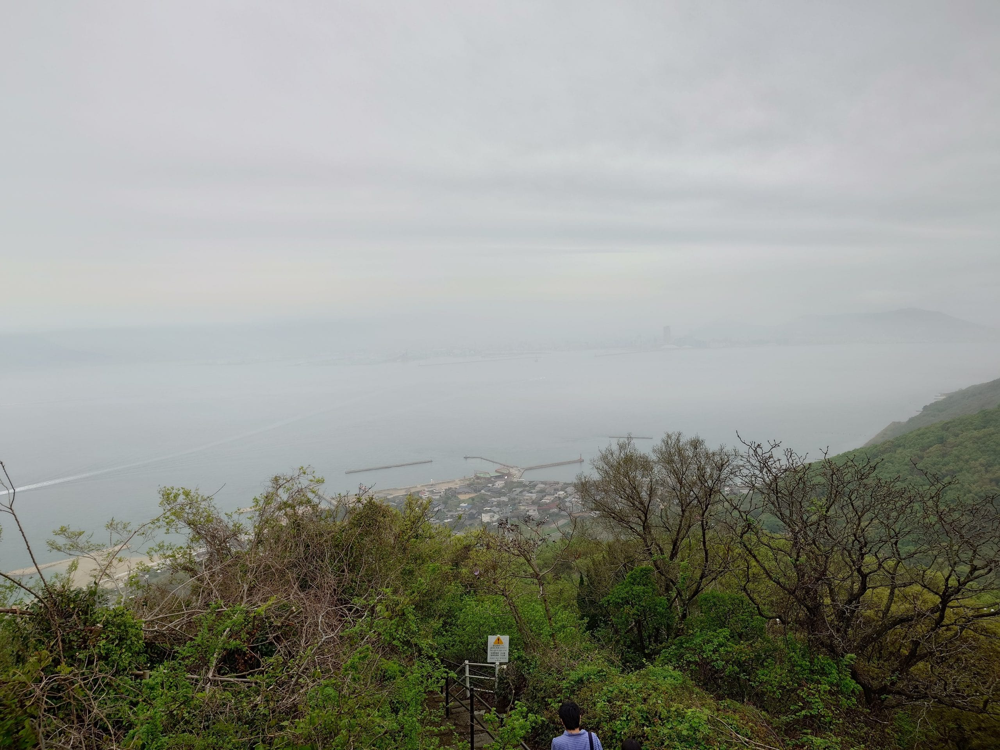

<figcaption>從展望台往高松港的方向看過去，前方的村落是女木島中心部</figcaption>
</figure>

我從公車亭旁的山路往下走，這條山路的階梯高度落差不小，加上昨晚的下雨，使得階梯有些溼滑，又周遭都是樹林和野草，我小心翼翼得踩著階梯往下，一方面避免滑倒，一方面避免踩到蛇之類。走了一陣子後，終於回到柏油道路，心情稍微放鬆，我順著道路，往山下小跑步，途中與往山上前進的公車相遇，我站到路旁讓公車通過，公車通過後，我繼續往山下小跑步，最後，在[住吉神社](https://maps.app.goo.gl/5cLUJk3viHTC7so77)附近，我從一條小路往上走，來到作品「[段々の風](https://setouchi-artfest.jp/artworks/detail/e8ec17bf-3ebe-4306-8754-10d25d6bcfd9)」前，欣賞完該作品後，我在女木島中心部繼續參觀其他作品。

<Gallery
	images={[
		{ src: import('../../assets/images/travel-setonaikai-2025-day4/20250423_092227492.jpg'), caption: '從山道往女木港的方向看' },
		{ src: import('../../assets/images/travel-setonaikai-2025-day4/20250423_092817159.jpg'), caption: '路旁有「小心野豬」的告示' },
		{ src: import('../../assets/images/travel-setonaikai-2025-day4/20250423_093043475.jpg'), caption: '作品「段々の風」' },
	]}
/>

首先是「[女木島人口増加大計画 ～あなぐまち入居者募集中～](https://setouchi-artfest.jp/artworks/detail/2b8facd0-bc1b-4bd5-83e1-baf8695e4cc4)」，這個作品是由許多紙板做的大樓所構成，大樓的部份房間裡有住戶，有些住戶底下會有一本小書，描述關於該住戶的資訊，此外，在這展覽的空間，不時會有小鳥飛進飛出，彷彿真的有住戶遷入遷出的樣子。另外，參觀者可以在隔壁的房間填寫「入住申請表」，在入住申請表上，選擇一個自己最重要的物品，賦予它形象與名字，並且描述其能力，即可完成入住申請。

接著是「[不在の存在](https://setouchi-artfest.jp/artworks/detail/72d18a1f-0e06-4f2e-ba49-cfaa67ab44d8)」，中庭的沙灘在特定條件下，會出現一條足跡，足跡會從一側逐漸往另一側的顯現，彷彿有一個透明人踩在沙灘走過去的樣子。

繼續往前走，來到「[女木島名画座](https://setouchi-artfest.jp/artworks/detail/e89dfb13-bcf0-4b7b-aa7e-9d65ce15e058)」，這是一間復古美國風格的電影院，坐在電影院的椅子上觀看前方播放中電影時，時空彷彿穿越到 1990 年代。

<figure>

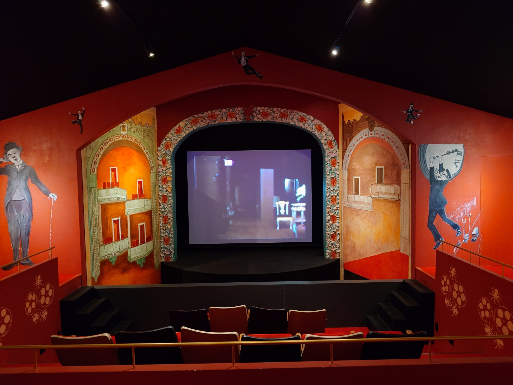

<figcaption>女木島名画座</figcaption>
</figure>

往前走一小段路，來到女木小學校，這裡有一些作品，我對當中[大竹伸朗](https://setouchi-artfest.jp/artists/detail/c2cd3799-bad9-47e6-ba9b-a0f70ef2c2dc)的作品[「女根／めこん](https://setouchi-artfest.jp/artworks/detail/a70422c8-ff0f-492c-8f41-ec06e0eea1a4)」印象深刻，這作品的構造，似乎是在暗示男性與女性性器官的結合。

<figure>

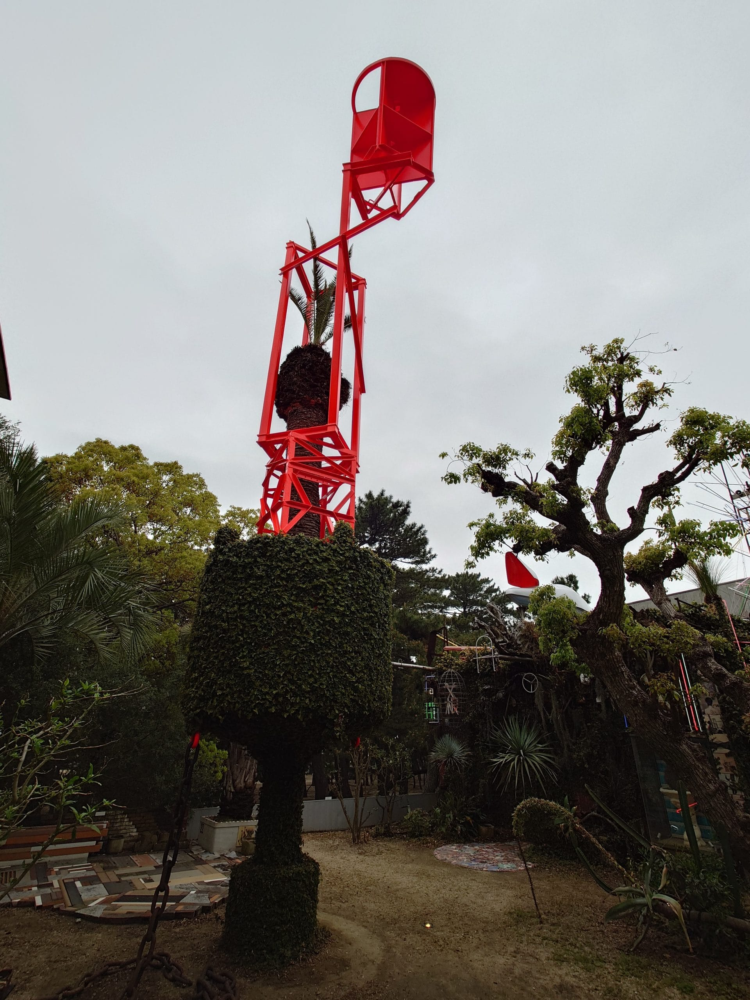

<figcaption>女根／めこん</figcaption>
</figure>

再往前走一段路，來到作品「[ナビゲーションルーム](https://setouchi-artfest.jp/artworks/detail/cb9aa4dd-0d2a-4e8c-b5cb-b2658249d652)」，該作品的中間部份是一堆自己轉動的物體，右邊是兩個重疊的金屬框，用來表示月亮的盈缺，左邊是一個大型的八音盒與其紙帶，紙帶上整齊得刻著許多大小相同的孔洞，雖然八音盒會播放音樂，但紙帶是靜止的，不會隨著音樂移動。

觀賞結束後往回走，來到有許多作品的女木島名店街，這當中我有印象的作品有[柴田あゆみ](https://setouchi-artfest.jp/artists/detail/0deedc52-155d-4b2d-93d0-af52e48264be)的「[いのちの詩・あまのおと](https://setouchi-artfest.jp/artworks/detail/ace2c451-765e-401e-b608-4698955f3c52)」、[中里繪魯洲](https://setouchi-artfest.jp/artists/detail/54d5056b-c3ae-4db4-8d8b-e6b4d6ab1787)的「[ヨガ教室 －瞑想するブランコ 転がる景色－](https://setouchi-artfest.jp/artworks/detail/783c5632-236d-4ffd-ab46-9174817de27f)」、[原游](https://setouchi-artfest.jp/artists/detail/3c86d9ae-dfc0-4012-a1da-cb2739513754)的「[SUNSET TAILOR　思い出オーダーメイド](https://setouchi-artfest.jp/artworks/detail/b9ca4aba-4985-4938-815b-594c2cb33d44)」、[ザ・キャビンカンパニー](https://setouchi-artfest.jp/artists/detail/1c723a53-511e-46ef-bdb7-c24d36306a84)的「[休校書店 メコチャン](https://setouchi-artfest.jp/artworks/detail/a4f1f115-ba85-4551-97b7-ab8a599dc66b)」、[柳建太郎](https://setouchi-artfest.jp/artists/detail/669e6b06-7288-4d01-9e98-96e147ef9cc1)的「[ガラス漁具店](https://setouchi-artfest.jp/artworks/detail/858a0e8e-1e18-4304-8f2a-4e1c91e199a4 "ガラス漁具店")」、[原倫太郎+原游](https://setouchi-artfest.jp/artists/detail/b5384097-ab46-4fe5-932b-119164485671)的「[ピンポン・シー NEW！](https://setouchi-artfest.jp/artworks/detail/12747cc0-9937-4935-9c1f-0b19abc51132)」和[原田郁](https://setouchi-artfest.jp/artists/detail/9435a85d-ca8f-48f7-9aa1-d7e5d86537ce)的「[カフェ・サムシング サインズ](https://setouchi-artfest.jp/artworks/detail/07e5e1fa-257c-400c-8020-c6a482850c13)」。

「いのちの詩・あまのおと」是由一堆一圈圈的紙片所構築而成，忽隱忽現的燈光打在這些紙片上時，看起來彷彿是一片片的水花；「ヨガ教室 －瞑想するブランコ 転がる景色－」的中間有一個鞦韆，參觀者坐在上面擺盪時，會產生電力，觸發其他裝置發出聲音，這些聲音交織在一起形成奇特的樂曲；「SUNSET TAILOR　思い出オーダーメイド」是一間裁縫店，參觀者可以在這裡「購買」畫在紙上裁剪而成的衣物，也可以投稿自己畫的衣物；「休校書店 メコチャン」是一間奇特的書店，有一位巨大的小女孩背著書包坐在書店中央，看向窗戶外。「ガラス漁具店」是在一間暗室中展示許多製作精美的玻璃裝飾，搭配光線照射在這些裝飾上，使得其看起來閃閃發光；「ピンポン・シー NEW！」是一堆造型奇特的乒乓球桌，參觀則可以在附近的商店租用乒乓球和球拍，在這些特殊的球桌上打乒乓球；最後，「カフェ・サムシング サインズ」是一間餐廳，這餐廳使用一塊一塊大面積的色塊所裝潢而成，有點像用 Minecraft 所拼湊出來的空間。

<Gallery
	images={[
		{ src: import('../../assets/images/travel-setonaikai-2025-day4/20250423_104634016.jpg'), caption: '作品「いのちの詩・あまのおと」' },
		{ src: import('../../assets/images/travel-setonaikai-2025-day4/20250423_105841872.jpg'), caption: '作品「ガラス漁具店」中展出的玻璃裝飾' },
		{ src: import('../../assets/images/travel-setonaikai-2025-day4/20250423_105858760.jpg'), caption: '作品「ガラス漁具店」中展出的玻璃裝飾' },
		{ src: import('../../assets/images/travel-setonaikai-2025-day4/20250423_105707160.jpg'), caption: '作品「ピンポン・シー NEW！」的其中一張桌子' },
		{ src: import('../../assets/images/travel-setonaikai-2025-day4/20250423_110417163.jpg'), caption: '作品「カフェ・サムシング サインズ」' },
	]}
/>

接著，往女木港的方向前進，途中遇到作品「[20世紀の回想](https://setouchi-artfest.jp/artworks/detail/8ac6d670-3f40-4680-ae07-056c75b9fce9)」，該作品是上面有四座帆，看起來有點像船的鋼琴，鋼琴會自動播放音樂，該作品似乎也作為 Summer Pockets 中，登場的海盜船的參考原型。而在鋼琴旁邊的提坊上，有著許多海鷗[^1]的藝術裝置，這些海鷗會隨著風向轉動。

<Gallery
	images={[
		{ src: import('../../assets/images/travel-setonaikai-2025-day4/20250423_110913218-1.jpg'), caption: '作品「20世紀の回想」與後方的「カモメの駐車場」' },
		{ src: import('../../assets/images/travel-setonaikai-2025-day4/20250423_111005154-1.jpg'), caption: '作品「カモメの駐車場」的特寫' },
	]}
/>

回到女木港時，由於距離前往男木島的船班還有一大段時間，又差不多接近中午時刻，我想起先前經過的餐廳—[鬼の台所 福](https://maps.app.goo.gl/dWJpGAFMg9Po7T6E9)，於是我前往該店解決午餐，午餐我點了ホルモン焼うどん和炸章魚來吃，ホルモン焼うどん的味道十分濃郁。

<figure>

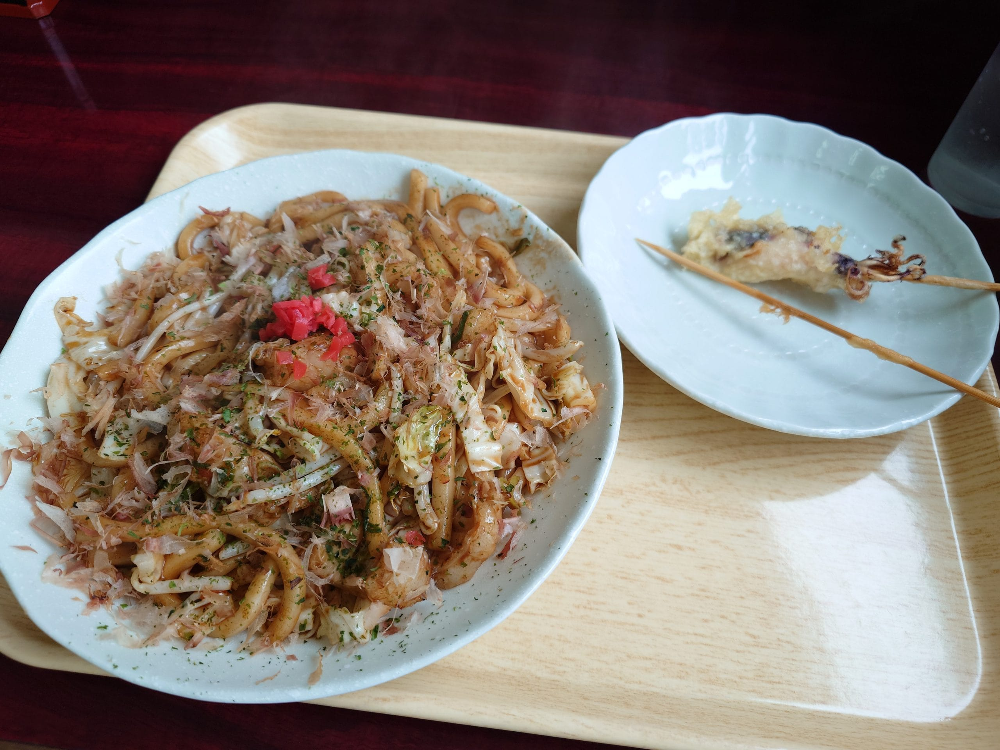

<figcaption>ホルモン焼うどん與炸章魚</figcaption>
</figure>

午餐後，我回到遊客服務中心，在裡面的用餐區點了哈密瓜刨冰來吃。接著，在遊客中心附近拍照、打發時間，等待船班的到來。

<Gallery
	images={[
		{ src: import('../../assets/images/travel-setonaikai-2025-day4/20250423_114953095.jpg'), caption: '哈密瓜刨冰' },
		{ src: import('../../assets/images/travel-setonaikai-2025-day4/20250423_111047672.jpg'), caption: '該地藏菩薩像為安撫紫雲丸事件的受難者所設立，紫雲丸事件亦為促成瀨戶大橋建設的重要轉捩點' },
		{ src: import('../../assets/images/travel-setonaikai-2025-day4/20250423_111617749.jpg'), caption: '摩艾石像' },
		{ src: import('../../assets/images/travel-setonaikai-2025-day4/20250423_111638497.jpg'), caption: '鬼島洞窟的路標' },
		{ src: import('../../assets/images/travel-setonaikai-2025-day4/20250423_120517023.jpg'), caption: '鬼ヶ島 おにの館，也是旅客服務中心' },
		{ src: import('../../assets/images/travel-setonaikai-2025-day4/20250423_120916444.jpg'), caption: '女木港的閃光塔，上面坐著許多的鬼' },
		{ src: import('../../assets/images/travel-setonaikai-2025-day4/20250423_121835328.jpg'), caption: '往返高松、女木島和男木島的渡輪「シマシマめおん」' },
	]}
/>

---

搭上渡輪，船航行約 20 分鐘後，抵達目的地—男木島。

<Gallery
	images={[
		{ src: import('../../assets/images/travel-setonaikai-2025-day4/20250423_123903768.jpg'), caption: '男木島聚落' },
		{ src: import('../../assets/images/travel-setonaikai-2025-day4/20250423_124008763.jpg'), caption: '男木島聚落' },
		{ src: import('../../assets/images/travel-setonaikai-2025-day4/20250423_124245583.jpg'), caption: '作為男木交流館的作品「男木島の魂 」' },
	]}
/>

<Compare before={compare3Before} after={compare3After}>さしずめ俺は……</Compare>

<Compare before={compare4Before} after={compare4After}>Summer Pockets 中一個重要的場景</Compare>

<Compare before={compare5Before} after={compare5After}>Summer Pockets 中，野村美希所站在的鐵塔</Compare>

在男木港一帶拍完照後，我繼續參觀其他的作品。

首先是「[男木島未来プロジェクト2125 　男木島　麦と未来の資料館](https://setouchi-artfest.jp/artworks/detail/f91c54d0-770e-4e54-93a7-943cdedbd5b7)」，這是由一群昭和 40 年（西元 1965 年）出生，今年剛好 60 歲的人，以 100 年後的架空歷史來設計的內容，而他們的著力點是在島上種植小麥，並使用在地的小麥生產啤酒，藉由啤酒來行銷男木島，在展覽中，呈現許多資料、實物和報導，甚至還有 VTuber 的介紹，給人一種這一切彷彿是真實存在，時光彷彿穿越到 100 年後，回顧這啤酒誕生的歷史。

前往「[ドリームランド](https://setouchi-artfest.jp/artworks/detail/9c568dec-675b-473d-b2de-503b5eb14411)」時，會先遇到[ドリームカフェ](https://maps.app.goo.gl/RS5PFsU4CK6SwW4x5)，起初，我以為兩者是一體的，後來才注意到作品是在餐廳後面的房子裡，於是才穿過餐廳，到達該作品。

<figure>

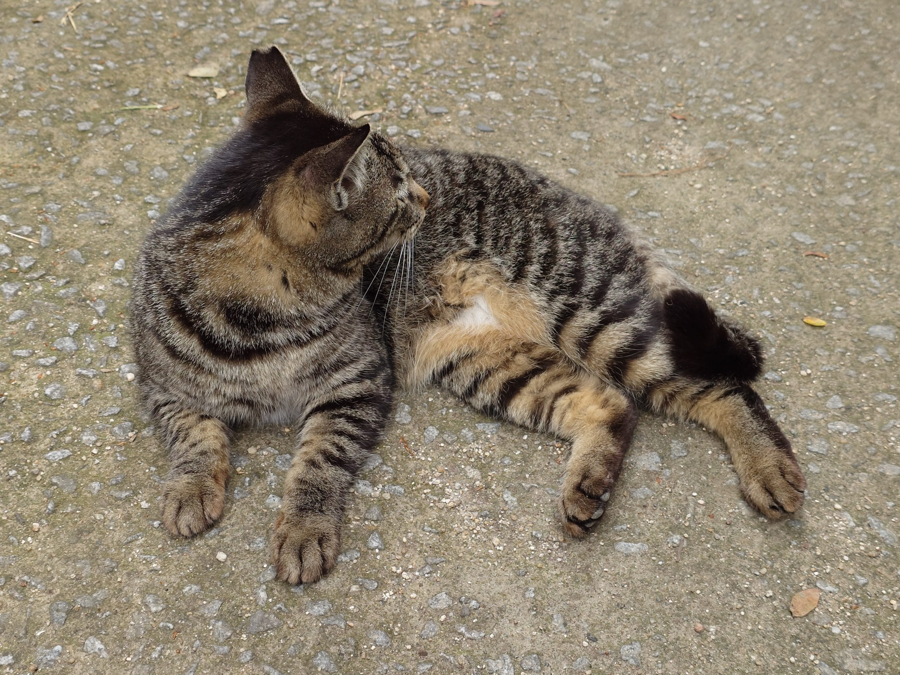

<figcaption>從「ドリームランド」前往「アキノリウム」的路上，遇到一隻在路中央的貓</figcaption>
</figure>

接著是「[アキノリウム](https://setouchi-artfest.jp/artworks/detail/b4521edb-f7ba-49bf-a8ea-72e07e314c49)」，這個作品有兩個樓層，一樓是燈光照到機關，機關的影子打在布幕上，二樓則是會自己動作並發出聲音的機關，這些機關都是用竹子做的。

「[部屋の中の部屋](https://setouchi-artfest.jp/artworks/detail/09a6817b-9f0b-4aae-9618-539f45a85f49)」是一間室內垂直逆時針 90 度擺放的和室，置身其中，產生人在橫躺的錯覺。

<figure>

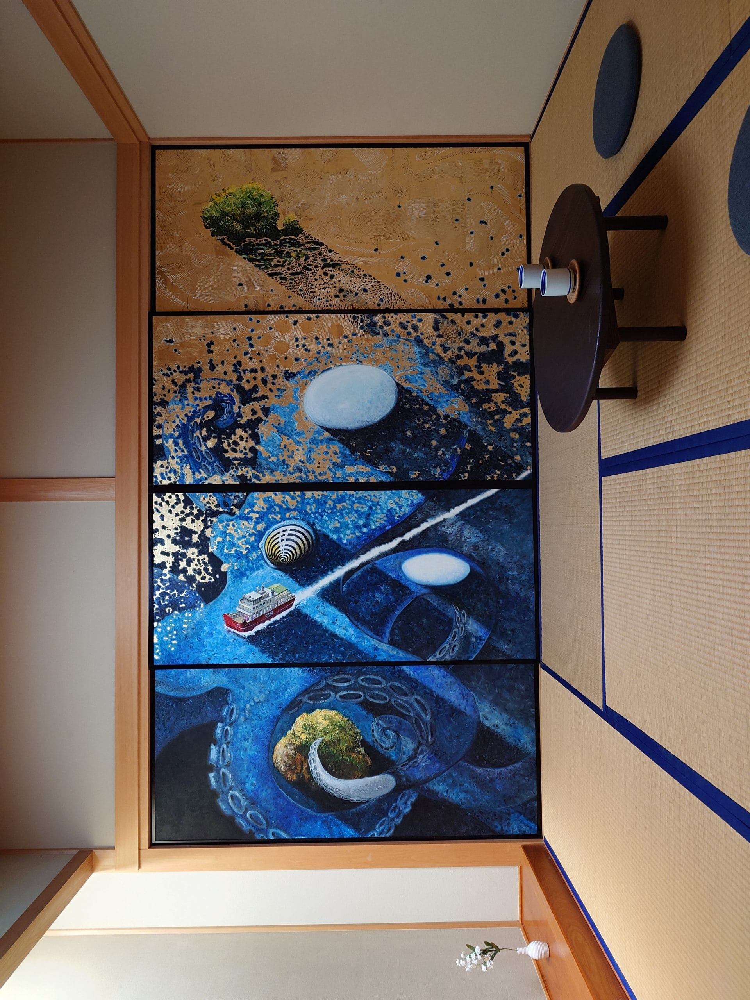

<figcaption>作品「部屋の中の部屋」</figcaption>
</figure>

在「部屋の中の部屋」斜對面有「[漆の家](https://setouchi-artfest.jp/artworks/detail/4bb98a19-4465-418d-9dd4-55ec59d0c456)」，這裡是日本漆藝的小型火力展示，展示了使用漆藝裝飾的房間、家具、餐具和裝飾，也展示實際的工作室，充分讓人體會漆藝的巧與美。

往[豐玉姬神社](https://maps.app.goo.gl/Wdh6DTWH33z9vns3A)的正門走，會來到作品「[男木島パビリオン](https://setouchi-artfest.jp/artworks/detail/6a16fe74-f8ea-4b4e-8470-69b922286411)」，這是在一間小屋面向男木港方向的三片落地窗上的作畫，三片落地窗並排錯開，而旁邊的牆上有重疊起來的照片，我向工作人員詢問是否能將三者重疊在一起，得到否定的答案。

<figure>

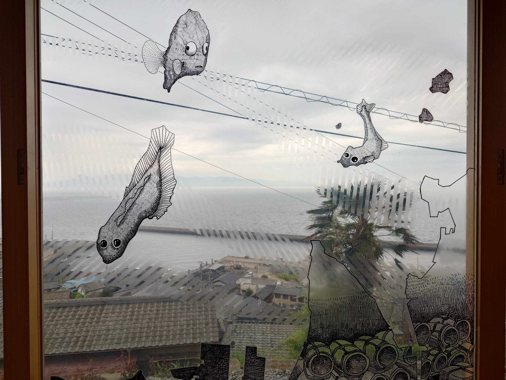

<figcaption>作品「男木島パビリオン」中間的落地窗</figcaption>
</figure>

<Compare before={compare6Before} after={compare6After}>Summer Pockets 中，站在鳥居前的水織静久</Compare>

<Compare before={compare7Before} after={compare7After}>Summer Pockets 動畫主視覺圖</Compare>

穿過豐玉姬神社，往[男木漁港](https://maps.app.goo.gl/xMth4njvUmwzdina6)的方向前進，途中皆是下坡，到達男木漁港後左轉，沿著海邊的道路往前走，會看到島上著名的作品「[歩く方舟](https://setouchi-artfest.jp/artworks/detail/2d93cbaa-56b0-4b5a-9f89-5fed706ce66f)」，在這裡，會有不少人到作品旁，跟在作品後面，擺著相同的姿勢，試圖以與作品融為一體的方式合照。

<Gallery
	images={[
		{ src: import('../../assets/images/travel-setonaikai-2025-day4/20250423_140120312.jpg'), caption: '在山路上，拍攝遠方的男木港' },
		{ src: import('../../assets/images/travel-setonaikai-2025-day4/20250423_140638626.jpg'), caption: '在前往作品「歩く方舟」路上所拍攝的貓' },
		{ src: import('../../assets/images/travel-setonaikai-2025-day4/20250423_141939954.jpg'), caption: '作品「歩く方舟」' },
	]}
/>

<Compare before={compare8Before} after={compare8After}>Summer Pockets 動畫中，男主角—鷹原羽依里—前往留宿地點，路途中一景</Compare>

<Compare before={compare9Before} after={compare9After}>Summer Pockets 動畫中，男主角—鷹原羽依里—前往留宿地點，路途中一景</Compare>

<Compare before={compare10Before} after={compare10After}>Summer Pockets 動畫中，傍晚時，男主角—鷹原羽依里—推著行李箱，與坐在行李箱上的女主角—久島鴎—前進。</Compare>

<Compare before={compare11Before} after={compare11After}>久島鴎坐在行李箱上往下衝一景</Compare>

拍完照，往男木港的方向折返回去，途中經過在學校體育館外牆上的作品「[青空を夢見て](https://setouchi-artfest.jp/artworks/detail/58cb6e19-0346-4087-ae23-daff1394191d)」，以及在[老人憩の家](https://maps.app.goo.gl/YtJdytyZ3x96z9QD8)展出的作品「[私たちの島](https://setouchi-artfest.jp/artworks/detail/6d608389-4897-41e8-8fd9-17bd28dae879)」，在「私たちの島」這個作品中，作者使用不同層次的藍色布，堆疊出整座島立體的樣子。

<figure>

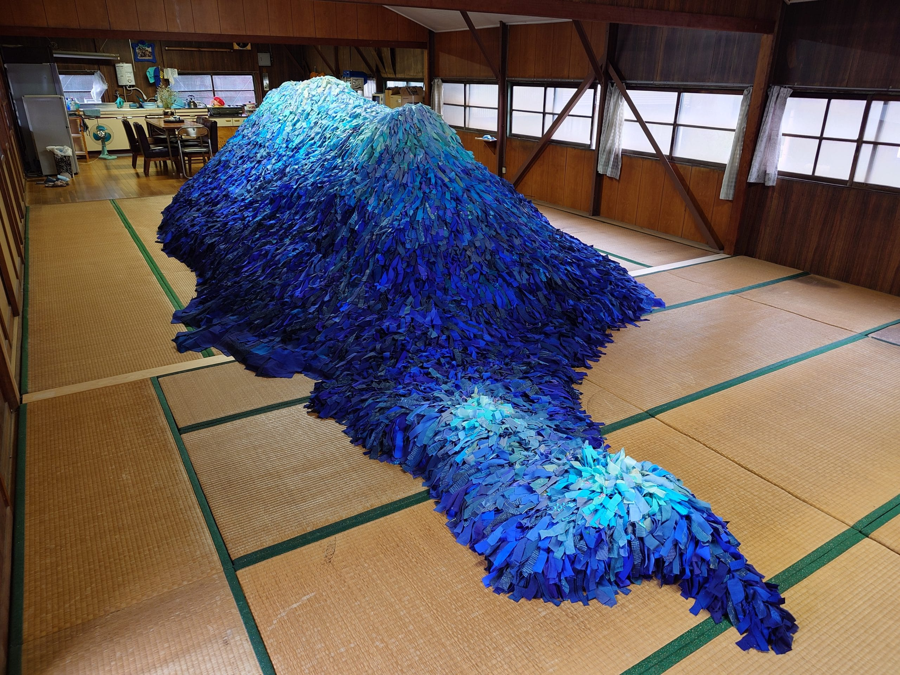

<figcaption>作品「私たちの島」</figcaption>
</figure>

<Compare before={compare12Before} after={compare12After}>Summer Pockets 中，女主角—鳴瀬しろは—游泳的地方，圍牆上有告示，禁止對學生拍照。</Compare>

往前走一小段路，會看到一戶人家門口擺著各種貓與 Summer Pockets 相關的週邊，兩旁的牆壁上貼滿各種圖畫與照片，這裡是同好間有名的[ねこポケハウス](https://maps.app.goo.gl/eXVKg6mNcGdbMrQSA)，裡面住著[豊爺](https://x.com/nekopoketoyoji)，可以從旁邊的小門進去拜訪他，門口是自助商店，週邊可以自行購買並結帳。

<Gallery
	images={[
		{ src: import('../../assets/images/travel-setonaikai-2025-day4/20250423_144112737.jpg'), caption: 'ねこポケハウス附近的圍牆' },
		{ src: import('../../assets/images/travel-setonaikai-2025-day4/20250423_144120332.jpg'), caption: 'ねこポケハウス附近的圍牆' },
		{ src: import('../../assets/images/travel-setonaikai-2025-day4/20250423_144139140.jpg'), caption: 'ねこポケハウス外的自助商店' },
	]}
/>

我在自助商店購買聖地巡禮導覽手冊「[とりしろっぷ ～Summer Pockets 舞台案内～](https://www.melonbooks.co.jp/detail/detail.php?product_id=2697465)」，稍作停留一會，接著往剩下的作品繼續前進。

<figure>

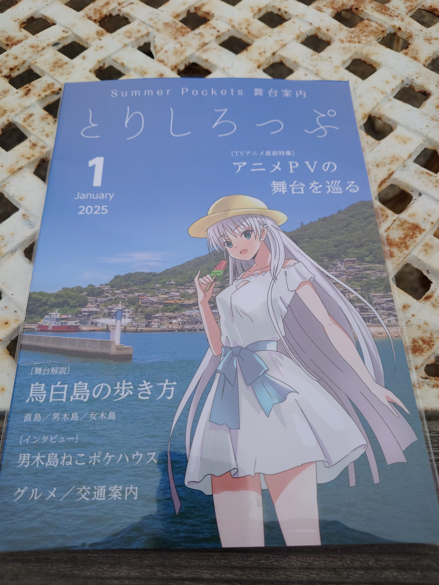

<figcaption>今年初出版的「とりしろっぷ ～Summer Pockets 舞台案内～」</figcaption>
</figure>

在作品「[生成するドローイング ― 日本家屋のために2.0](https://setouchi-artfest.jp/artworks/detail/d05acf0d-57e3-4806-8b42-dd9b55dc6759)」中，作者重複利用相同組成的區塊，填滿整個房子的牆壁，有的是用花草圖案，有的是用貝殼的紋路。

回到男木港，由於距離返回高松的船班還有一大段時間，我在男木港附近閒晃，等待船班的到來。

<Compare before={compare13Before} after={compare13After}>在 Summer Pockets 中登場的市政廳舍</Compare>

<Gallery
	images={[
		{ src: import('../../assets/images/travel-setonaikai-2025-day4/20250423_145321125.jpg'), caption: '貼在紀念品上店門窗上的合作活動海報' },
		{ src: import('../../assets/images/travel-setonaikai-2025-day4/20250423_145341078.jpg'), caption: '在合作商店裡，有紬ヴェンダース和野村美希的立牌' },
		{ src: import('../../assets/images/travel-setonaikai-2025-day4/20250423_150144172.jpg'), caption: '男木島の魂' },
		{ src: import('../../assets/images/travel-setonaikai-2025-day4/20250423_152243324.jpg'), caption: '男木島の魂' },
		{ src: import('../../assets/images/travel-setonaikai-2025-day4/20250423_152422032.jpg'), caption: '男木島の魂' },
		{ src: import('../../assets/images/travel-setonaikai-2025-day4/20250423_152326842.jpg'), caption: '在岸邊停靠的「めおん2」渡輪，外觀與 Summer Pockets 中，男主角所搭乘的船相似' },
		{ src: import('../../assets/images/travel-setonaikai-2025-day4/20250423_161033586.jpg'), caption: '停留於男木島の魂周圍池塘裡鴨子' },
		{ src: import('../../assets/images/travel-setonaikai-2025-day4/20250423_155848559.jpg'), caption: '附近的貓' },
		{ src: import('../../assets/images/travel-setonaikai-2025-day4/20250423_161622037.jpg'), caption: '從男木港防波堤上拍攝整個男木港與聚落' },
		{ src: import('../../assets/images/travel-setonaikai-2025-day4/20250423_153959950.jpg'), caption: '男木島燈塔 1/25 比例的模型' },
	]}
/>

搭上回程的渡輪，船開始離港時，我站在船側走道上，看向男木島，注意到島民聚集至作品「[タコツボル](https://setouchi-artfest.jp/artworks/detail/7a828576-d432-455a-9a17-cb53793de53f)」，拿起插在上面的旗幟，並走到渡輪前，組成隊伍，舉起旗幟，向船上的遊客道謝並送行，船上不少遊客也用喊叫的方式，向島民們表達感謝與祝福之意，我也跟著一起喊。

<Gallery
	images={[
		{ src: import('../../assets/images/travel-setonaikai-2025-day4/20250423_165922686.jpg'), caption: '島民熱情的再見' },
		{ src: import('../../assets/images/travel-setonaikai-2025-day4/20250423_165933248.jpg'), caption: '島民熱情的再見' },
		{ src: import('../../assets/images/travel-setonaikai-2025-day4/20250423_170001956.jpg'), caption: '島民熱情的再見' },
		{ src: import('../../assets/images/travel-setonaikai-2025-day4/20250423_170014987.jpg'), caption: '島民熱情的再見' },
	]}
/>

---

回到高松後，我加緊腳步前往高速巴士車站，在服務櫃台下班前，完成預約第七天旅行所要用到的交通套票[^2]。完成預約後，我在高松站的[便當店](https://maps.app.goo.gl/y78ZYhsnVRaZfmP88)購買便當作為晚餐，接著，直接回到旅館房間享用晚餐，結束今天的行程。

<figure>

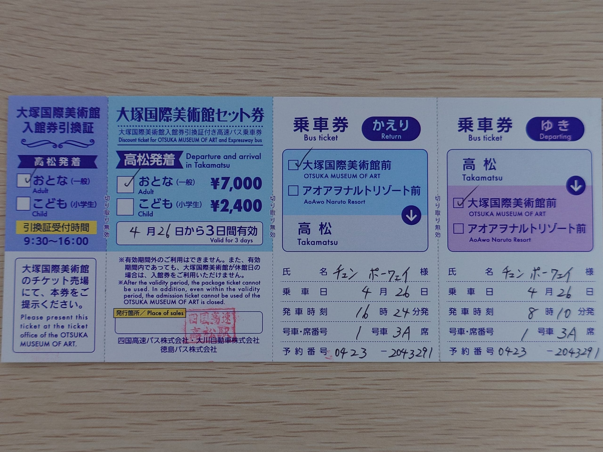

<figcaption>往返高松與大塚國際美術館的高速巴士的交通套票</figcaption>
</figure>

<figure>

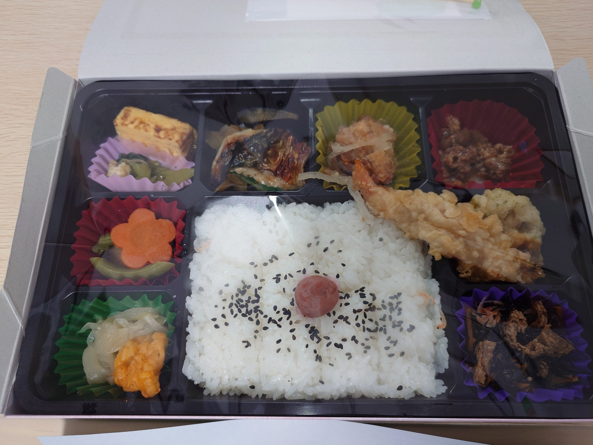

<figcaption>便當「瀬戸の凪」</figcaption>
</figure>

---

[^1]: 海鷗，日文讀音為カモメ，在象徵海盜船造型鋼琴旁的海鷗，或許這就是久島鴎（カモメ）名字的由來
[^2]: [高松與大塚國際美術館的往返交通套票](https://www.yonkou-bus.co.jp/news/20240801.html)
