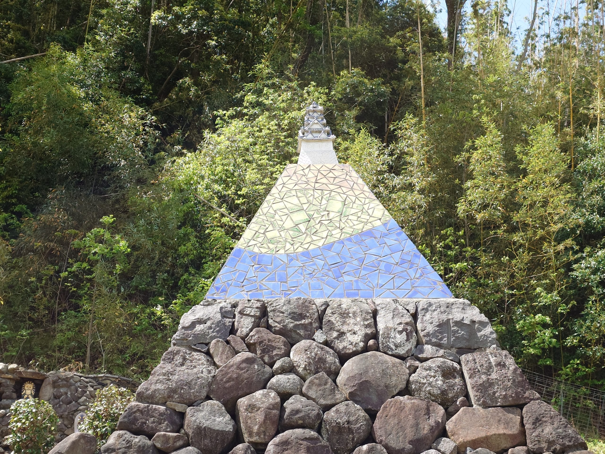
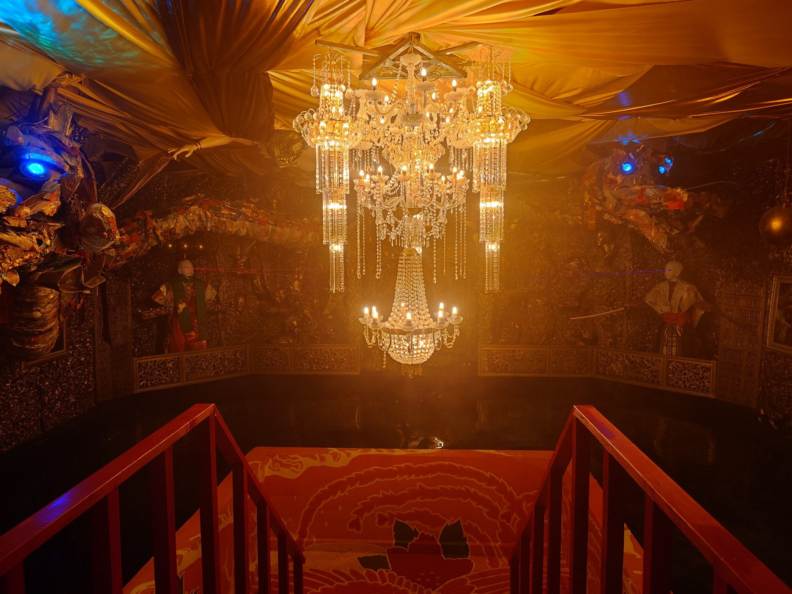
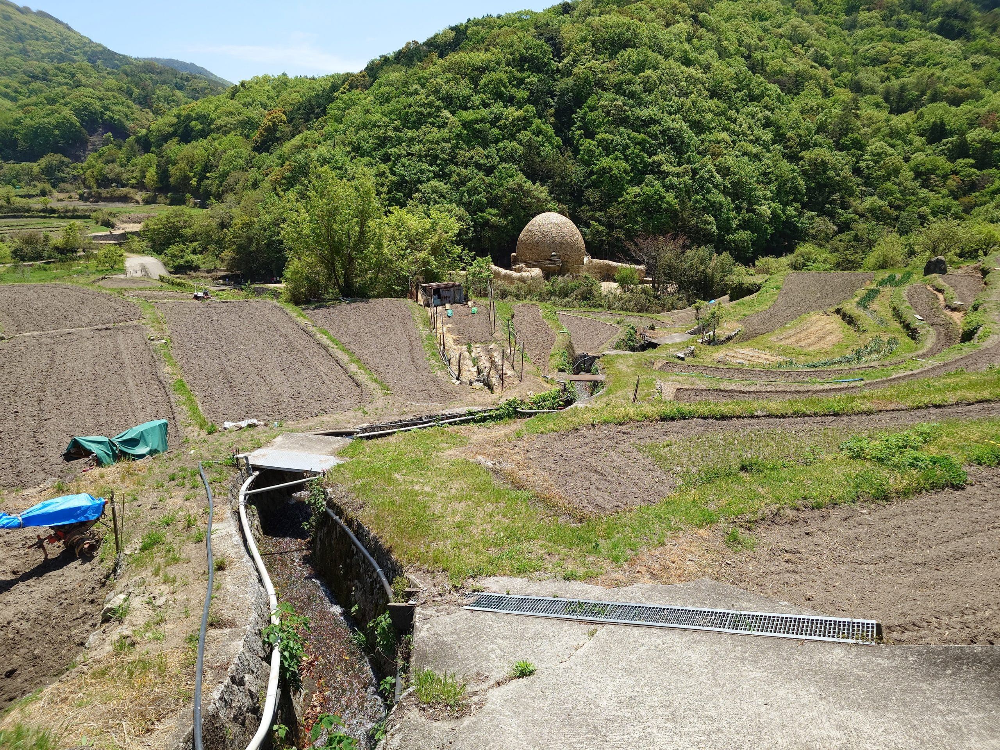
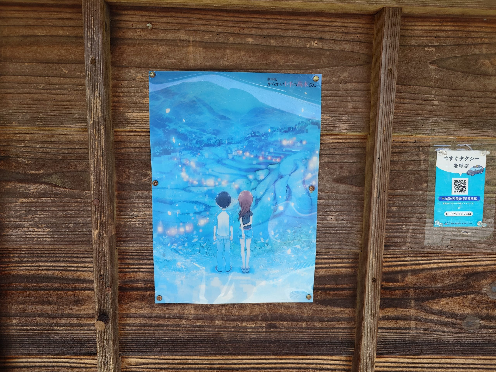
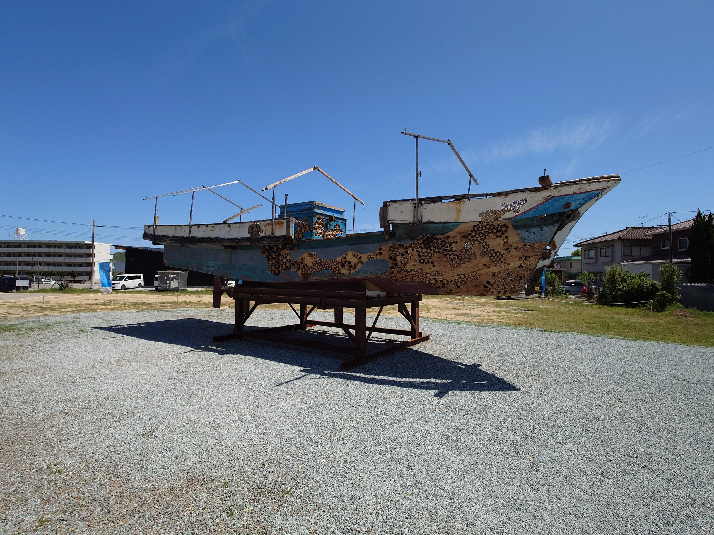

旅遊第五天，早上，我在高松港搭乘特別的渡輪前往小豆島，在小豆島上，藉由走路、單車、計程車和登山纜車完成預定的行程。傍晚，搭船返回高松港。

今天一早就出門至高松港，搭乘前往小豆島的渡輪，途中在超商購買早餐，並把早餐帶到渡輪上吃，這次很幸運搭到[高木同學](https://takagi3.me/1st/)塗裝的渡輪，在渡輪航行的過程中，我四處拍照蒐集高木同學相關的裝飾。

```html title="wp-unconverted: envira/envira-gallery"
<!-- wp:envira/envira-gallery {"galleryId":950,"title":"高木同學塗裝的渡輪","columns":"0","margins":"custom","custom_margins":8,"lightbox_enabled":1,"lazyload_enabled":1,"lightbox_theme":"base","images":[{"status":"active","src":"https://aniya.moe/wp-content/uploads/2025/05/20250424_070129973-scaled.jpg","title":"往返高松港與小豆島，有高木同學塗裝的渡輪","link":"https://aniya.moe/wp-content/uploads/2025/05/20250424_070129973-scaled.jpg","alt":"","caption":"","thumb":"","id":951,"height":94.1696113074205,"width":125.2},{"status":"active","src":"https://aniya.moe/wp-content/uploads/2025/05/20250424_172354987-scaled.jpg","title":"船艙內，停車場樓層的塗裝","link":"https://aniya.moe/wp-content/uploads/2025/05/20250424_172354987-scaled.jpg","alt":"","caption":"","thumb":"","id":987,"height":94.1696113074205,"width":70.6},{"status":"active","src":"https://aniya.moe/wp-content/uploads/2025/05/20250424_081805557-scaled.jpg","title":"渡輪內的電梯入口","link":"https://aniya.moe/wp-content/uploads/2025/05/20250424_081805557-scaled.jpg","alt":"","caption":"","thumb":"","id":981,"height":94.1696113074205,"width":70.6},{"status":"active","src":"https://aniya.moe/wp-content/uploads/2025/05/20250424_071512069-scaled.jpg","title":"客艙入口前的通道","link":"https://aniya.moe/wp-content/uploads/2025/05/20250424_071512069-scaled.jpg","alt":"","caption":"","thumb":"","id":965,"height":94.1696113074205,"width":70.6},{"status":"active","src":"https://aniya.moe/wp-content/uploads/2025/05/20250424_071527505-scaled.jpg","title":"客艙入口前的通道","link":"https://aniya.moe/wp-content/uploads/2025/05/20250424_071527505-scaled.jpg","alt":"","caption":"","thumb":"","id":966,"height":94.1696113074205,"width":125.2},{"status":"active","src":"https://aniya.moe/wp-content/uploads/2025/05/20250424_070233825-scaled.jpg","title":"客艙入口外窗戶上的天川ユカリ","link":"https://aniya.moe/wp-content/uploads/2025/05/20250424_070233825-scaled.jpg","alt":"","caption":"","thumb":"","id":952,"height":94.1696113074205,"width":70.6},{"status":"active","src":"https://aniya.moe/wp-content/uploads/2025/05/20250424_070240180-scaled.jpg","title":"客艙入口外窗戶上的日々野ミナ","link":"https://aniya.moe/wp-content/uploads/2025/05/20250424_070240180-scaled.jpg","alt":"","caption":"","thumb":"","id":953,"height":98.47619047619048,"width":73.9},{"status":"active","src":"https://aniya.moe/wp-content/uploads/2025/05/20250424_070246747-scaled.jpg","title":"客艙入口外窗戶上的月本サナエ","link":"https://aniya.moe/wp-content/uploads/2025/05/20250424_070246747-scaled.jpg","alt":"","caption":"","thumb":"","id":954,"height":98.47619047619048,"width":73.9},{"status":"active","src":"https://aniya.moe/wp-content/uploads/2025/05/20250424_071537039-scaled.jpg","title":"客艙入口外窗戶上的高尾","link":"https://aniya.moe/wp-content/uploads/2025/05/20250424_071537039-scaled.jpg","alt":"","caption":"","thumb":"","id":967,"height":98.47619047619048,"width":73.9},{"status":"active","src":"https://aniya.moe/wp-content/uploads/2025/05/20250424_071557727-scaled.jpg","title":"客艙入口外窗戶上的木村","link":"https://aniya.moe/wp-content/uploads/2025/05/20250424_071557727-scaled.jpg","alt":"","caption":"","thumb":"","id":970,"height":98.47619047619048,"width":73.9},{"status":"active","src":"https://aniya.moe/wp-content/uploads/2025/05/20250424_071549887-scaled.jpg","title":"客艙入口外窗戶上的中井","link":"https://aniya.moe/wp-content/uploads/2025/05/20250424_071549887-scaled.jpg","alt":"","caption":"","thumb":"","id":969,"height":98.47619047619048,"width":73.9},{"status":"active","src":"https://aniya.moe/wp-content/uploads/2025/05/20250424_071848163-scaled.jpg","title":"客艙入口外窗戶上的真野","link":"https://aniya.moe/wp-content/uploads/2025/05/20250424_071848163-scaled.jpg","alt":"","caption":"","thumb":"","id":972,"height":98.47619047619048,"width":73.9},{"status":"active","src":"https://aniya.moe/wp-content/uploads/2025/05/20250424_071544765-scaled.jpg","title":"客艙入口外窗戶上的浜口","link":"https://aniya.moe/wp-content/uploads/2025/05/20250424_071544765-scaled.jpg","alt":"","caption":"","thumb":"","id":968,"height":98.47619047619048,"width":73.9},{"status":"active","src":"https://aniya.moe/wp-content/uploads/2025/05/20250424_071854388-scaled.jpg","title":"客艙入口外窗戶上的北条","link":"https://aniya.moe/wp-content/uploads/2025/05/20250424_071854388-scaled.jpg","alt":"","caption":"","thumb":"","id":973,"height":104.92125984251969,"width":78.7},{"status":"active","src":"https://aniya.moe/wp-content/uploads/2025/05/20250424_071951531-scaled.jpg","title":"客艙入口門上的高木","link":"https://aniya.moe/wp-content/uploads/2025/05/20250424_071951531-scaled.jpg","alt":"","caption":"","thumb":"","id":974,"height":104.92125984251969,"width":78.7},{"status":"active","src":"https://aniya.moe/wp-content/uploads/2025/05/20250424_071637481-scaled.jpg","title":"客艙入口門上的高木","link":"https://aniya.moe/wp-content/uploads/2025/05/20250424_071637481-scaled.jpg","alt":"","caption":"","thumb":"","id":971,"height":104.92125984251969,"width":78.7},{"status":"active","src":"https://aniya.moe/wp-content/uploads/2025/05/20250424_070459338-scaled.jpg","title":"客艙內其中一區座位","link":"https://aniya.moe/wp-content/uploads/2025/05/20250424_070459338-scaled.jpg","alt":"","caption":"","thumb":"","id":956,"height":104.92125984251969,"width":78.7},{"status":"active","src":"https://aniya.moe/wp-content/uploads/2025/05/20250424_070519281-scaled.jpg","title":"客艙內其中一區靠窗的座位","link":"https://aniya.moe/wp-content/uploads/2025/05/20250424_070519281-scaled.jpg","alt":"","caption":"","thumb":"","id":957,"height":104.92125984251969,"width":78.7},{"status":"active","src":"https://aniya.moe/wp-content/uploads/2025/05/20250424_070600582-scaled.jpg","title":"客艙內其中一面窗戶","link":"https://aniya.moe/wp-content/uploads/2025/05/20250424_070600582-scaled.jpg","alt":"","caption":"","thumb":"","id":958,"height":104.92125984251969,"width":139.5},{"status":"active","src":"https://aniya.moe/wp-content/uploads/2025/05/20250424_070626768-scaled.jpg","title":"客艙內的脫鞋休憩區","link":"https://aniya.moe/wp-content/uploads/2025/05/20250424_070626768-scaled.jpg","alt":"","caption":"","thumb":"","id":959,"height":85.41666666666666,"width":113.6},{"status":"active","src":"https://aniya.moe/wp-content/uploads/2025/05/20250424_070634397-scaled.jpg","title":"客艙內的脫鞋休憩區","link":"https://aniya.moe/wp-content/uploads/2025/05/20250424_070634397-scaled.jpg","alt":"","caption":"","thumb":"","id":960,"height":85.41666666666666,"width":113.6},{"status":"active","src":"https://aniya.moe/wp-content/uploads/2025/05/20250424_070649504-scaled.jpg","title":"從客艙後側通往上層甲板的樓梯","link":"https://aniya.moe/wp-content/uploads/2025/05/20250424_070649504-scaled.jpg","alt":"","caption":"","thumb":"","id":961,"height":85.41666666666666,"width":64.1},{"status":"active","src":"https://aniya.moe/wp-content/uploads/2025/05/20250424_072459418-scaled.jpg","title":"客艙後側與甲板樓梯間上方的牆面","link":"https://aniya.moe/wp-content/uploads/2025/05/20250424_072459418-scaled.jpg","alt":"","caption":"","thumb":"","id":978,"height":85.41666666666666,"width":64.1},{"status":"active","src":"https://aniya.moe/wp-content/uploads/2025/05/20250424_071306180-scaled.jpg","title":"用途不明的構造，後面是甲板與客艙後側間的樓梯","link":"https://aniya.moe/wp-content/uploads/2025/05/20250424_071306180-scaled.jpg","alt":"","caption":"","thumb":"","id":964,"height":85.41666666666666,"width":64.1},{"status":"active","src":"https://aniya.moe/wp-content/uploads/2025/05/20250424_070737711-scaled.jpg","title":"觀景台內，站立區的桌面","link":"https://aniya.moe/wp-content/uploads/2025/05/20250424_070737711-scaled.jpg","alt":"","caption":"","thumb":"","id":962,"height":85.41666666666666,"width":113.6},{"status":"active","src":"https://aniya.moe/wp-content/uploads/2025/05/20250424_070751505-scaled.jpg","title":"客艙中間通往觀景台的樓梯間","link":"https://aniya.moe/wp-content/uploads/2025/05/20250424_070751505-scaled.jpg","alt":"","caption":"","thumb":"","id":963,"height":94.1696113074205,"width":125.2},{"status":"active","src":"https://aniya.moe/wp-content/uploads/2025/05/20250424_070442624-scaled.jpg","title":"客艙內其中一景","link":"https://aniya.moe/wp-content/uploads/2025/05/20250424_070442624-scaled.jpg","alt":"","caption":"","thumb":"","id":955,"height":94.1696113074205,"width":125.2},{"status":"active","src":"https://aniya.moe/wp-content/uploads/2025/05/20250424_072056064-scaled.jpg","title":"客艙內其中一景","link":"https://aniya.moe/wp-content/uploads/2025/05/20250424_072056064-scaled.jpg","alt":"","caption":"","thumb":"","id":975,"height":94.1696113074205,"width":70.6},{"status":"active","src":"https://aniya.moe/wp-content/uploads/2025/05/20250424_072216491-scaled.jpg","title":"客艙內其中一景","link":"https://aniya.moe/wp-content/uploads/2025/05/20250424_072216491-scaled.jpg","alt":"","caption":"","thumb":"","id":977,"height":94.1696113074205,"width":70.6},{"status":"active","src":"https://aniya.moe/wp-content/uploads/2025/05/20250424_072156219-scaled.jpg","title":"客艙內，粉絲贈送的盆栽","link":"https://aniya.moe/wp-content/uploads/2025/05/20250424_072156219-scaled.jpg","alt":"","caption":"","thumb":"","id":976,"height":94.1696113074205,"width":70.6},{"status":"active","src":"https://aniya.moe/wp-content/uploads/2025/05/20250424_172337459-scaled.jpg","title":"船艙內其中一景","link":"https://aniya.moe/wp-content/uploads/2025/05/20250424_172337459-scaled.jpg","alt":"","caption":"","thumb":"","id":986,"height":94.1696113074205,"width":70.6},{"status":"active","src":"https://aniya.moe/wp-content/uploads/2025/05/20250424_081607790-scaled.jpg","title":"另一艘有高木同學塗裝的渡輪停靠在小豆島土庄港旁，主要往返岡山港與小豆島","link":"https://aniya.moe/wp-content/uploads/2025/05/20250424_081607790-scaled.jpg","alt":"","caption":"","thumb":"","id":979,"height":106.20300751879698,"width":141.3},{"status":"active","src":"https://aniya.moe/wp-content/uploads/2025/05/20250424_081619772-scaled.jpg","title":"高木同學的塗裝","link":"https://aniya.moe/wp-content/uploads/2025/05/20250424_081619772-scaled.jpg","alt":"","caption":"","thumb":"","id":980,"height":106.20300751879698,"width":141.3},{"status":"active","src":"https://aniya.moe/wp-content/uploads/2025/05/20250424_082815309-scaled.jpg","title":"另一面高木同學的塗裝","link":"https://aniya.moe/wp-content/uploads/2025/05/20250424_082815309-scaled.jpg","alt":"","caption":"","thumb":"","id":985,"height":106.20300751879698,"width":141.3},{"status":"active","src":"https://aniya.moe/wp-content/uploads/2025/05/20250424_082108047-scaled.jpg","title":"停在小豆島土庄港，有高木同學塗裝的渡輪","link":"https://aniya.moe/wp-content/uploads/2025/05/20250424_082108047-scaled.jpg","alt":"","caption":"","thumb":"","id":982,"height":106.20300751879698,"width":141.3},{"status":"active","src":"https://aniya.moe/wp-content/uploads/2025/05/20250424_082115941-scaled.jpg","title":"高木同學的塗裝","link":"https://aniya.moe/wp-content/uploads/2025/05/20250424_082115941-scaled.jpg","alt":"","caption":"","thumb":"","id":983,"height":106.20300751879698,"width":141.3},{"status":"active","src":"https://aniya.moe/wp-content/uploads/2025/05/20250424_082629269-scaled.jpg","title":"另一面高木同學的塗裝","link":"https://aniya.moe/wp-content/uploads/2025/05/20250424_082629269-scaled.jpg","alt":"","caption":"","thumb":"","id":984,"height":106.20300751879698,"width":141.3},{"status":"active","src":"https://aniya.moe/wp-content/uploads/2025/05/20250424_183114445-scaled.jpg","title":"傍晚時，高木同學的塗裝","link":"https://aniya.moe/wp-content/uploads/2025/05/20250424_183114445-scaled.jpg","alt":"","caption":"","thumb":"","id":988,"height":106.20300751879698,"width":141.3},{"status":"active","src":"https://aniya.moe/wp-content/uploads/2025/05/20250424_183125453-scaled.jpg","title":"傍晚時，高木同學的塗裝","link":"https://aniya.moe/wp-content/uploads/2025/05/20250424_183125453-scaled.jpg","alt":"","caption":"","thumb":"","id":989,"height":106.20300751879698,"width":141.3}]} -->
<div class="wp-block-envira-envira-gallery">[envira-gallery id='950']</div>
<!-- /wp:envira/envira-gallery -->
```

```html title="wp-unconverted: envira/envira-gallery"
<!-- wp:envira/envira-gallery {"galleryId":991,"title":"從高松港前往小豆島的途中","columns":"0","row_height":200,"margins":"custom","custom_margins":8,"lightbox_enabled":1,"lazyload_enabled":1,"lightbox_theme":"base","images":[{"status":"active","src":"https://aniya.moe/wp-content/uploads/2025/05/20250424_072627168-scaled.jpg","title":"準備進入高松港，有呆呆獸塗裝的渡輪","link":"https://aniya.moe/wp-content/uploads/2025/05/20250424_072627168-scaled.jpg","alt":"","caption":"","thumb":"","id":992,"height":224.4360902255639,"width":298.5},{"status":"active","src":"https://aniya.moe/wp-content/uploads/2025/05/20250424_080745921-scaled.jpg","title":"準備進入土渕海峽，抵達小豆島土庄港","link":"https://aniya.moe/wp-content/uploads/2025/05/20250424_080745921-scaled.jpg","alt":"","caption":"","thumb":"","id":993,"height":224.4360902255639,"width":298.5}]} -->
<div class="wp-block-envira-envira-gallery">[envira-gallery id='991']</div>
<!-- /wp:envira/envira-gallery -->
```

抵達小豆島土庄港後，我先在這一帶拍照，等時間差不多 8:30 後，我到[とのしょうBASE](https://maps.app.goo.gl/T5nok83JJfipYkQ99)參觀。參觀完畢後，我打算租借 HELLO CYCLING，於是，我先到附近的觀光中心服務台，詢問能否租借安全帽，結果得到否定的答案，對方請我到附近的租車店詢問看看，並告知我租車店的位置。我前往租車店，向老闆詢問，老闆表示安全帽沒有單獨出租，為隨車附帶，我決定直接跟老闆租單車。

```html title="wp-unconverted: envira/envira-gallery"
<!-- wp:envira/envira-gallery {"galleryId":995,"title":"小豆島土庄港一帶","columns":"0","row_height":140,"margins":"custom","custom_margins":8,"lightbox_enabled":1,"lazyload_enabled":1,"lightbox_theme":"base","images":[{"status":"active","src":"https://aniya.moe/wp-content/uploads/2025/05/20250424_082505099-scaled.jpg","title":"小豆島知名的地標「太陽の贈り物」","link":"https://aniya.moe/wp-content/uploads/2025/05/20250424_082505099-scaled.jpg","alt":"","caption":"","thumb":"","id":996,"height":145.6140350877193,"width":193.7},{"status":"active","src":"https://aniya.moe/wp-content/uploads/2025/05/20250424_083418561-scaled.jpg","title":"土庄港旅客中心","link":"https://aniya.moe/wp-content/uploads/2025/05/20250424_083418561-scaled.jpg","alt":"","caption":"","thumb":"","id":997,"height":145.6140350877193,"width":193.7},{"status":"active","src":"https://aniya.moe/wp-content/uploads/2025/05/20250424_083637706-scaled.jpg","title":"土庄港旅客中心內，高木同學真人電影版的海報與仿造其風格的海報","link":"https://aniya.moe/wp-content/uploads/2025/05/20250424_083637706-scaled.jpg","alt":"","caption":"","thumb":"","id":998,"height":145.6140350877193,"width":193.7}]} -->
<div class="wp-block-envira-envira-gallery">[envira-gallery id='995']</div>
<!-- /wp:envira/envira-gallery -->
```

```html title="wp-unconverted: envira/envira-gallery"
<!-- wp:envira/envira-gallery {"galleryId":1000,"title":"とのしょうBASE","columns":"0","margins":"custom","custom_margins":8,"lightbox_enabled":1,"lazyload_enabled":1,"lightbox_theme":"base","images":[{"status":"active","src":"https://aniya.moe/wp-content/uploads/2025/05/20250424_084337679-scaled.jpg","title":"とのしょうBASE入口","link":"https://aniya.moe/wp-content/uploads/2025/05/20250424_084337679-scaled.jpg","alt":"","caption":"","thumb":"","id":1001,"height":111.81262729124236,"width":83.9},{"status":"active","src":"https://aniya.moe/wp-content/uploads/2025/05/20250424_084354477-scaled.jpg","title":"高木同學的立牌","link":"https://aniya.moe/wp-content/uploads/2025/05/20250424_084354477-scaled.jpg","alt":"","caption":"","thumb":"","id":1002,"height":111.81262729124236,"width":83.9},{"status":"active","src":"https://aniya.moe/wp-content/uploads/2025/05/20250424_084405737-scaled.jpg","title":"2025 年日曆","link":"https://aniya.moe/wp-content/uploads/2025/05/20250424_084405737-scaled.jpg","alt":"","caption":"","thumb":"","id":1003,"height":111.81262729124236,"width":83.9},{"status":"active","src":"https://aniya.moe/wp-content/uploads/2025/05/20250424_084419569-scaled.jpg","title":"高木同學的週邊展示櫃","link":"https://aniya.moe/wp-content/uploads/2025/05/20250424_084419569-scaled.jpg","alt":"","caption":"","thumb":"","id":1004,"height":111.81262729124236,"width":148.7},{"status":"active","src":"https://aniya.moe/wp-content/uploads/2025/05/20250424_084431721-scaled.jpg","title":"高木同學的週邊展示櫃","link":"https://aniya.moe/wp-content/uploads/2025/05/20250424_084431721-scaled.jpg","alt":"","caption":"","thumb":"","id":1005,"height":111.81262729124236,"width":148.7},{"status":"active","src":"https://aniya.moe/wp-content/uploads/2025/05/20250424_084439256-scaled.jpg","title":"高木同學的週邊展示櫃","link":"https://aniya.moe/wp-content/uploads/2025/05/20250424_084439256-scaled.jpg","alt":"","caption":"","thumb":"","id":1006,"height":104.92125984251969,"width":139.5},{"status":"active","src":"https://aniya.moe/wp-content/uploads/2025/05/20250424_084446728-scaled.jpg","title":"高木同學的透明立牌","link":"https://aniya.moe/wp-content/uploads/2025/05/20250424_084446728-scaled.jpg","alt":"","caption":"","thumb":"","id":1007,"height":104.92125984251969,"width":78.7},{"status":"active","src":"https://aniya.moe/wp-content/uploads/2025/05/20250424_084457838-scaled.jpg","title":"高木同學的立牌","link":"https://aniya.moe/wp-content/uploads/2025/05/20250424_084457838-scaled.jpg","alt":"","caption":"","thumb":"","id":1008,"height":104.92125984251969,"width":78.7},{"status":"active","src":"https://aniya.moe/wp-content/uploads/2025/05/20250424_084507994-scaled.jpg","title":"門上的是班級導師—田辺先生","link":"https://aniya.moe/wp-content/uploads/2025/05/20250424_084507994-scaled.jpg","alt":"","caption":"","thumb":"","id":1009,"height":104.92125984251969,"width":78.7},{"status":"active","src":"https://aniya.moe/wp-content/uploads/2025/05/20250424_084529197-scaled.jpg","title":"相關資料櫃","link":"https://aniya.moe/wp-content/uploads/2025/05/20250424_084529197-scaled.jpg","alt":"","caption":"","thumb":"","id":1010,"height":104.92125984251969,"width":78.7},{"status":"active","src":"https://aniya.moe/wp-content/uploads/2025/05/20250424_084543609-scaled.jpg","title":"等身大的高木同學","link":"https://aniya.moe/wp-content/uploads/2025/05/20250424_084543609-scaled.jpg","alt":"","caption":"","thumb":"","id":1011,"height":104.92125984251969,"width":78.7},{"status":"active","src":"https://aniya.moe/wp-content/uploads/2025/05/20250424_084557011-scaled.jpg","title":"高木同學的單車","link":"https://aniya.moe/wp-content/uploads/2025/05/20250424_084557011-scaled.jpg","alt":"","caption":"","thumb":"","id":1012,"height":100,"width":133},{"status":"active","src":"https://aniya.moe/wp-content/uploads/2025/05/20250424_084612897-scaled.jpg","title":"全景","link":"https://aniya.moe/wp-content/uploads/2025/05/20250424_084612897-scaled.jpg","alt":"","caption":"","thumb":"","id":1013,"height":100,"width":133},{"status":"active","src":"https://aniya.moe/wp-content/uploads/2025/05/20250424_084648779-scaled.jpg","title":"教室","link":"https://aniya.moe/wp-content/uploads/2025/05/20250424_084648779-scaled.jpg","alt":"","caption":"","thumb":"","id":1014,"height":100,"width":133},{"status":"active","src":"https://aniya.moe/wp-content/uploads/2025/05/20250424_084903691-scaled.jpg","title":"とのしょうBASE的外牆","link":"https://aniya.moe/wp-content/uploads/2025/05/20250424_084903691-scaled.jpg","alt":"","caption":"","thumb":"","id":1015,"height":100,"width":75},{"status":"active","src":"https://aniya.moe/wp-content/uploads/2025/05/20250424_084950417-scaled.jpg","title":"とのしょうBASE的外牆","link":"https://aniya.moe/wp-content/uploads/2025/05/20250424_084950417-scaled.jpg","alt":"","caption":"","thumb":"","id":1016,"height":100,"width":75}]} -->
<div class="wp-block-envira-envira-gallery">[envira-gallery id='1000']</div>
<!-- /wp:envira/envira-gallery -->
```

```html title="wp-unconverted: jetpack/image-compare"
<!-- wp:jetpack/image-compare {"imageBefore":{"id":1018,"url":"https://aniya.moe/wp-content/uploads/2025/05/si_20250418_220749_8.jpg","alt":"","width":1024,"height":575},"imageAfter":{"id":1019,"url":"https://aniya.moe/wp-content/uploads/2025/05/pi_20250424_082429.jpg","alt":"","width":1920,"height":1080},"caption":"高木同學第三季的一個畫面"} -->
<figure class="wp-block-jetpack-image-compare"><div class="juxtapose" data-mode="horizontal"></div><figcaption>高木同學第三季的一個畫面</figcaption></figure>
<!-- /wp:jetpack/image-compare -->
```

---

騎上單車，我首先前往[西光寺](https://maps.app.goo.gl/fRFyoRMFefW7bKWe7)一帶，在附近的停好車後，我在這帶跑一些點，接著，再把車騎到[迷路のまち](https://maps.app.goo.gl/Vh7rkAwjL7shJjE28)附近停放，從這裡參觀鄰近的作品和跑點。這一帶的作品有「[迷路のまち～変幻自在の路地空間～](https://setouchi-artfest.jp/artworks/detail/8b51ee7f-f467-4a65-920e-d9d5db90f6f5)」和「[うみのうつわ](https://setouchi-artfest.jp/artworks/detail/a0a64f4e-53ce-483b-b6fa-ee0c5f29a1fb)」，前者是在一間屋子裡的迷宮，後者是在一間昏暗倉庫裡，擺放會發光的船。

```html title="wp-unconverted: envira/envira-gallery"
<!-- wp:envira/envira-gallery {"galleryId":1020,"title":"迷路のまち一帶","columns":"0","row_height":200,"margins":"custom","custom_margins":8,"lightbox_enabled":1,"lazyload_enabled":1,"lightbox_theme":"base","images":[{"status":"active","src":"https://aniya.moe/wp-content/uploads/2025/05/20250424_100920104-scaled.jpg","title":"作品「うみのうつわ」，之前工作人員會引導搭乘發光的船，不過有消息指出船被踩破了，實際不清楚現在還能否搭乘","link":"https://aniya.moe/wp-content/uploads/2025/05/20250424_100920104-scaled.jpg","alt":"","caption":"","thumb":"","id":1021,"height":224.4360902255639,"width":298.5},{"status":"active","src":"https://aniya.moe/wp-content/uploads/2025/05/20250424_101900463-scaled.jpg","title":"土渕海峡是金氏世界紀錄第一窄的海峽","link":"https://aniya.moe/wp-content/uploads/2025/05/20250424_101900463-scaled.jpg","alt":"","caption":"","thumb":"","id":1022,"height":224.4360902255639,"width":298.5}]} -->
<div class="wp-block-envira-envira-gallery">[envira-gallery id='1020']</div>
<!-- /wp:envira/envira-gallery -->
```

```html title="wp-unconverted: jetpack/image-compare"
<!-- wp:jetpack/image-compare {"imageBefore":{"id":1025,"url":"https://aniya.moe/wp-content/uploads/2025/05/si_20250418_220749_9.jpg","alt":"","width":1920,"height":1080},"imageAfter":{"id":1026,"url":"https://aniya.moe/wp-content/uploads/2025/05/pi_20250424_092439.jpg","alt":"","width":1920,"height":1080},"caption":"人物背後的背景，拍攝地點為西光寺附近"} -->
<figure class="wp-block-jetpack-image-compare"><div class="juxtapose" data-mode="horizontal"></div><figcaption>人物背後的背景，拍攝地點為西光寺附近</figcaption></figure>
<!-- /wp:jetpack/image-compare -->
```

```html title="wp-unconverted: jetpack/image-compare"
<!-- wp:jetpack/image-compare {"imageBefore":{"id":1027,"url":"https://aniya.moe/wp-content/uploads/2025/05/si_20250418_220749_10.jpg","alt":"","width":1280,"height":720},"imageAfter":{"id":1028,"url":"https://aniya.moe/wp-content/uploads/2025/05/pi_20250424_092701.jpg","alt":"","width":1920,"height":1080},"caption":"高木同學的一個景，拍攝地點為西光寺誓願の塔"} -->
<figure class="wp-block-jetpack-image-compare"><div class="juxtapose" data-mode="horizontal"></div><figcaption>高木同學的一個景，拍攝地點為西光寺誓願の塔</figcaption></figure>
<!-- /wp:jetpack/image-compare -->
```

```html title="wp-unconverted: jetpack/image-compare"
<!-- wp:jetpack/image-compare {"imageBefore":{"id":1029,"url":"https://aniya.moe/wp-content/uploads/2025/05/si_20250418_220749_11.jpg","alt":"","width":1161,"height":653},"imageAfter":{"id":1030,"url":"https://aniya.moe/wp-content/uploads/2025/05/pi_20250424_092952.jpg","alt":"","width":1920,"height":1080},"caption":"高木同學的一個景，拍攝地點西光寺正門前"} -->
<figure class="wp-block-jetpack-image-compare"><div class="juxtapose" data-mode="horizontal"></div><figcaption>高木同學的一個景，拍攝地點西光寺正門前</figcaption></figure>
<!-- /wp:jetpack/image-compare -->
```

```html title="wp-unconverted: jetpack/image-compare"
<!-- wp:jetpack/image-compare {"imageBefore":{"id":1253,"url":"https://aniya.moe/wp-content/uploads/2025/05/Snipaste_2025-05-14_10-55-47.png","alt":"","width":1920,"height":1080},"imageAfter":{"id":1032,"url":"https://i0.wp.com/aniya.moe/wp-content/uploads/2025/05/pi_20250424_094302.jpg?ssl=1","alt":"","width":1920,"height":1080},"caption":"高木同學的一個景，拍攝地點為(有)大川商店前"} -->
<figure class="wp-block-jetpack-image-compare"><div class="juxtapose" data-mode="horizontal"></div><figcaption>高木同學的一個景，拍攝地點為(有)大川商店前</figcaption></figure>
<!-- /wp:jetpack/image-compare -->
```

```html title="wp-unconverted: jetpack/image-compare"
<!-- wp:jetpack/image-compare {"imageBefore":{"id":1033,"url":"https://aniya.moe/wp-content/uploads/2025/05/si_20250418_220749_13.jpg","alt":"","width":1920,"height":1080},"imageAfter":{"id":1034,"url":"https://aniya.moe/wp-content/uploads/2025/05/pi_20250424_094700.jpg","alt":"","width":1920,"height":1080},"caption":"高木同學的一個景，拍攝地點為妖怪美術館 01 入口前"} -->
<figure class="wp-block-jetpack-image-compare"><div class="juxtapose" data-mode="horizontal"></div><figcaption>高木同學的一個景，拍攝地點為妖怪美術館 01 入口前</figcaption></figure>
<!-- /wp:jetpack/image-compare -->
```

```html title="wp-unconverted: jetpack/image-compare"
<!-- wp:jetpack/image-compare {"imageBefore":{"id":1037,"url":"https://aniya.moe/wp-content/uploads/2025/05/si_20250418_220749_14.jpg","alt":"","width":1200,"height":673},"imageAfter":{"id":1038,"url":"https://aniya.moe/wp-content/uploads/2025/05/pi_20250424_101713.jpg","alt":"","width":1920,"height":1080},"caption":"高木同學的一個景，拍攝地點為迷路のまち的入口標示前"} -->
<figure class="wp-block-jetpack-image-compare"><div class="juxtapose" data-mode="horizontal"></div><figcaption>高木同學的一個景，拍攝地點為迷路のまち的入口標示前</figcaption></figure>
<!-- /wp:jetpack/image-compare -->
```

```html title="wp-unconverted: jetpack/image-compare"
<!-- wp:jetpack/image-compare {"imageBefore":{"id":1035,"url":"https://aniya.moe/wp-content/uploads/2025/05/si_20250418_220749_15.jpg","alt":"","width":853,"height":480},"imageAfter":{"id":1036,"url":"https://aniya.moe/wp-content/uploads/2025/05/pi_20250424_101537.jpg","alt":"","width":1920,"height":1080},"caption":"高木同學的一個景，拍攝地點為土渕海峡上的人行道"} -->
<figure class="wp-block-jetpack-image-compare"><div class="juxtapose" data-mode="horizontal"></div><figcaption>高木同學的一個景，拍攝地點為土渕海峡上的人行道</figcaption></figure>
<!-- /wp:jetpack/image-compare -->
```

接著，我往[中山千枚田](https://maps.app.goo.gl/VT9gVwhuLRXpkEWu6)的方向騎，途中經過[土庄町立中央図書館](https://maps.app.goo.gl/x7xyAJdJn4WzvFL66)和[八幡橋](https://maps.app.goo.gl/w8Nh4JNAJiLkA8gM7)，到達作品「[猪鹿垣の島](https://setouchi-artfest.jp/artworks/detail/37741064-9ab9-4413-98a7-4032ae479b2f)」，在從縣道 252 號切進前往該作品的道路時，因為有工程車輛會進出這條道路，所以有人員在[路口](https://maps.app.goo.gl/L1wcWshZD5cLDKCt5 "路口")進行管制。

```html title="wp-unconverted: jetpack/image-compare"
<!-- wp:jetpack/image-compare {"imageBefore":{"id":1041,"url":"https://aniya.moe/wp-content/uploads/2025/05/si_20250418_220749_16.jpg","alt":"","width":1161,"height":653},"imageAfter":{"id":1042,"url":"https://aniya.moe/wp-content/uploads/2025/05/pi_20250424_102241.jpg","alt":"","width":1920,"height":1080},"caption":"高木同學的一個景，拍攝地點為中央圖書館前"} -->
<figure class="wp-block-jetpack-image-compare"><div class="juxtapose" data-mode="horizontal"></div><figcaption>高木同學的一個景，拍攝地點為中央圖書館前</figcaption></figure>
<!-- /wp:jetpack/image-compare -->
```

```html title="wp-unconverted: core/html"
<!-- wp:html -->
<figure class="wp-block-jetpack-image-compare"><div class="juxtapose" data-mode="horizontal"></div><figcaption>高木同學第一季 OP 中出現的八幡橋</figcaption></figure>
<!-- /wp:html -->
```

<figure>



<figcaption>作品「猪鹿垣の島」</figcaption>
</figure>

繼續往[肥土山站](https://maps.app.goo.gl/DnXDwPjsZs7EkKAEA)騎，會來到作品「[黄金の海に消えた船](https://setouchi-artfest.jp/artworks/detail/915d13f1-94ff-444a-922e-bb0047ff1ce9)」。參觀作品時，工作人員拿雨衣給我套上，進去後，會看到房間裡有一座池塘，池塘中間有一塊凹陷下去沒有水的地方，池塘水面上浮著一艘小船，在工作人員的協助下，我搭乘小船，用雙手控制小船的前進與方向，繞行池塘一圈。

<figure>



<figcaption>作品「黄金の海に消えた船」</figcaption>
</figure>

結束後，原本想從另一邊的道路，沿著河邊前往下一個作品，結果騎到一堆田間的道路時，因為不確定接下來的道路是否會通往目的地，所以採取比較保守的方法，決定先切到縣道 252 號上，縣道 252 號在此處已經是爬坡路段了，我使勁全力騎著沒有變速的單車往上爬，接著將單車停放在[西中山站](https://maps.app.goo.gl/BSKKdAE7mqrQABDR9)前的岔路旁，緩緩得走下岔路旁的山路，抵達作品「[Reverberations 残響 ～ 岡八水車](https://setouchi-artfest.jp/artworks/detail/bc9ed0af-e84a-4815-ab48-06fde5ac276e)」，這個作品使用風車、農具和日常用品組成樂器，並讓這些樂器自動發出聲音，演奏音樂。

騎著單車沿著縣道 252 號繼續往上爬，來到中山千枚田，我在這附近的公車站稍作休息，接著往[オリーブ園](https://maps.app.goo.gl/PWgZAHV1sBMdWktYA)前進。

<figure>



<figcaption>中山千枚田與在遠方的作品「<a href="https://setouchi-artfest.jp/artworks/detail/9f333df3-8c61-4294-b84f-4563880398b3">抱擁・小豆島</a>」</figcaption>
</figure>

<figure>



<figcaption>春日神社前公車站裡貼著高木同學劇場版的海報</figcaption>
</figure>

```html title="wp-unconverted: jetpack/image-compare"
<!-- wp:jetpack/image-compare {"imageBefore":{"id":1047,"url":"https://aniya.moe/wp-content/uploads/2025/05/si_20250418_220749_18.jpg","alt":"","width":1920,"height":1080},"imageAfter":{"id":1048,"url":"https://aniya.moe/wp-content/uploads/2025/05/pi_20250424_113813.jpg","alt":"","width":1920,"height":1080},"caption":"Ave Mujica 中，\u003cruby\u003e豊川\u003cbr\u003e\u003crp\u003e（\u003csmall\u003eとがわ\u003c/small\u003e）\u003c/rp\u003e\u003c/ruby\u003e祥子所停留的公車站，拍攝地點為公車站春日神社前"} -->
<figure class="wp-block-jetpack-image-compare"><div class="juxtapose" data-mode="horizontal"></div><figcaption>Ave Mujica 中，<ruby>豊川<br><rp>（<small>とがわ</small>）</rp></ruby>祥子所停留的公車站，拍攝地點為公車站春日神社前</figcaption></figure>
<!-- /wp:jetpack/image-compare -->
```

接下來到縣道 436 號前基本上是下坡路段，進到縣道 436 號後，到オリーブ園前，有一段坡度不小的上下坡。抵達オリーブ園時是中午 12 點左右，停好單車後，我走到[ギリシャ風車](https://maps.app.goo.gl/VgWzyMNUfr2nohUa7)前拍照，然後再走回商品店採買一些冰棒，坐在商品店外的陽台上享用冰棒，補充水分和體力。

```html title="wp-unconverted: jetpack/image-compare"
<!-- wp:jetpack/image-compare {"imageBefore":{"id":1255,"url":"https://i0.wp.com/aniya.moe/wp-content/uploads/2025/05/0_XEE66wMg2W4FFny__waifu2x_art_noise3_scale.webp?ssl=1","alt":"","width":472,"height":700},"imageAfter":{"id":1214,"url":"https://i0.wp.com/aniya.moe/wp-content/uploads/2025/05/pi_20250424_121441-1.jpg?ssl=1","alt":"","width":1080,"height":1562},"caption":"高木同學劇場版特點明信片的背景，拍攝地點為ギリシャ風車前"} -->
<figure class="wp-block-jetpack-image-compare"><div class="juxtapose" data-mode="horizontal"></div><figcaption>高木同學劇場版特點明信片的背景，拍攝地點為ギリシャ風車前</figcaption></figure>
<!-- /wp:jetpack/image-compare -->
```

```html title="wp-unconverted: envira/envira-gallery"
<!-- wp:envira/envira-gallery {"galleryId":1052,"title":"小豆島オリーブ園","columns":"0","row_height":140,"margins":"custom","custom_margins":8,"lightbox_enabled":1,"lazyload_enabled":1,"lightbox_theme":"base","images":[{"status":"active","src":"https://aniya.moe/wp-content/uploads/2025/05/20250424_121701728-scaled.jpg","title":"ギリシャ風車與瀨戶內海","link":"https://aniya.moe/wp-content/uploads/2025/05/20250424_121701728-scaled.jpg","alt":"","caption":"","thumb":"","id":1051,"height":145.6140350877193,"width":193.7},{"status":"active","src":"https://aniya.moe/wp-content/uploads/2025/05/20250424_122035450-scaled.jpg","title":"小豆島最初的橄欖樹","link":"https://aniya.moe/wp-content/uploads/2025/05/20250424_122035450-scaled.jpg","alt":"","caption":"","thumb":"","id":1053,"height":145.6140350877193,"width":193.7},{"status":"active","src":"https://aniya.moe/wp-content/uploads/2025/05/20250424_124057166-scaled.jpg","title":"四種口味的冰，由左到右分別是橄欖、伊予柑、柚子和酢橘，橄欖是雪糕，其他都是冰棒","link":"https://aniya.moe/wp-content/uploads/2025/05/20250424_124057166-scaled.jpg","alt":"","caption":"","thumb":"","id":1054,"height":145.6140350877193,"width":193.7}]} -->
<div class="wp-block-envira-envira-gallery">[envira-gallery id='1052']</div>
<!-- /wp:envira/envira-gallery -->
```

休息差不多後，我繼續騎著單車，沿著海邊的縣道 436 號往東前進，來到[草壁港](https://maps.app.goo.gl/gUA3xuJUcsbxhsBFA)，將單車停放在公車站旁後，參觀了在港邊的作品「[Inner Light -Floating Houseboat of Setouchi-](https://setouchi-artfest.jp/artworks/detail/4e95679d-1169-44ac-a0f6-fe6a01e72eed)」，接著再回到公車站，看了一下公車時刻表，決定搭乘計程車前往[紅雲亭](https://maps.app.goo.gl/6QNK8GV141w2WSeY8)，於是我查詢[官方導覽手冊](https://www.amazon.co.jp/%E7%80%AC%E6%88%B8%E5%86%85%E5%9B%BD%E9%9A%9B%E8%8A%B8%E8%A1%93%E7%A5%AD2025%E5%85%AC%E5%BC%8F%E3%82%AC%E3%82%A4%E3%83%89%E3%83%96%E3%83%83%E3%82%AF-%E7%80%AC%E6%88%B8%E5%86%85%E5%9B%BD%E9%9A%9B%E8%8A%B8%E8%A1%93%E7%A5%AD%E5%AE%9F%E8%A1%8C%E5%A7%94%E5%93%A1%E4%BC%9A/dp/4568432219)上的交通資訊，用 [Viber](https://account.viber.com/ja/) 聯繫當地的計程車業者，半小時後，計程車出現，我搭上計程車，前往目的地，這一趟車資約￥2,500。

<figure>



<figcaption>作品「Inner Light -Floating Houseboat of Setouchi-」</figcaption>
</figure>

抵達紅雲亭後，我看到停車場裡有一台遊覽車，看了車上貼的團體資訊並作查詢，得知是台灣某科技公司的旅遊團。接著，我搭乘登山纜車，前往[寒霞渓](https://maps.app.goo.gl/fm7ZridsbvcMSjGg9)。

```html title="wp-unconverted: envira/envira-gallery"
<!-- wp:envira/envira-gallery {"galleryId":1057,"title":"寒霞渓ロープウェイ","columns":"0","row_height":140,"margins":"custom","custom_margins":8,"lightbox_enabled":1,"lazyload_enabled":1,"lightbox_theme":"base","images":[{"status":"active","src":"https://aniya.moe/wp-content/uploads/2025/05/20250424_133602954-scaled.jpg","title":"寒霞渓ロープウェイ紅雲亭站","link":"https://aniya.moe/wp-content/uploads/2025/05/20250424_133602954-scaled.jpg","alt":"","caption":"","thumb":"","id":1058,"height":135.81730769230768,"width":101.9},{"status":"active","src":"https://aniya.moe/wp-content/uploads/2025/05/20250424_133944459-scaled.jpg","title":"寒霞渓ロープウェイ的官方宣傳角色，屬於鉄道むすめ企劃","link":"https://aniya.moe/wp-content/uploads/2025/05/20250424_133944459-scaled.jpg","alt":"","caption":"","thumb":"","id":1059,"height":135.81730769230768,"width":101.9},{"status":"active","src":"https://aniya.moe/wp-content/uploads/2025/05/20250424_135016790-scaled.jpg","title":"纜車上拍攝一景","link":"https://aniya.moe/wp-content/uploads/2025/05/20250424_135016790-scaled.jpg","alt":"","caption":"","thumb":"","id":1060,"height":135.81730769230768,"width":180.6},{"status":"active","src":"https://aniya.moe/wp-content/uploads/2025/05/20250424_135020748-scaled.jpg","title":"纜車上拍攝一景","link":"https://aniya.moe/wp-content/uploads/2025/05/20250424_135020748-scaled.jpg","alt":"","caption":"","thumb":"","id":1061,"height":135.81730769230768,"width":180.6},{"status":"active","src":"https://aniya.moe/wp-content/uploads/2025/05/20250424_135045783-scaled.jpg","title":"纜車上拍攝一景","link":"https://aniya.moe/wp-content/uploads/2025/05/20250424_135045783-scaled.jpg","alt":"","caption":"","thumb":"","id":1062,"height":119.19831223628691,"width":158.5},{"status":"active","src":"https://aniya.moe/wp-content/uploads/2025/05/20250424_135051092-scaled.jpg","title":"纜車上拍攝一景","link":"https://aniya.moe/wp-content/uploads/2025/05/20250424_135051092-scaled.jpg","alt":"","caption":"","thumb":"","id":1063,"height":119.19831223628691,"width":158.5},{"status":"active","src":"https://aniya.moe/wp-content/uploads/2025/05/20250424_135056977-scaled.jpg","title":"纜車上拍攝一景","link":"https://aniya.moe/wp-content/uploads/2025/05/20250424_135056977-scaled.jpg","alt":"","caption":"","thumb":"","id":1064,"height":119.19831223628691,"width":89.4},{"status":"active","src":"https://aniya.moe/wp-content/uploads/2025/05/20250424_135105167-scaled.jpg","title":"纜車上拍攝一景","link":"https://aniya.moe/wp-content/uploads/2025/05/20250424_135105167-scaled.jpg","alt":"","caption":"","thumb":"","id":1065,"height":119.19831223628691,"width":158.5},{"status":"active","src":"https://aniya.moe/wp-content/uploads/2025/05/20250424_135125238-scaled.jpg","title":"纜車上拍攝一景","link":"https://aniya.moe/wp-content/uploads/2025/05/20250424_135125238-scaled.jpg","alt":"","caption":"","thumb":"","id":1066,"height":157.82122905027933,"width":118.4},{"status":"active","src":"https://aniya.moe/wp-content/uploads/2025/05/20250424_135157572-scaled.jpg","title":"纜車上拍攝一景","link":"https://aniya.moe/wp-content/uploads/2025/05/20250424_135157572-scaled.jpg","alt":"","caption":"","thumb":"","id":1067,"height":157.82122905027933,"width":118.4},{"status":"active","src":"https://aniya.moe/wp-content/uploads/2025/05/20250424_135245122-scaled.jpg","title":"纜車上拍攝一景","link":"https://aniya.moe/wp-content/uploads/2025/05/20250424_135245122-scaled.jpg","alt":"","caption":"","thumb":"","id":1068,"height":157.82122905027933,"width":118.4},{"status":"active","src":"https://aniya.moe/wp-content/uploads/2025/05/20250424_135350538-scaled.jpg","title":"纜車上拍攝一景","link":"https://aniya.moe/wp-content/uploads/2025/05/20250424_135350538-scaled.jpg","alt":"","caption":"","thumb":"","id":1069,"height":157.82122905027933,"width":209.9},{"status":"active","src":"https://aniya.moe/wp-content/uploads/2025/05/20250424_135506777-scaled.jpg","title":"寒霞渓ロープウェイ山頂站","link":"https://aniya.moe/wp-content/uploads/2025/05/20250424_135506777-scaled.jpg","alt":"","caption":"","thumb":"","id":1070,"height":145.6140350877193,"width":193.7},{"status":"active","src":"https://aniya.moe/wp-content/uploads/2025/05/20250424_150415389-scaled.jpg","title":"寒霞溪春天的景色","link":"https://aniya.moe/wp-content/uploads/2025/05/20250424_150415389-scaled.jpg","alt":"","caption":"","thumb":"","id":1071,"height":145.6140350877193,"width":193.7},{"status":"active","src":"https://aniya.moe/wp-content/uploads/2025/05/20250424_150424535-scaled.jpg","title":"寒霞溪夏天的景色","link":"https://aniya.moe/wp-content/uploads/2025/05/20250424_150424535-scaled.jpg","alt":"","caption":"","thumb":"","id":1072,"height":145.6140350877193,"width":193.7},{"status":"active","src":"https://aniya.moe/wp-content/uploads/2025/05/20250424_150435345-scaled.jpg","title":"寒霞溪秋天的景色，秋天為有名的紅葉觀賞地點","link":"https://aniya.moe/wp-content/uploads/2025/05/20250424_150435345-scaled.jpg","alt":"","caption":"","thumb":"","id":1073,"height":145.6140350877193,"width":193.7},{"status":"active","src":"https://aniya.moe/wp-content/uploads/2025/05/20250424_150451174-scaled.jpg","title":"寒霞溪冬天的景色","link":"https://aniya.moe/wp-content/uploads/2025/05/20250424_150451174-scaled.jpg","alt":"","caption":"","thumb":"","id":1074,"height":145.6140350877193,"width":193.7},{"status":"active","src":"https://aniya.moe/wp-content/uploads/2025/05/20250424_150501058-scaled.jpg","title":"寒霞溪冬天的景色","link":"https://aniya.moe/wp-content/uploads/2025/05/20250424_150501058-scaled.jpg","alt":"","caption":"","thumb":"","id":1075,"height":145.6140350877193,"width":193.7}]} -->
<div class="wp-block-envira-envira-gallery">[envira-gallery id='1057']</div>
<!-- /wp:envira/envira-gallery -->
```

到達山頂站後，我先前往作品「[空の玉／寒霞渓](https://setouchi-artfest.jp/artworks/detail/0fc9d71b-b5ef-456d-9f57-e170c9a832c0)」，接著再折返回寒霞溪，經過[阿豆枳島神社 鳥居](https://maps.app.goo.gl/KLvURZMuP1mPfoxA6)，走在佈滿落葉的山路，前往[三笠山山頂](https://maps.app.goo.gl/5937ceMbpNc1cisz8)。到達山頂時，此時是下午 2 點多，由於晴空萬里，又周圍沒什麼遮蔽物，感到十分炎熱，簡單拍照後，就循著原路，走下山回到山頂站。

```html title="wp-unconverted: envira/envira-gallery"
<!-- wp:envira/envira-gallery {"galleryId":1077,"title":"寒霞溪","columns":"0","margins":"custom","custom_margins":8,"lightbox_enabled":1,"lazyload_enabled":1,"lightbox_theme":"base","images":[{"status":"active","src":"https://aniya.moe/wp-content/uploads/2025/05/20250424_140002570-scaled.jpg","title":"作品「空の玉」","link":"https://aniya.moe/wp-content/uploads/2025/05/20250424_140002570-scaled.jpg","alt":"","caption":"","thumb":"","link_new_window":"0","id":1078,"height":63.435582822085884,"width":47.6},{"status":"active","src":"https://aniya.moe/wp-content/uploads/2025/05/20250424_140040761-scaled.jpg","title":"站在作品「空の玉」中，朝前方拍照","link":"https://aniya.moe/wp-content/uploads/2025/05/20250424_140040761-scaled.jpg","alt":"","caption":"","thumb":"","id":1079,"height":63.435582822085884,"width":84.4},{"status":"active","src":"https://aniya.moe/wp-content/uploads/2025/05/20250424_140515923-scaled.jpg","title":"寒霞渓裡一棵開花的樹","link":"https://aniya.moe/wp-content/uploads/2025/05/20250424_140515923-scaled.jpg","alt":"","caption":"","thumb":"","id":1080,"height":63.435582822085884,"width":84.4},{"status":"active","src":"https://aniya.moe/wp-content/uploads/2025/05/20250424_140630561-scaled.jpg","title":"寒霞渓地標","link":"https://aniya.moe/wp-content/uploads/2025/05/20250424_140630561-scaled.jpg","alt":"","caption":"","thumb":"","id":1081,"height":63.435582822085884,"width":84.4},{"status":"active","src":"https://aniya.moe/wp-content/uploads/2025/05/20250424_140658980-scaled.jpg","title":"前往三笠山山頂的路標","link":"https://aniya.moe/wp-content/uploads/2025/05/20250424_140658980-scaled.jpg","alt":"","caption":"","thumb":"","id":1082,"height":63.435582822085884,"width":84.4},{"status":"active","src":"https://aniya.moe/wp-content/uploads/2025/05/20250424_140707649-scaled.jpg","title":"阿豆枳島神社參道","link":"https://aniya.moe/wp-content/uploads/2025/05/20250424_140707649-scaled.jpg","alt":"","caption":"","thumb":"","id":1083,"height":63.435582822085884,"width":47.6},{"status":"active","src":"https://aniya.moe/wp-content/uploads/2025/05/20250424_142140401-scaled.jpg","title":"三笠山山頂的一座木製平台","link":"https://aniya.moe/wp-content/uploads/2025/05/20250424_142140401-scaled.jpg","alt":"","caption":"","thumb":"","id":1084,"height":63.435582822085884,"width":84.4}]} -->
<div class="wp-block-envira-envira-gallery">[envira-gallery id='1077']</div>
<!-- /wp:envira/envira-gallery -->
```

```html title="wp-unconverted: jetpack/image-compare"
<!-- wp:jetpack/image-compare {"imageBefore":{"id":1090,"url":"https://aniya.moe/wp-content/uploads/2025/05/si_20250418_220749_22.jpg","alt":"","width":1920,"height":1080},"imageAfter":{"id":1091,"url":"https://aniya.moe/wp-content/uploads/2025/05/pi_20250424_140938.jpg","alt":"","width":1920,"height":1080},"caption":"Ave Mujica 中，\u003cruby\u003e豊川\u003cbr\u003e\u003crp\u003e（\u003csmall\u003eとがわ\u003c/small\u003e）\u003c/rp\u003e\u003c/ruby\u003e祥子與\u003cruby\u003e三角\u003cbr\u003e\u003crp\u003e（\u003csmall\u003eみすみ\u003c/small\u003e）\u003c/rp\u003e\u003c/ruby\u003e初華前往上頂的畫面，拍攝地點為前往三笠山山頂的山路"} -->
<figure class="wp-block-jetpack-image-compare"><div class="juxtapose" data-mode="horizontal"></div><figcaption>Ave Mujica 中，<ruby>豊川<br><rp>（<small>とがわ</small>）</rp></ruby>祥子與<ruby>三角<br><rp>（<small>みすみ</small>）</rp></ruby>初華前往上頂的畫面，拍攝地點為前往三笠山山頂的山路</figcaption></figure>
<!-- /wp:jetpack/image-compare -->
```

```html title="wp-unconverted: jetpack/image-compare"
<!-- wp:jetpack/image-compare {"imageBefore":{"id":1092,"url":"https://aniya.moe/wp-content/uploads/2025/05/si_20250418_220750.jpg","alt":"","width":1920,"height":1080},"imageAfter":{"id":1093,"url":"https://aniya.moe/wp-content/uploads/2025/05/pi_20250424_141955.jpg","alt":"","width":1920,"height":1080},"caption":"Ave Mujica 中，豊川祥子與三角初華在山頂休息的畫面，拍攝地點為三笠山山頂"} -->
<figure class="wp-block-jetpack-image-compare"><div class="juxtapose" data-mode="horizontal"></div><figcaption>Ave Mujica 中，豊川祥子與三角初華在山頂休息的畫面，拍攝地點為三笠山山頂</figcaption></figure>
<!-- /wp:jetpack/image-compare -->
```

回到山頂站，我感受一下「[一億元的廁所](https://maps.app.goo.gl/EuWBUDzxgMbRLWF6A)」的厲害，逛了一下紀念品商店，最後，在 [KANKAKEI CAFE](https://www.google.com/maps/place/KANKAKEI+CAFE/@34.5156607,134.3009216,21z/data=!4m6!3m5!1s0x355479dadd3d47a5:0x7cdea8e1e871272b!8m2!3d34.5156651!4d134.3009345!16s%2Fg%2F11scym3s16?authuser=0&entry=ttu&g_ep=EgoyMDI1MDUwNy4wIKXMDSoASAFQAw%3D%3D) 點了橄欖豬肉漢堡套餐當作正式的午餐，在露天用餐區，邊看風景邊享用。

用餐結束，休息一會，我搭乘登山纜車回到紅雲亭站，接著，我租借附近的 HELLO CYCLING，騎下山至草壁港。由於整段路都是坡度不小的下坡，我不太需要踩踏板，讓單車藉由重力的作用來前進，即可達到極快的速度，大約 20 分鐘後，抵達目的地。

將 HELLO CYCLING 歸還後，我前去解鎖先前停在附近公車站旁的單車，騎著這台沒有變速與電力輔助的單車，沿著縣道 436 號往土庄港的方向前進，途中經過[池田港](https://maps.app.goo.gl/zRkWYj6z6oBzCUALA)和[富丘八幡神社](https://maps.app.goo.gl/72zSvBkLBsyxQYMH6)，在富丘八幡神社時，看到遠方的[エンジェルロード](https://maps.app.goo.gl/Dv1veHhnnTd1xAiJ7)還沒被淹沒，衡量一下時間，臨時決定加緊腳步前往。

```html title="wp-unconverted: jetpack/image-compare"
<!-- wp:jetpack/image-compare {"imageBefore":{"id":1676,"url":"https://aniya.moe/wp-content/uploads/2025/05/池田港​-2-Ave-Mujica.jpg","alt":"","width":1625,"height":915},"imageAfter":{"id":1096,"url":"https://i0.wp.com/aniya.moe/wp-content/uploads/2025/05/pi_20250424_161932.jpg?ssl=1","alt":"","width":1920,"height":1080},"caption":"Ave Mujica 中出現的池田港"} -->
<figure class="wp-block-jetpack-image-compare"><div class="juxtapose" data-mode="horizontal"></div><figcaption>Ave Mujica 中出現的池田港</figcaption></figure>
<!-- /wp:jetpack/image-compare -->
```

```html title="wp-unconverted: jetpack/image-compare"
<!-- wp:jetpack/image-compare {"imageBefore":{"id":1097,"url":"https://aniya.moe/wp-content/uploads/2025/05/si_20250418_220749_19.jpg","alt":"","width":1900,"height":1063},"imageAfter":{"id":1098,"url":"https://aniya.moe/wp-content/uploads/2025/05/pi_20250424_161707.jpg","alt":"","width":1920,"height":1080},"caption":"Ave Mujica 中出現的池田港"} -->
<figure class="wp-block-jetpack-image-compare"><div class="juxtapose" data-mode="horizontal"></div><figcaption>Ave Mujica 中出現的池田港</figcaption></figure>
<!-- /wp:jetpack/image-compare -->
```

```html title="wp-unconverted: envira/envira-gallery"
<!-- wp:envira/envira-gallery {"galleryId":1099,"title":"富丘八幡神社","columns":"0","row_height":140,"margins":"custom","custom_margins":8,"lightbox_enabled":1,"lazyload_enabled":1,"lightbox_theme":"base","images":[{"status":"active","src":"https://aniya.moe/wp-content/uploads/2025/05/20250424_163624761-scaled.jpg","title":"富丘八幡神社入口，坡度很抖","link":"https://aniya.moe/wp-content/uploads/2025/05/20250424_163624761-scaled.jpg","alt":"","caption":"","thumb":"","id":1100,"height":145.6140350877193,"width":193.7},{"status":"active","src":"https://aniya.moe/wp-content/uploads/2025/05/20250424_164329441-scaled.jpg","title":"從神社正面入口向外拍，右前方就是エンジェルロード","link":"https://aniya.moe/wp-content/uploads/2025/05/20250424_164329441-scaled.jpg","alt":"","caption":"","thumb":"","id":1101,"height":145.6140350877193,"width":193.7},{"status":"active","src":"https://aniya.moe/wp-content/uploads/2025/05/20250424_164343459-scaled.jpg","title":"從神社位置拍エンジェルロード","link":"https://aniya.moe/wp-content/uploads/2025/05/20250424_164343459-scaled.jpg","alt":"","caption":"","thumb":"","id":1102,"height":145.6140350877193,"width":193.7}]} -->
<div class="wp-block-envira-envira-gallery">[envira-gallery id='1099']</div>
<!-- /wp:envira/envira-gallery -->
```

抵達エンジェルロード後，加緊腳步拍照，前往[約束の丘展望台](https://maps.app.goo.gl/8fFyK7mCTJp8fAhv5)時，需要抓著旁邊的繩子，小心踏著台階往上爬，避免摔落。

```html title="wp-unconverted: envira/envira-gallery"
<!-- wp:envira/envira-gallery {"galleryId":1105,"title":"エンジェルロード","columns":"0","margins":"custom","custom_margins":8,"lightbox_enabled":1,"lazyload_enabled":1,"lightbox_theme":"base","images":[{"status":"active","src":"https://aniya.moe/wp-content/uploads/2025/05/20250424_165717270-scaled.jpg","title":"エンジェルロード","link":"https://aniya.moe/wp-content/uploads/2025/05/20250424_165717270-scaled.jpg","alt":"","caption":"","thumb":"","id":1106,"height":119.19831223628691,"width":158.5},{"status":"active","src":"https://aniya.moe/wp-content/uploads/2025/05/20250424_165732742-scaled.jpg","title":"エンジェルロード與太陽和海面上的反光","link":"https://aniya.moe/wp-content/uploads/2025/05/20250424_165732742-scaled.jpg","alt":"","caption":"","thumb":"","id":1107,"height":119.19831223628691,"width":158.5},{"status":"active","src":"https://aniya.moe/wp-content/uploads/2025/05/20250424_165956981-scaled.jpg","title":"約束の丘展望台","link":"https://aniya.moe/wp-content/uploads/2025/05/20250424_165956981-scaled.jpg","alt":"","caption":"","thumb":"","id":1108,"height":119.19831223628691,"width":89.4},{"status":"active","src":"https://aniya.moe/wp-content/uploads/2025/05/20250424_170134226-scaled.jpg","title":"從約束の丘展望台拍攝エンジェルロード","link":"https://aniya.moe/wp-content/uploads/2025/05/20250424_170134226-scaled.jpg","alt":"","caption":"","thumb":"","id":1109,"height":119.19831223628691,"width":158.5}]} -->
<div class="wp-block-envira-envira-gallery">[envira-gallery id='1105']</div>
<!-- /wp:envira/envira-gallery -->
```

```html title="wp-unconverted: core/html"
<!-- wp:html -->
<figure class="wp-block-jetpack-image-compare"><div class="juxtapose" data-mode="horizontal"></div><figcaption>高木同學第三季 OP 中出現的約束の丘展望台</figcaption></figure>
<!-- /wp:html -->
```

拍照結束後，我騎單車回土庄港，並歸還單車給店家。歸還時，向老闆表示今天設定的行程都達成了，老闆對於我能用這輛單車完成所有的行程`wp-unconverted: <sup data-fn="9cce15ad-10e7-45da-a5e3-6b26e11b678d" class="fn"><a href="#9cce15ad-10e7-45da-a5e3-6b26e11b678d" id="9cce15ad-10e7-45da-a5e3-6b26e11b678d-link">1</a></sup>`感到驚訝與佩服。歸還後，我前往觀光中心，看看有沒有什麼土產可以買，接著，前往附近的渡輪售票處購買船票，搭上即將返回高松的船班，結束今天在小豆島的行程。

在船上，我跟店家點了わかとろうどん當作晚餐，當我在觀景台圓桌準備用餐時，有遊客過來徵詢同意，借拍一下食物。

```html title="wp-unconverted: envira/envira-gallery"
<!-- wp:envira/envira-gallery {"galleryId":1115,"title":"從小豆島返回高松港的渡輪上","columns":"0","row_height":140,"margins":"custom","custom_margins":8,"lightbox_enabled":1,"lazyload_enabled":1,"lightbox_theme":"base","images":[{"status":"active","src":"https://aniya.moe/wp-content/uploads/2025/05/20250424_175528331-scaled.jpg","title":"傍晚時刻的瀨戶內海","link":"https://aniya.moe/wp-content/uploads/2025/05/20250424_175528331-scaled.jpg","alt":"","caption":"","thumb":"","id":1116,"height":82.5563909774436,"width":109.8},{"status":"active","src":"https://aniya.moe/wp-content/uploads/2025/05/20250424_180611763-scaled.jpg","title":"夕陽與男木島","link":"https://aniya.moe/wp-content/uploads/2025/05/20250424_180611763-scaled.jpg","alt":"","caption":"","thumb":"","id":1117,"height":82.5563909774436,"width":109.8},{"status":"active","src":"https://aniya.moe/wp-content/uploads/2025/05/20250424_180842888-scaled.jpg","title":"印著小豆島吉祥物「オリーブしまちゃん」的渡輪","link":"https://aniya.moe/wp-content/uploads/2025/05/20250424_180842888-scaled.jpg","alt":"","caption":"","thumb":"","id":1118,"height":82.5563909774436,"width":109.8},{"status":"active","src":"https://aniya.moe/wp-content/uploads/2025/05/20250424_181954630-scaled.jpg","title":"夕陽與瀨戶大橋","link":"https://aniya.moe/wp-content/uploads/2025/05/20250424_181954630-scaled.jpg","alt":"","caption":"","thumb":"","id":1119,"height":82.5563909774436,"width":109.8},{"status":"active","src":"https://aniya.moe/wp-content/uploads/2025/05/20250424_182738962-scaled.jpg","title":"夕陽與香川県立アリーナ","link":"https://aniya.moe/wp-content/uploads/2025/05/20250424_182738962-scaled.jpg","alt":"","caption":"","thumb":"","id":1120,"height":82.5563909774436,"width":109.8}]} -->
<div class="wp-block-envira-envira-gallery">[envira-gallery id='1115']</div>
<!-- /wp:envira/envira-gallery -->
```

---

回到高松後，我在高松站附近拍一下傍晚的景色，接著返回旅館房間。晚上 9 點左右，前往[高松駅高速バスターミナル](https://maps.app.goo.gl/wgn3wwevPau3QJKu8)等待目標，等目標出現後開始拍照，結束後直接返回旅館房間，結束今天的行程。

```html title="wp-unconverted: envira/envira-gallery"
<!-- wp:envira/envira-gallery {"galleryId":1132,"title":"高松 \u0026#8211; 20250424","columns":"0","margins":"custom","custom_margins":8,"lightbox_enabled":1,"lazyload_enabled":1,"lightbox_theme":"base","images":[{"status":"active","src":"https://aniya.moe/wp-content/uploads/2025/05/20250424_183841156-scaled.jpg","title":"高松站與高松港間的聯絡空橋","link":"https://aniya.moe/wp-content/uploads/2025/05/20250424_183841156-scaled.jpg","alt":"","caption":"","thumb":"","id":1133,"height":106.20300751879698,"width":141.3},{"status":"active","src":"https://aniya.moe/wp-content/uploads/2025/05/20250424_184306129-scaled.jpg","title":"傍晚的高松站","link":"https://aniya.moe/wp-content/uploads/2025/05/20250424_184306129-scaled.jpg","alt":"","caption":"","thumb":"","id":1134,"height":106.20300751879698,"width":141.3},{"status":"active","src":"https://aniya.moe/wp-content/uploads/2025/05/20250424_184312899-scaled.jpg","title":"傍晚的高松站","link":"https://aniya.moe/wp-content/uploads/2025/05/20250424_184312899-scaled.jpg","alt":"","caption":"","thumb":"","id":1135,"height":106.20300751879698,"width":141.3},{"status":"active","src":"https://aniya.moe/wp-content/uploads/2025/05/20250424_184334778-scaled.jpg","title":"傍晚的高松站前廣場","link":"https://aniya.moe/wp-content/uploads/2025/05/20250424_184334778-scaled.jpg","alt":"","caption":"","thumb":"","id":1136,"height":106.20300751879698,"width":141.3}]} -->
<div class="wp-block-envira-envira-gallery">[envira-gallery id='1132']</div>
<!-- /wp:envira/envira-gallery -->
```

```html title="wp-unconverted: jetpack/image-compare"
<!-- wp:jetpack/image-compare {"imageBefore":{"id":1138,"url":"https://aniya.moe/wp-content/uploads/2025/05/si_20250418_220749_6.jpg","alt":"","width":1912,"height":1053},"imageAfter":{"id":1139,"url":"https://aniya.moe/wp-content/uploads/2025/05/pi_20250424_211256.jpg","alt":"","width":1920,"height":1080},"caption":"Ave Mujica 中的一個畫面，高松駅高速バスターミナル與高速巴士"} -->
<figure class="wp-block-jetpack-image-compare"><div class="juxtapose" data-mode="horizontal"></div><figcaption>Ave Mujica 中的一個畫面，高松駅高速バスターミナル與高速巴士</figcaption></figure>
<!-- /wp:jetpack/image-compare -->
```

```html title="wp-unconverted: jetpack/image-compare"
<!-- wp:jetpack/image-compare {"imageBefore":{"id":1140,"url":"https://aniya.moe/wp-content/uploads/2025/05/夜行巴士-Ave-Mujica.jpg","alt":"","width":1920,"height":1080},"imageAfter":{"id":1141,"url":"https://aniya.moe/wp-content/uploads/2025/05/20250424_211156217-scaled.jpg","alt":"","width":2560,"height":1920},"caption":"Ave Mujica 中，豊川祥子與三角初華所搭乘的夜行巴士的參考原型"} -->
<figure class="wp-block-jetpack-image-compare"><div class="juxtapose" data-mode="horizontal"></div><figcaption>Ave Mujica 中，豊川祥子與三角初華所搭乘的夜行巴士的參考原型</figcaption></figure>
<!-- /wp:jetpack/image-compare -->
```

```html title="wp-unconverted: envira/envira-gallery"
<!-- wp:envira/envira-gallery {"galleryId":1142,"title":"停在高松站的サンライズ瀬戸","columns":"0","row_height":140,"margins":"custom","custom_margins":8,"lightbox_enabled":1,"lazyload_enabled":1,"lightbox_theme":"base","images":[{"status":"active","src":"https://aniya.moe/wp-content/uploads/2025/05/20250424_211943114-scaled.jpg","title":"停在高松站的サンライズ瀬戸，準備發車前往東京","link":"https://aniya.moe/wp-content/uploads/2025/05/20250424_211943114-scaled.jpg","alt":"","caption":"","thumb":"","id":1143,"height":145.6140350877193,"width":193.7},{"status":"active","src":"https://aniya.moe/wp-content/uploads/2025/05/20250424_211956874-scaled.jpg","title":"停在高松站的サンライズ瀬戸，準備發車前往東京","link":"https://aniya.moe/wp-content/uploads/2025/05/20250424_211956874-scaled.jpg","alt":"","caption":"","thumb":"","id":1144,"height":145.6140350877193,"width":193.7},{"status":"active","src":"https://aniya.moe/wp-content/uploads/2025/05/20250424_212021119-scaled.jpg","title":"停在高松站的サンライズ瀬戸，準備發車前往東京","link":"https://aniya.moe/wp-content/uploads/2025/05/20250424_212021119-scaled.jpg","alt":"","caption":"","thumb":"","id":1145,"height":145.6140350877193,"width":193.7}]} -->
<div class="wp-block-envira-envira-gallery">[envira-gallery id='1142']</div>
<!-- /wp:envira/envira-gallery -->
```

---

```html title="wp-unconverted: core/footnotes"
<!-- wp:footnotes /-->
<ol class="wp-block-footnotes"><li id="9cce15ad-10e7-45da-a5e3-6b26e11b678d">有兩段路的交通方式是使用單車，分別是<a href="https://maps.app.goo.gl/pr53FJVUEnLfCTqF8" target="_blank" rel="noopener" title="">土庄港→中山→草壁港</a>和<a href="https://maps.app.goo.gl/LUzbWarqnKcWQm6dA" target="_blank" rel="noopener" title="">紅雲亭→草壁港→エンジェルロード→土庄港</a>，總騎行距離約 40 公里</li></ol>
```
