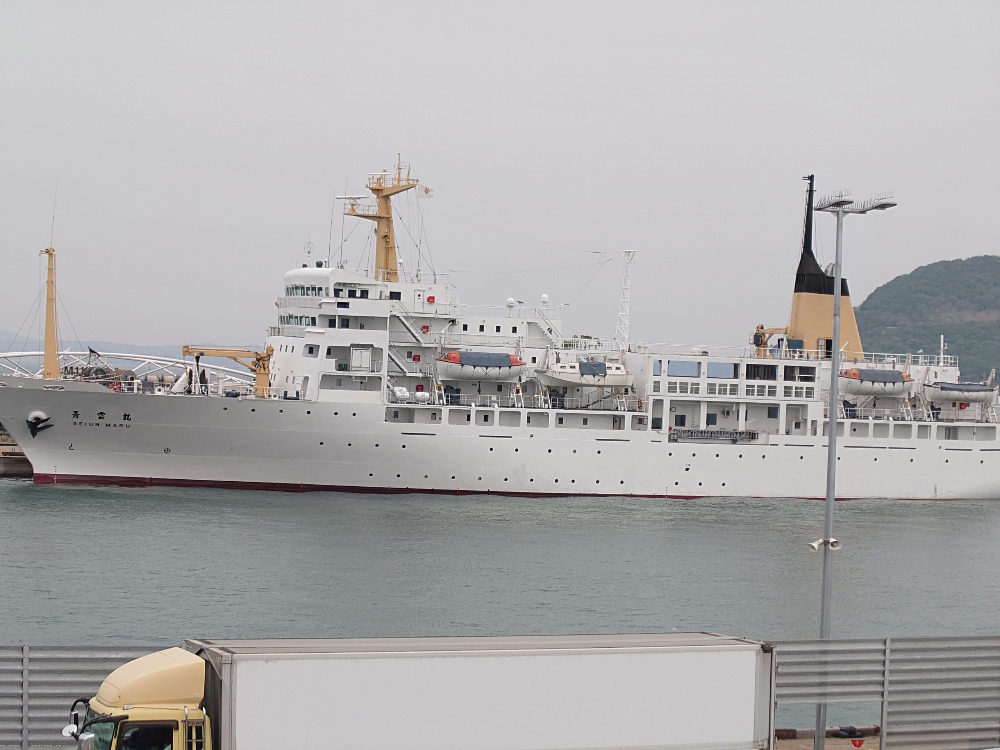
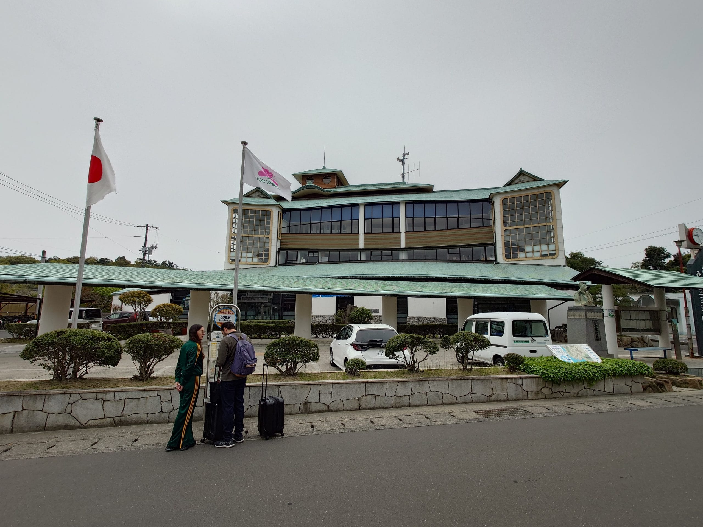
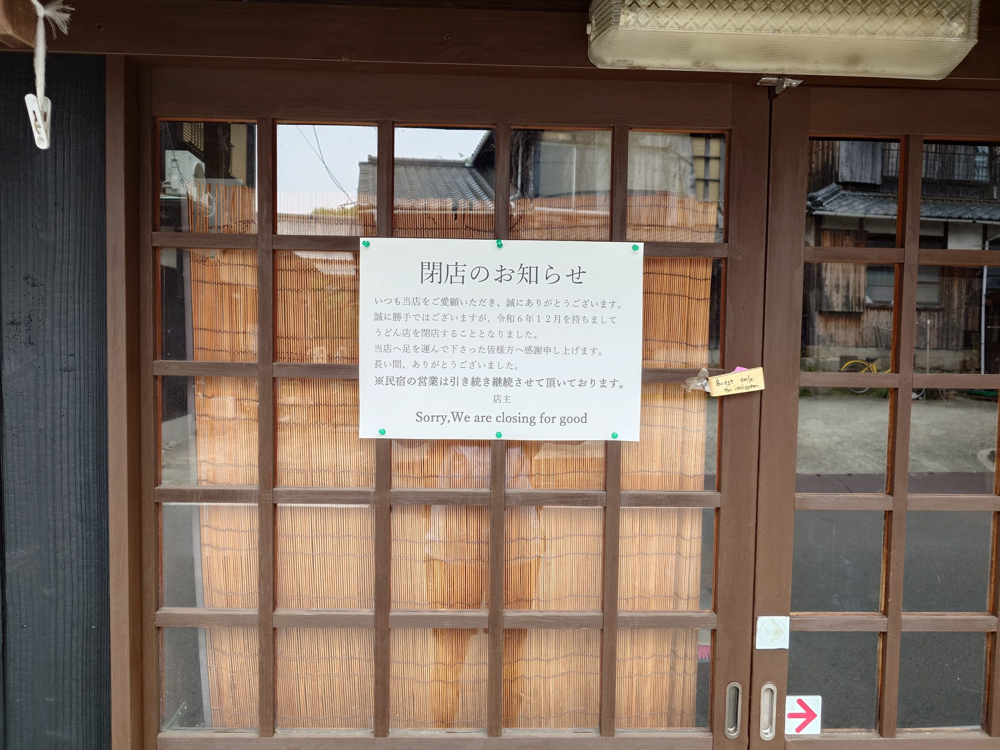
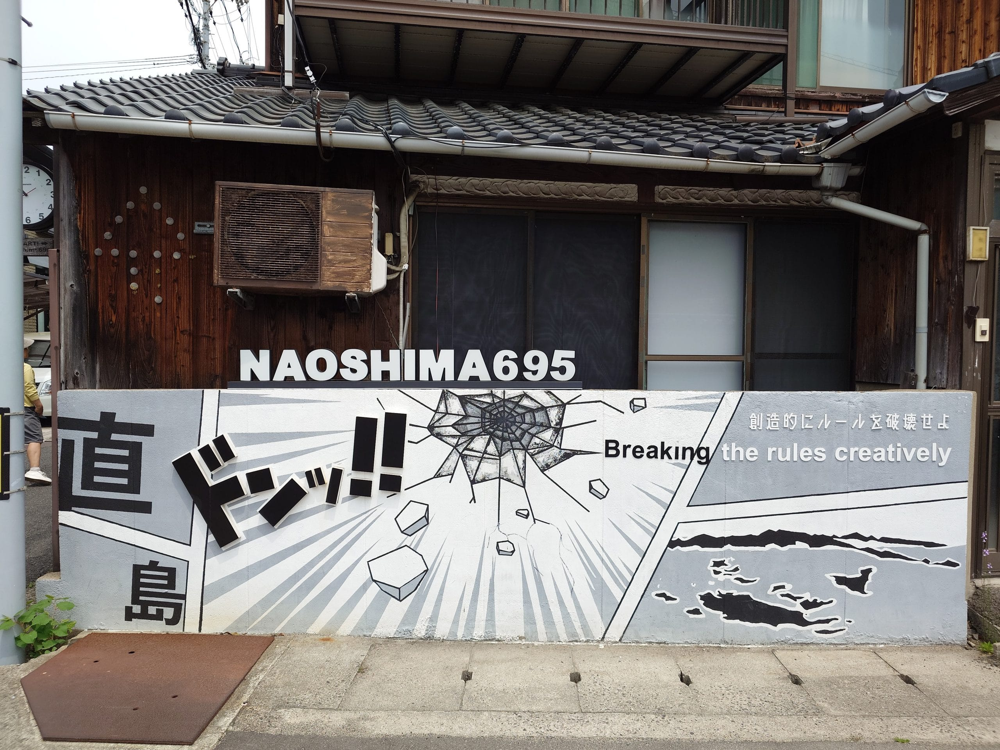
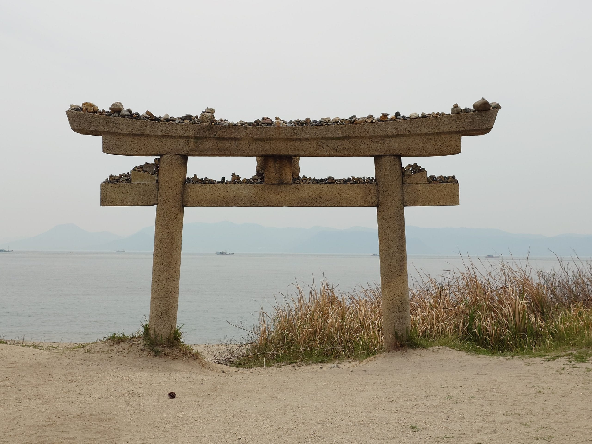
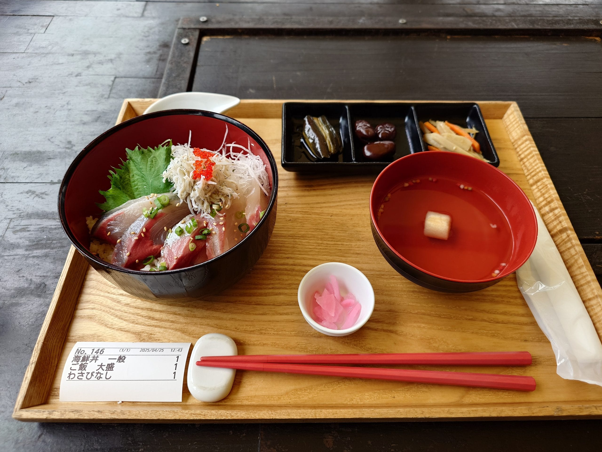
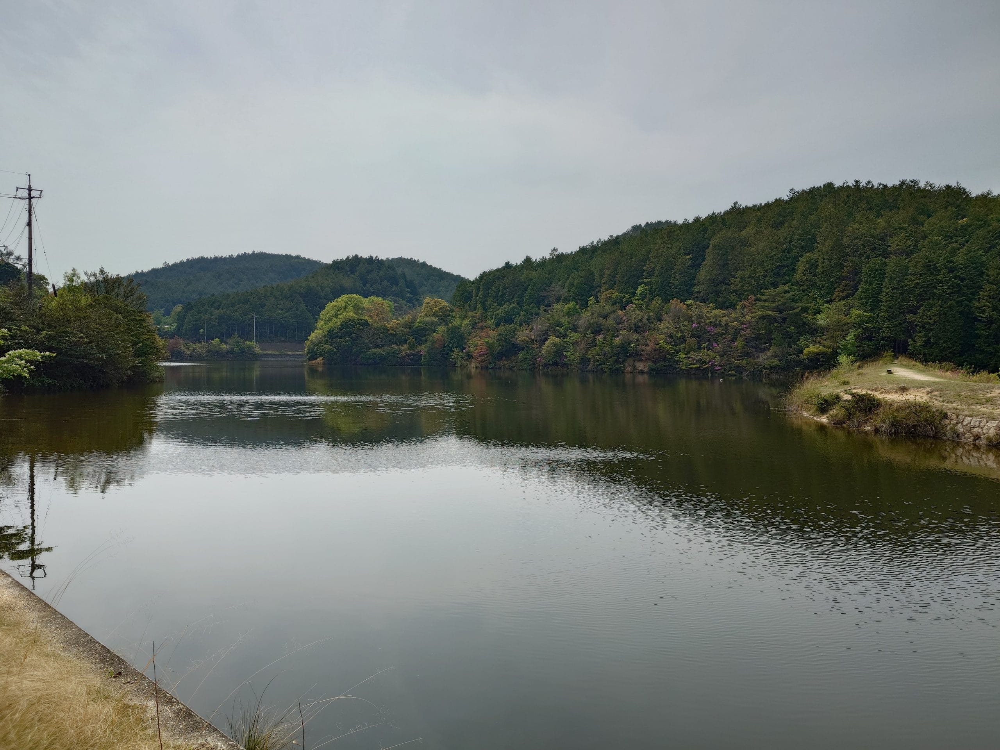
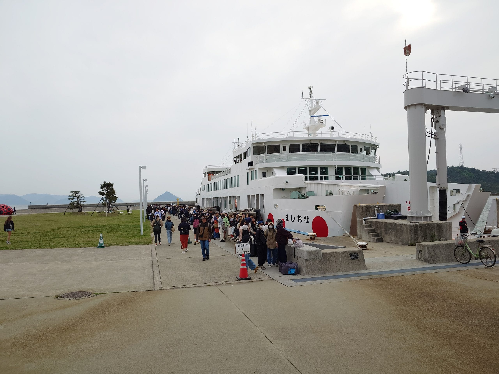
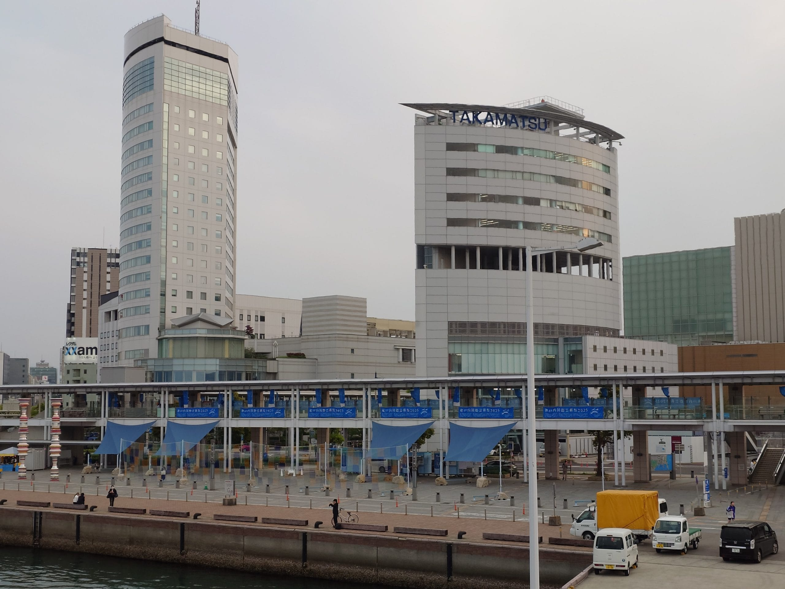
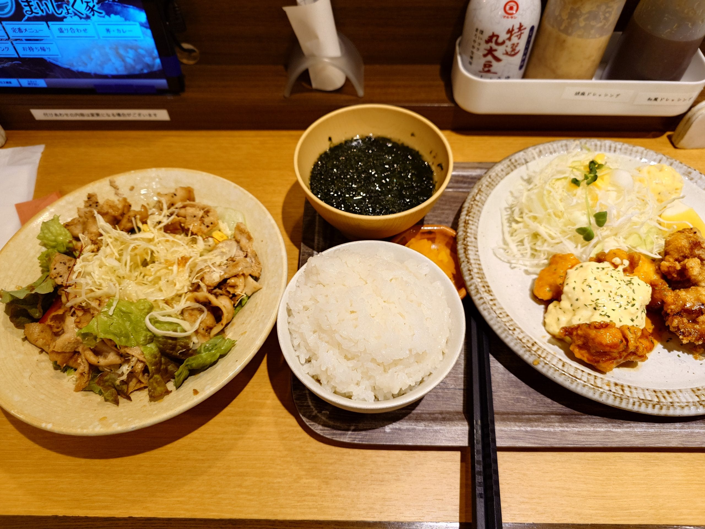

import Compare from '../../components/Compare.astro';
import compare10After from '../../assets/images/travel-setonaikai-2025-day6/pi_20250425_122900.jpg';
import compare10Before from '../../assets/images/travel-setonaikai-2025-day6/si_20250418_220750_27.jpg';
import compare11After from '../../assets/images/travel-setonaikai-2025-day6/pi_20250425_123758.jpg';
import compare11Before from '../../assets/images/travel-setonaikai-2025-day6/si_20250418_220750_5.jpg';
import compare12After from '../../assets/images/travel-setonaikai-2025-day6/pi_20250425_124114.jpg';
import compare12Before from '../../assets/images/travel-setonaikai-2025-day6/si_20250418_220750_6.jpg';
import compare1After from '../../assets/images/travel-setonaikai-2025-day6/pi_20250425_091836.jpg';
import compare1Before from '../../assets/images/travel-setonaikai-2025-day6/Snipaste_2025-05-14_10-30-25.png';
import compare2After from '../../assets/images/travel-setonaikai-2025-day6/pi_20250425_093153.jpg';
import compare2Before from '../../assets/images/travel-setonaikai-2025-day6/si_20250418_220750_13.jpg';
import compare3After from '../../assets/images/travel-setonaikai-2025-day6/pi_20250425_093041.jpg';
import compare3Before from '../../assets/images/travel-setonaikai-2025-day6/si_20250418_220750_14.jpg';
import compare4After from '../../assets/images/travel-setonaikai-2025-day6/pi_20250425_095623.jpg';
import compare4Before from '../../assets/images/travel-setonaikai-2025-day6/tameike-1.jpg';
import compare5After from '../../assets/images/travel-setonaikai-2025-day6/pi_20250425_110123.jpg';
import compare5Before from '../../assets/images/travel-setonaikai-2025-day6/Snipaste_2025-05-14_10-29-14.png';
import compare6After from '../../assets/images/travel-setonaikai-2025-day6/pi_20250425_110737.jpg';
import compare6Before from '../../assets/images/travel-setonaikai-2025-day6/si_20250418_220750_38.jpg';
import compare7After from '../../assets/images/travel-setonaikai-2025-day6/pi_20250425_115133-1.jpg';
import compare7Before from '../../assets/images/travel-setonaikai-2025-day6/si_20250418_220750_8.jpg';
import compare8After from '../../assets/images/travel-setonaikai-2025-day6/pi_20250425_120132.jpg';
import compare8Before from '../../assets/images/travel-setonaikai-2025-day6/simahazure-6-1.jpg';
import compare9After from '../../assets/images/travel-setonaikai-2025-day6/pi_20250425_120412.jpg';
import compare9Before from '../../assets/images/travel-setonaikai-2025-day6/si_20250418_220750_10.jpg';

旅遊第六天，早上，我在高松港搭船前往直島，在直島上，藉由單車和走路進行旅行。傍晚，搭船返回高松港。

早上，在旅館用餐完後，前往高松港，搭乘渡輪前往直島，不知道是直島本來就很熱門，還是黃金週連假開始發威，排隊等待上船隊伍的人數很多。

<figure>



<figcaption>停靠在高松港岸邊的青雲丸</figcaption>
</figure>

渡輪抵達直島家浦港，我下船後，馬上前往[ふうちゃんレンタサイクル](https://maps.app.goo.gl/zhMdkw8LXLdgr86s9)租借單車，開始今天的直島旅行。

首先往[本村](https://maps.app.goo.gl/ss8oi3qmdiC1jjuZ6)的方向騎，到達後，將單車停妥，開始在這一帶探索。

<figure>



<figcaption>直島町役場</figcaption>
</figure>

<figure>



<figcaption>石井商店，已於 2024 年 12 月停業，旁邊的民宿繼續營業。為 Summer Pockets 中登場的食堂的參考原型</figcaption>
</figure>

<Compare before={compare1Before} after={compare1After}>Summer Pockets 中，主角從食堂回家的途中</Compare>

<Compare before={compare2Before} after={compare2After}>Summer Pockets 中的街道，拍攝地點為石井商店附近</Compare>

<Compare before={compare3Before} after={compare3After}>Summer Pockets 中加藤家前的街道，拍攝地點為石井商店附近</Compare>

在石井商店附近拍照時，注意到一組人往石井商店旁的民宿探頭進去並拍照，我想他們也是來聖地巡禮（笑。

由於距離預約的作品入場時間還有好一陣子，又這一帶的作品還沒開放參觀，於是我先騎去[直島ダム](https://maps.app.goo.gl/6Cx3UqHpFhToYimh9)拍照，然後再從另一條路回到本村一帶，把單車停放在[家プロジェクト「南寺」](https://setouchi-artfest.jp/artworks/detail/6b70e0ac-b7ed-4984-9bf1-c8078829c662)的[停車場](https://maps.app.goo.gl/xXfWJpLZVGYsqCru9)。

```html title="wp-unconverted: envira/envira-gallery"
<!-- wp:envira/envira-gallery {"galleryId":1168,"title":"直島ダム","columns":"0","row_height":140,"margins":"custom","custom_margins":8,"lightbox_enabled":1,"lazyload_enabled":1,"lightbox_theme":"base","images":[{"status":"active","src":"https://aniya.moe/wp-content/uploads/2025/05/20250425_095700876-scaled.jpg","title":"直島ダム","link":"https://aniya.moe/wp-content/uploads/2025/05/20250425_095700876-scaled.jpg","alt":"","caption":"","thumb":"","id":1169,"height":145.6140350877193,"width":193.7},{"status":"active","src":"https://aniya.moe/wp-content/uploads/2025/05/20250425_095711808-scaled.jpg","title":"直島ダム","link":"https://aniya.moe/wp-content/uploads/2025/05/20250425_095711808-scaled.jpg","alt":"","caption":"","thumb":"","id":1170,"height":145.6140350877193,"width":193.7},{"status":"active","src":"https://aniya.moe/wp-content/uploads/2025/05/20250425_095728969-scaled.jpg","title":"直島ダム","link":"https://aniya.moe/wp-content/uploads/2025/05/20250425_095728969-scaled.jpg","alt":"","caption":"","thumb":"","id":1171,"height":145.6140350877193,"width":193.7}]} -->
<div class="wp-block-envira-envira-gallery">[envira-gallery id='1168']</div>
<!-- /wp:envira/envira-gallery -->
```

<Compare before={compare4Before} after={compare4After}>Summer Pockets 中，女主角—鳴瀬しろは—練習招式的地方</Compare>

我在附近又逛了一些地點，首先是即將開幕的[直島新美術館](https://setouchi-artfest.jp/artworks/detail/aff68685-272c-4fd3-83a6-630230964b1b)，由於還在施工中無法進入，我只能在外圍拍照；接著，經過[八幡神社鳥居](https://maps.app.goo.gl/xr81RWYdSpjoFHfL8)往上走，到達[八幡神社](https://maps.app.goo.gl/3re5bXi7b9XDTnV86)；最後，從另一條路走下去，經過 [ANDO MUSEUM](https://maps.app.goo.gl/54TLHM24aNv2Tymq5) 回到南寺。

```html title="wp-unconverted: envira/envira-gallery"
<!-- wp:envira/envira-gallery {"galleryId":1179,"title":"直島新美術館","columns":"0","margins":"custom","custom_margins":8,"lightbox_enabled":1,"lazyload_enabled":1,"lightbox_theme":"base","images":[{"status":"active","src":"https://aniya.moe/wp-content/uploads/2025/05/20250425_101012410-scaled.jpg","title":"從停車場前往的路口","link":"https://aniya.moe/wp-content/uploads/2025/05/20250425_101012410-scaled.jpg","alt":"","caption":"","thumb":"","id":1180,"height":106.20300751879698,"width":141.3},{"status":"active","src":"https://aniya.moe/wp-content/uploads/2025/05/20250425_101309763-scaled.jpg","title":"另一側入口","link":"https://aniya.moe/wp-content/uploads/2025/05/20250425_101309763-scaled.jpg","alt":"","caption":"","thumb":"","id":1181,"height":106.20300751879698,"width":141.3},{"status":"active","src":"https://aniya.moe/wp-content/uploads/2025/05/20250425_101400805-scaled.jpg","title":"圍牆後面是通往入口的道路","link":"https://aniya.moe/wp-content/uploads/2025/05/20250425_101400805-scaled.jpg","alt":"","caption":"","thumb":"","id":1182,"height":106.20300751879698,"width":141.3},{"status":"active","src":"https://aniya.moe/wp-content/uploads/2025/05/20250425_101521386-scaled.jpg","title":"後面是正在施工中的直島新美術館","link":"https://aniya.moe/wp-content/uploads/2025/05/20250425_101521386-scaled.jpg","alt":"","caption":"","thumb":"","id":1183,"height":106.20300751879698,"width":141.3}]} -->
<div class="wp-block-envira-envira-gallery">[envira-gallery id='1179']</div>
<!-- /wp:envira/envira-gallery -->
```

<Compare before={compare5Before} after={compare5After}>Summer Pockets 第一集，男主角所通過的鳥居，拍攝地點為八幡神社鳥居前</Compare>

<Compare before={compare6Before} after={compare6After}>Summer Pockets 第二集，男主角所參拜的神社，拍攝地點為八幡神社</Compare>

10:35，終於到了預約的時間，我與其他參觀者一樣，在南寺的入口處排隊，等候工作人員的引導。工作人員講解完注意事項後，將參觀者分成兩組，一組接著一組帶到南寺內兩側牆邊的座位上。南寺是一間完全不透光的大暗室，一開始，待在這個空間裡，伸手不見五指，四處張望時，所看到的景色依舊沒有改變，感覺眼睛完全失明了。後來，當前方開始有微弱的光時，剛開始以為是錯覺，但隨著光的亮度漸漸提昇，似乎看到模糊的海浪，此時，工作人員告知大家可以站起來，朝光源的方向移動，我小心翼翼往前移動，當十分接近光時，發現一面矮牆把發光區域與暗室完全隔開，形成兩個明顯的對比的空間，我嘗試搞懂發光機制，但沒有成功。結束前，我用雙腳掌一前一後的方式交替往後走，嘗試測量出暗室的深度，最後得出約 9 米的結果。走出南寺時，令我感到意外的是沒有發生光適應的情況。

```html title="wp-unconverted: envira/envira-gallery"
<!-- wp:envira/envira-gallery {"galleryId":1190,"title":"家プロジェクト 南寺","columns":"0","row_height":140,"margins":"custom","custom_margins":8,"lightbox_enabled":1,"lazyload_enabled":1,"lightbox_theme":"base","images":[{"status":"active","src":"https://aniya.moe/wp-content/uploads/2025/05/20250425_101802065-scaled.jpg","title":"南寺","link":"https://aniya.moe/wp-content/uploads/2025/05/20250425_101802065-scaled.jpg","alt":"","caption":"","thumb":"","id":1191,"height":145.6140350877193,"width":193.7},{"status":"active","src":"https://aniya.moe/wp-content/uploads/2025/05/20250425_101829677-scaled.jpg","title":"南寺","link":"https://aniya.moe/wp-content/uploads/2025/05/20250425_101829677-scaled.jpg","alt":"","caption":"","thumb":"","id":1192,"height":145.6140350877193,"width":193.7},{"status":"active","src":"https://aniya.moe/wp-content/uploads/2025/05/20250425_102040037-scaled.jpg","title":"南寺外的停車場","link":"https://aniya.moe/wp-content/uploads/2025/05/20250425_102040037-scaled.jpg","alt":"","caption":"","thumb":"","id":1193,"height":145.6140350877193,"width":193.7}]} -->
<div class="wp-block-envira-envira-gallery">[envira-gallery id='1190']</div>
<!-- /wp:envira/envira-gallery -->
```

接著，我前往作品「[Ring of Fire -ヤンの太陽 & ウィーラセタクンの月 Solar（昼）](https://setouchi-artfest.jp/artworks/detail/2562c77d-c392-414e-a532-0f245c9a1dd1)」。該作品會藉由地震的訊號來產生動作，因此，要能夠觀賞到它在動作是需要運氣與耐性。我與其他參觀者一樣，坐在周圍的座墊上，默默得等待它發生動作，等了好一會，終於因為一級地震，產生短暫且微小的動作。

結束後，我回到南寺前，騎上單車前往[弁財天附近的海邊](https://www.google.com/maps/search/34.454789,+133.999283?entry=tts&g_ep=EgoyMDI1MDUwNy4wIPu8ASoASAFQAw%3D%3D&skid=efa50f34-2c44-4384-9a2e-5d07bced668a)。

<figure>



<figcaption>南寺附近的直島ルカコ/naoshima695</figcaption>
</figure>

到海邊後，我把單車停在路旁。由於事先已確認潮汐的時間，現在是退潮時間，沙灘上看起來有足夠的空間，可以讓人走到[弁財天](https://maps.app.goo.gl/sAszTHEL5ffJ6LJDA)的位置。我走到沙灘上，往弁財天的方向前進，途中小心翻過帶有青苔的岩石，避免發生意外，前進的過程中，也不時往停車的位置察看，確認有沒有疑似同好的人出現，只可惜到回到岸上後，都沒有出現。

```html title="wp-unconverted: envira/envira-gallery"
<!-- wp:envira/envira-gallery {"galleryId":1198,"title":"弁財天","columns":"0","margins":"custom","custom_margins":8,"lightbox_enabled":1,"lazyload_enabled":1,"lightbox_theme":"base","images":[{"status":"active","src":"https://aniya.moe/wp-content/uploads/2025/05/20250425_115241286-scaled.jpg","title":"前往弁財天的沙灘，需要翻過前面的岩石","link":"https://aniya.moe/wp-content/uploads/2025/05/20250425_115241286-scaled.jpg","alt":"","caption":"","thumb":"","id":1199,"height":59.22107674684994,"width":78.8},{"status":"active","src":"https://aniya.moe/wp-content/uploads/2025/05/20250425_115712899-scaled.jpg","title":"翻過岩石後，繼續前進，通過聯絡橋，即可到達","link":"https://aniya.moe/wp-content/uploads/2025/05/20250425_115712899-scaled.jpg","alt":"","caption":"","thumb":"","id":1200,"height":59.22107674684994,"width":78.8},{"status":"active","src":"https://aniya.moe/wp-content/uploads/2025/05/20250425_120213344-scaled.jpg","title":"從弁財天的位置往沙灘的方向拍","link":"https://aniya.moe/wp-content/uploads/2025/05/20250425_120213344-scaled.jpg","alt":"","caption":"","thumb":"","id":1201,"height":59.22107674684994,"width":78.8},{"status":"active","src":"https://aniya.moe/wp-content/uploads/2025/05/20250425_120228119-scaled.jpg","title":"弁財天旁的小屋","link":"https://aniya.moe/wp-content/uploads/2025/05/20250425_120228119-scaled.jpg","alt":"","caption":"","thumb":"","id":1202,"height":59.22107674684994,"width":78.8},{"status":"active","src":"https://aniya.moe/wp-content/uploads/2025/05/20250425_120237774-scaled.jpg","title":"弁財天旁的小屋","link":"https://aniya.moe/wp-content/uploads/2025/05/20250425_120237774-scaled.jpg","alt":"","caption":"","thumb":"","id":1203,"height":59.22107674684994,"width":78.8},{"status":"active","src":"https://aniya.moe/wp-content/uploads/2025/05/20250425_120253682-scaled.jpg","title":"弁財天旁的小屋","link":"https://aniya.moe/wp-content/uploads/2025/05/20250425_120253682-scaled.jpg","alt":"","caption":"","thumb":"","id":1204,"height":59.22107674684994,"width":44.4},{"status":"active","src":"https://aniya.moe/wp-content/uploads/2025/05/20250425_121013712-scaled.jpg","title":"在沙灘上拍攝海灣","link":"https://aniya.moe/wp-content/uploads/2025/05/20250425_121013712-scaled.jpg","alt":"","caption":"","thumb":"","id":1205,"height":59.22107674684994,"width":78.8}]} -->
<div class="wp-block-envira-envira-gallery">[envira-gallery id='1198']</div>
<!-- /wp:envira/envira-gallery -->
```

<Compare before={compare7Before} after={compare7After}>Summer Pockets 中，うみちゃん的主視覺，拍攝地點為弁財天附近的海邊</Compare>

<Compare before={compare8Before} after={compare8After}>Summer Pockets 中的海邊，拍攝地點為前往弁財天的聯絡橋上</Compare>

<Compare before={compare9Before} after={compare9After}>Summer Pockets 中，女主角—鳴瀬しろは—在海邊釣魚的畫面，拍攝地點為弁財天周遭的岩石堆</Compare>

回到岸上後，騎著單車往[つつじ荘](https://maps.app.goo.gl/Fo29MFEEzQNzxP2g9)前進，途中經過[積浦漁港](https://maps.app.goo.gl/88U3hHCtcsC5s4te7)，到達[琴弾地海水浴場](https://maps.app.goo.gl/EkFk5HMwHwfW8Q1L7)，將單車停在旁邊的停車場，穿過つつじ荘的入口，到[直島食堂](https://maps.app.goo.gl/GjdNMYnA27WTyVZ56)點了海鮮丼當作午餐。

<Compare before={compare10Before} after={compare10After}>Summer Pockets 動畫中，男主角—鷹原羽依里—前往留宿地點，路途中一景，拍攝地點為積浦漁港</Compare>

<figure>



<figcaption>琴弾地海水浴場前的恵美須神社鳥居</figcaption>
</figure>

<Compare before={compare11Before} after={compare11After}>Summer Pockets 中，水織静久與後面的鳥居</Compare>

<Compare before={compare12Before} after={compare12After}>Summer Pockets 裡的海邊小屋，實際為つつじ荘裡的直島食堂</Compare>

<figure>



<figcaption>直島食堂的海鮮丼</figcaption>
</figure>

午餐享用完畢後，我前往倍樂生區域散步，從東門進入，先遇到知名的[黃南瓜](https://maps.app.goo.gl/BFS11Eo3garxgzF67)[^1]，加入黃南瓜前的拍照隊伍。接著，進到紀念商店購買週邊。離開店家後，往西走，經過[ウッドデッキ](https://maps.app.goo.gl/sJLD7uyhg1kjn3zV9)到達道路，沿著路往回走，經過[ベネッセハウス パーク](https://maps.app.goo.gl/xw4SWecuo8XAUe3a7)前，最後回到東門。

```html title="wp-unconverted: envira/envira-gallery"
<!-- wp:envira/envira-gallery {"galleryId":1265,"title":"倍樂生區域東半部","columns":"0","margins":"custom","custom_margins":8,"lightbox_enabled":1,"lazyload_enabled":1,"lightbox_theme":"base","images":[{"status":"active","src":"https://aniya.moe/wp-content/uploads/2025/05/20250425_130720487-scaled.jpg","title":"琴弾地海水浴場，小牆另一側似乎是私有地","link":"https://aniya.moe/wp-content/uploads/2025/05/20250425_130720487-scaled.jpg","alt":"","caption":"","thumb":"","id":1266,"height":82.5563909774436,"width":109.8},{"status":"active","src":"https://aniya.moe/wp-content/uploads/2025/05/20250425_132143294-scaled.jpg","title":"海邊的黃南瓜","link":"https://aniya.moe/wp-content/uploads/2025/05/20250425_132143294-scaled.jpg","alt":"","caption":"","thumb":"","id":1267,"height":82.5563909774436,"width":109.8},{"status":"active","src":"https://aniya.moe/wp-content/uploads/2025/05/20250425_132235315-scaled.jpg","title":"黃南瓜前等待拍照的隊伍","link":"https://aniya.moe/wp-content/uploads/2025/05/20250425_132235315-scaled.jpg","alt":"","caption":"","thumb":"","id":1268,"height":82.5563909774436,"width":109.8},{"status":"active","src":"https://aniya.moe/wp-content/uploads/2025/05/20250425_132432493-scaled.jpg","title":"倍樂生區域","link":"https://aniya.moe/wp-content/uploads/2025/05/20250425_132432493-scaled.jpg","alt":"","caption":"","thumb":"","id":1269,"height":82.5563909774436,"width":109.8},{"status":"active","src":"https://aniya.moe/wp-content/uploads/2025/05/20250425_132525956-scaled.jpg","title":"紀念品商店前的裝飾「腰掛」","link":"https://aniya.moe/wp-content/uploads/2025/05/20250425_132525956-scaled.jpg","alt":"","caption":"","thumb":"","id":1270,"height":82.5563909774436,"width":109.8},{"status":"active","src":"https://aniya.moe/wp-content/uploads/2025/05/20250425_133431298-scaled.jpg","title":"ウッドデッキ","link":"https://aniya.moe/wp-content/uploads/2025/05/20250425_133431298-scaled.jpg","alt":"","caption":"","thumb":"","id":1271,"height":82.5563909774436,"width":109.8},{"status":"active","src":"https://aniya.moe/wp-content/uploads/2025/05/20250425_133933218-scaled.jpg","title":"ベネッセハウス パーク前，預約制作品「杉本博司ギャラリー 時の回廊」就在裡面","link":"https://aniya.moe/wp-content/uploads/2025/05/20250425_133933218-scaled.jpg","alt":"","caption":"","thumb":"","id":1272,"height":82.5563909774436,"width":109.8},{"status":"active","src":"https://aniya.moe/wp-content/uploads/2025/05/20250425_134309815-scaled.jpg","title":"ベネッセハウス パーク","link":"https://aniya.moe/wp-content/uploads/2025/05/20250425_134309815-scaled.jpg","alt":"","caption":"","thumb":"","id":1273,"height":82.5563909774436,"width":109.8},{"status":"active","src":"https://aniya.moe/wp-content/uploads/2025/05/20250425_134318074-scaled.jpg","title":"ベネッセハウスショップ","link":"https://aniya.moe/wp-content/uploads/2025/05/20250425_134318074-scaled.jpg","alt":"","caption":"","thumb":"","id":1274,"height":82.5563909774436,"width":109.8},{"status":"active","src":"https://aniya.moe/wp-content/uploads/2025/05/20250425_134322882-scaled.jpg","title":"ベネッセハウス パーク與ベネッセハウスショップ","link":"https://aniya.moe/wp-content/uploads/2025/05/20250425_134322882-scaled.jpg","alt":"","caption":"","thumb":"","id":1275,"height":82.5563909774436,"width":109.8}]} -->
<div class="wp-block-envira-envira-gallery">[envira-gallery id='1265']</div>
<!-- /wp:envira/envira-gallery -->
```

接著要前往[ヴァレーギャラリー](https://setouchi-artfest.jp/artworks/detail/308f396a-1cf2-4f59-a133-50495bf2d572)，由於從つつじ荘走縣道 256 號到[李禹煥美術館](https://setouchi-artfest.jp/artworks/detail/3e0e0711-1ccf-4d7b-8be3-e5717d98bc0a)前的路段坡度過大，又倍樂生區域的道路是禁止外部車輛通行的，因此我騎著單車繞道至本村，經過[直島ダム公園](https://maps.app.goo.gl/ciQZnAgigbyjXCW46)，抵達李禹煥美術館前的入口，將單車停在附近的停車場，再度走進倍樂生區域。

<figure>



<figcaption>直島ダム</figcaption>
</figure>

ヴァレーギャラリー裡展示著兩位作者的作品，分別是[草間彌生](https://setouchi-artfest.jp/artists/detail/ceead043-ce9a-4ece-89d6-89f2673d080e)的「ナルシスの庭」和[小沢剛](https://setouchi-artfest.jp/artists/detail/3d70b141-ea81-495d-bd73-16305e48ec59)的「スラグブッダ88」。「スラグブッダ88」該作品以直島在江戶時代設立的「直島八十八箇所」的佛像為參考，使用豊島產廢事件[^2]中的廢棄爐渣來製作，以瀨戶內的歷史，提醒人們重視自然環境。

```html title="wp-unconverted: envira/envira-gallery"
<!-- wp:envira/envira-gallery {"galleryId":1281,"title":"ヴァレーギャラリー","columns":"0","margins":"custom","custom_margins":8,"lightbox_enabled":1,"lazyload_enabled":1,"lightbox_theme":"base","images":[{"status":"active","src":"https://aniya.moe/wp-content/uploads/2025/05/20250425_140823353-scaled.jpg","title":"作品「ナルシスの庭」","link":"https://aniya.moe/wp-content/uploads/2025/05/20250425_140823353-scaled.jpg","alt":"","caption":"","thumb":"","id":1282,"height":119.19831223628691,"width":158.5},{"status":"active","src":"https://aniya.moe/wp-content/uploads/2025/05/20250425_140903859-scaled.jpg","title":"作品「ナルシスの庭」","link":"https://aniya.moe/wp-content/uploads/2025/05/20250425_140903859-scaled.jpg","alt":"","caption":"","thumb":"","id":1283,"height":119.19831223628691,"width":158.5},{"status":"active","src":"https://aniya.moe/wp-content/uploads/2025/05/20250425_141004303-scaled.jpg","title":"作品「スラグブッダ88」的看板","link":"https://aniya.moe/wp-content/uploads/2025/05/20250425_141004303-scaled.jpg","alt":"","caption":"","thumb":"","id":1284,"height":119.19831223628691,"width":89.4},{"status":"active","src":"https://aniya.moe/wp-content/uploads/2025/05/20250425_141024384-scaled.jpg","title":"作品「スラグブッダ88」","link":"https://aniya.moe/wp-content/uploads/2025/05/20250425_141024384-scaled.jpg","alt":"","caption":"","thumb":"","id":1285,"height":119.19831223628691,"width":158.5},{"status":"active","src":"https://aniya.moe/wp-content/uploads/2025/05/20250425_141110270-scaled.jpg","title":"作品「ナルシスの庭」","link":"https://aniya.moe/wp-content/uploads/2025/05/20250425_141110270-scaled.jpg","alt":"","caption":"","thumb":"","id":1286,"height":106.20300751879698,"width":141.3},{"status":"active","src":"https://aniya.moe/wp-content/uploads/2025/05/20250425_141229674-scaled.jpg","title":"作品「ナルシスの庭」","link":"https://aniya.moe/wp-content/uploads/2025/05/20250425_141229674-scaled.jpg","alt":"","caption":"","thumb":"","id":1287,"height":106.20300751879698,"width":141.3},{"status":"active","src":"https://aniya.moe/wp-content/uploads/2025/05/20250425_141518503-scaled.jpg","title":"作品「ナルシスの庭」","link":"https://aniya.moe/wp-content/uploads/2025/05/20250425_141518503-scaled.jpg","alt":"","caption":"","thumb":"","id":1288,"height":106.20300751879698,"width":141.3},{"status":"active","src":"https://aniya.moe/wp-content/uploads/2025/05/20250425_141822174-scaled.jpg","title":"ヴァレーギャラリー","link":"https://aniya.moe/wp-content/uploads/2025/05/20250425_141822174-scaled.jpg","alt":"","caption":"","thumb":"","id":1289,"height":106.20300751879698,"width":141.3}]} -->
<div class="wp-block-envira-envira-gallery">[envira-gallery id='1281']</div>
<!-- /wp:envira/envira-gallery -->
```

接續去了[ベネッセハウス ミュージアム](https://setouchi-artfest.jp/artworks/detail/5022255b-1652-4241-a5eb-8fc1370ba467)，裡面的展覽內容似乎和上次相同，於是很快就走完一圈，結束後，回到停車場，騎上單車，往宮浦港的方向前進。

```html title="wp-unconverted: envira/envira-gallery"
<!-- wp:envira/envira-gallery {"galleryId":1292,"title":"從倍樂生區域往宮浦港的途中","columns":"0","margins":"custom","custom_margins":8,"lightbox_enabled":1,"lazyload_enabled":1,"lightbox_theme":"base","images":[{"status":"active","src":"https://aniya.moe/wp-content/uploads/2025/05/20250425_144708943-scaled.jpg","title":"從倍樂生區域往宮浦港的路上，往瀨戶大橋方向拍攝","link":"https://aniya.moe/wp-content/uploads/2025/05/20250425_144708943-scaled.jpg","alt":"","caption":"","thumb":"","id":1293,"height":106.20300751879698,"width":141.3},{"status":"active","src":"https://aniya.moe/wp-content/uploads/2025/05/20250425_145123149-scaled.jpg","title":"從倍樂生區域往宮浦港的路上，往瀨戶大橋方向拍攝","link":"https://aniya.moe/wp-content/uploads/2025/05/20250425_145123149-scaled.jpg","alt":"","caption":"","thumb":"","id":1294,"height":106.20300751879698,"width":141.3},{"status":"active","src":"https://aniya.moe/wp-content/uploads/2025/05/20250425_150758612-scaled.jpg","title":"從倍樂生區域往宮浦港的路上，往瀨戶大橋方向拍攝","link":"https://aniya.moe/wp-content/uploads/2025/05/20250425_150758612-scaled.jpg","alt":"","caption":"","thumb":"","id":1295,"height":106.20300751879698,"width":141.3},{"status":"active","src":"https://aniya.moe/wp-content/uploads/2025/05/20250425_150818029-scaled.jpg","title":"從倍樂生區域往宮浦港的路上，往瀨戶大橋方向拍攝","link":"https://aniya.moe/wp-content/uploads/2025/05/20250425_150818029-scaled.jpg","alt":"","caption":"","thumb":"","id":1296,"height":106.20300751879698,"width":141.3}]} -->
<div class="wp-block-envira-envira-gallery">[envira-gallery id='1292']</div>
<!-- /wp:envira/envira-gallery -->
```

經過宮浦港，繼續往前騎，來到今天在直島最後的景點—[瀬戸内「　　　」資料館／宮浦ギャラリー六区](https://setouchi-artfest.jp/artworks/detail/d1aabd02-44f7-4f2f-93fa-58668f168213)，這是由展示室搭配工作室的複合空間，展示室的主題以瀨戶內海地區的風土民情為內容，這次展出的主題是「漂流家族」，展出使用漂流物製作的照相機，以及使用該相機所拍攝的照片。

離開直島前，我前往島上唯一的超市—[コープ 三菱マテリアル直島生協](https://maps.app.goo.gl/JfR77rMPUxEzY3xM9)，在那購買了西瓜冰棒，並在外面的長椅上享用。

```html title="wp-unconverted: envira/envira-gallery"
<!-- wp:envira/envira-gallery {"galleryId":1302,"title":"コープ 三菱マテリアル直島生協","columns":"0","row_height":200,"margins":"custom","custom_margins":8,"lightbox_enabled":1,"lazyload_enabled":1,"lightbox_theme":"base","images":[{"status":"active","src":"https://aniya.moe/wp-content/uploads/2025/05/20250425_160625475-scaled.jpg","title":"西瓜冰棒","link":"https://aniya.moe/wp-content/uploads/2025/05/20250425_160625475-scaled.jpg","alt":"","caption":"","thumb":"","id":1303,"height":398,"width":298.5},{"status":"active","src":"https://aniya.moe/wp-content/uploads/2025/05/20250425_161237540-scaled.jpg","title":"今天租借的電動輔助單車，上面有ひげ猫団的圖案","link":"https://aniya.moe/wp-content/uploads/2025/05/20250425_161237540-scaled.jpg","alt":"","caption":"","thumb":"","id":1304,"height":398,"width":298.5}]} -->
<div class="wp-block-envira-envira-gallery">[envira-gallery id='1302']</div>
<!-- /wp:envira/envira-gallery -->
```

最後，回到宮浦港，歸還單車，購買返回高松港的船票，加入排隊等著上船的隊伍中，排隊人數十分多，多到從宇野港調派一艘渡輪來應付剩下的遊客。我搭上第一艘渡輪，渡輪航行時，我看著遠處有加派的第二艘渡輪跟隨著。

<figure>



<figcaption>在宮浦港，等待搭乘渡輪的隊伍</figcaption>
</figure>

<figure>



<figcaption>從渡輪上拍攝，傍晚時的高松港</figcaption>
</figure>

---

回到高松後，我前往兵庫町商店街解決晚餐，原本是想要找[瀬戸の祭寿し 兵庫町店](https://maps.app.goo.gl/TVjNrp7BdryAaZiFA)，前幾天路過時，看裡面還有不少空位，但今天去時，裡面沒有空位，且有不少人在候位，於是放棄它。最後是去附近的[香川の食堂 まいしょく家 兵庫町店](https://maps.app.goo.gl/BtfMuRtfzkE5UgWa9)，點了使用豐島鹽的唐揚雞與使用仏升山吉的酢的南蠻雞的套餐。用餐結束後，返回旅館，結束今天的行程。

<figure>



<figcaption>使用豐島鹽的唐揚雞與使用仏升山吉的酢的南蠻雞的套餐</figcaption>
</figure>

---

[^1]: 黃南瓜曾[於 2021 年第 9 號颱風盧碧時遭遇重創](https://theartpressasia.com/news/typhoon-lupi-washed-yayoi-kusamas-iconic-yellow-pumpkin-artwork-into-the-sea/)，經修復後，再度展出
[^2]: [\#137 那些旅行社不愛排的地方系列||瀨戶內國際藝術祭(21)-曾為「垃圾之島」的豊島](https://vocus.cc/article/63af6d7bfd89780001c7cdf5)
