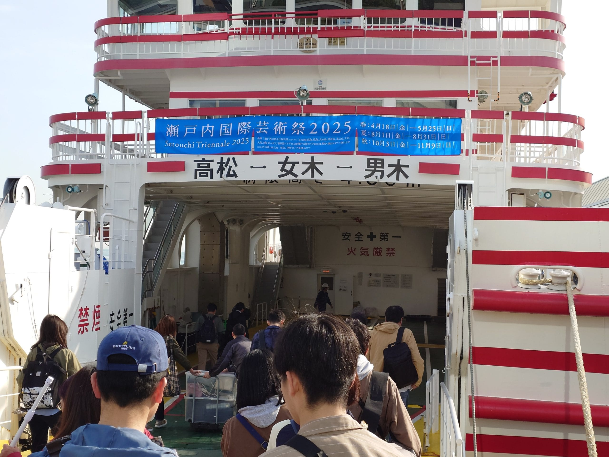
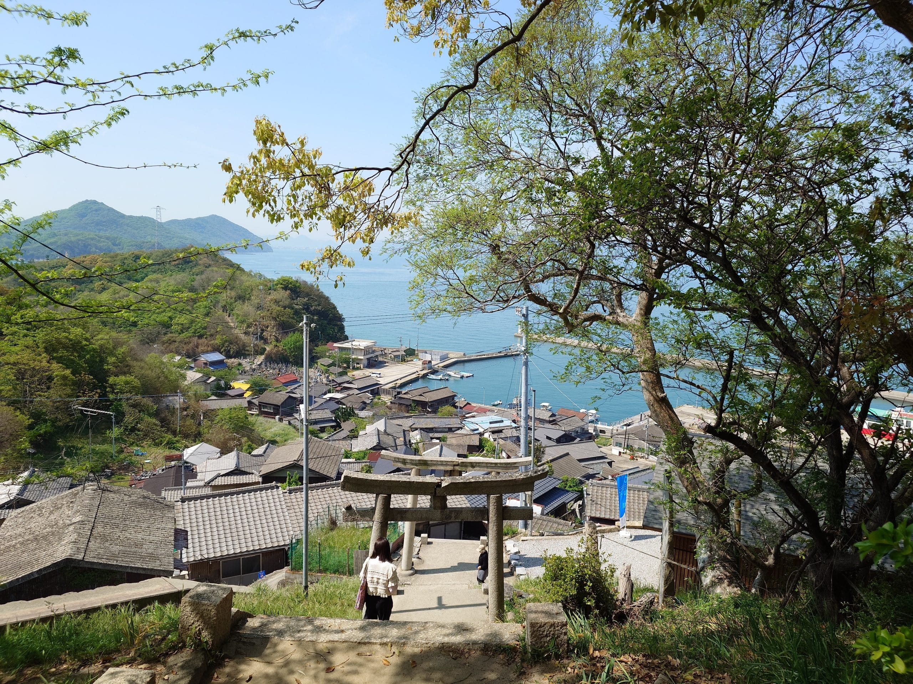
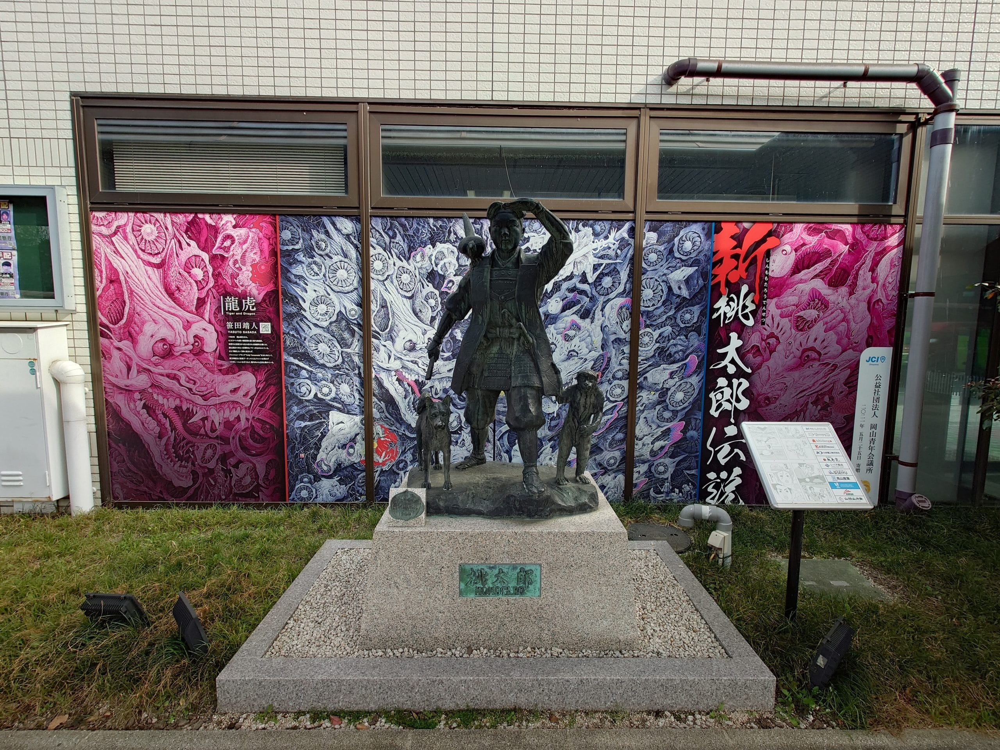
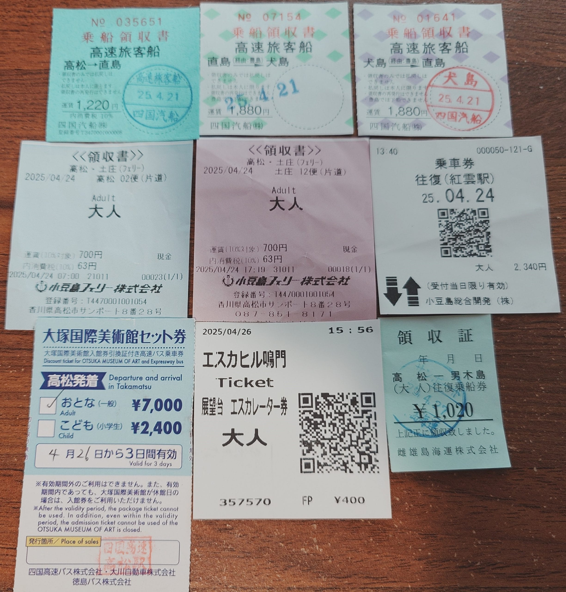
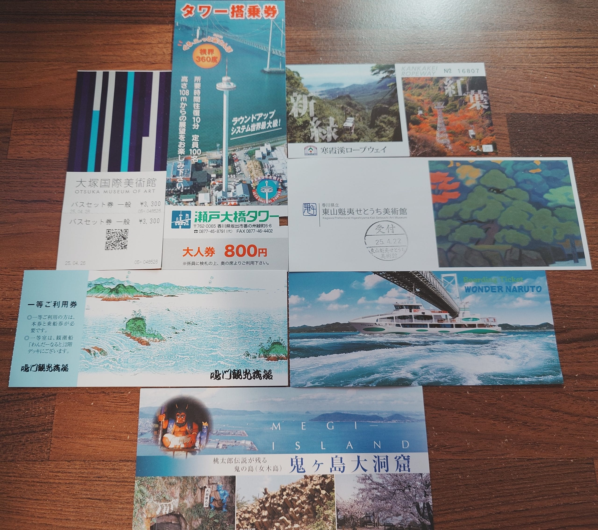
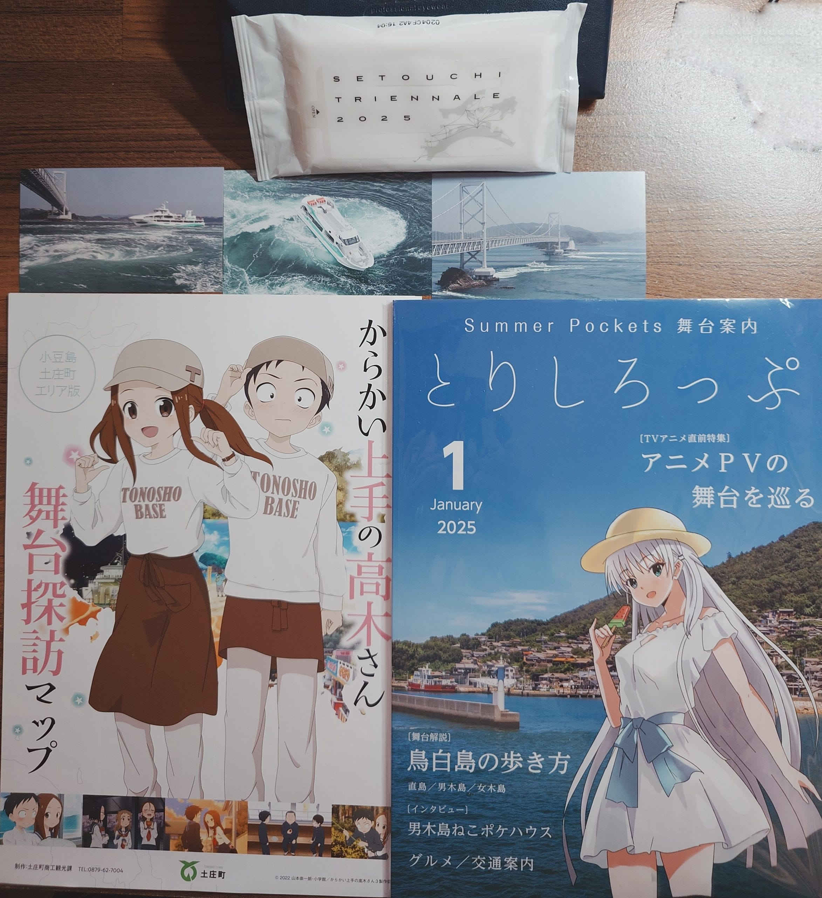

import Compare from '../../components/Compare.astro';
import compare10After from '../../assets/images/travel-setonaikai-2025-day8/pi_20250427_100245.jpg';
import compare10Before from '../../assets/images/travel-setonaikai-2025-day4/si_20250418_220750_24.jpg';
import compare11After from '../../assets/images/travel-setonaikai-2025-day8/pi_20250427_100612.jpg';
import compare11Before from '../../assets/images/travel-setonaikai-2025-day4/si_20250418_220750_28.jpg';
import compare12After from '../../assets/images/travel-setonaikai-2025-day8/pi_20250427_101034.jpg';
import compare12Before from '../../assets/images/travel-setonaikai-2025-day8/鴎と出会った海岸-Summer-Pocket.jpg';
import compare13After from '../../assets/images/travel-setonaikai-2025-day8/pi_20250427_101359.jpg';
import compare13Before from '../../assets/images/travel-setonaikai-2025-day4/si_20250418_220750_29.jpg';
import compare14After from '../../assets/images/travel-setonaikai-2025-day8/pi_20250427_101542.jpg';
import compare14Before from '../../assets/images/travel-setonaikai-2025-day4/1e8177190b6d34eaa8f96d3c4b938828.jpg';
import compare15After from '../../assets/images/travel-setonaikai-2025-day8/pi_20250427_101632.jpg';
import compare15Before from '../../assets/images/travel-setonaikai-2025-day8/si_20250422_071525.jpg';
import compare16After from '../../assets/images/travel-setonaikai-2025-day8/pi_20250427_101759.jpg';
import compare16Before from '../../assets/images/travel-setonaikai-2025-day4/8442820bc1a675c0d280aadc8162a799.jpg';
import compare17After from '../../assets/images/travel-setonaikai-2025-day8/pi_20250427_102748.jpg';
import compare17Before from '../../assets/images/travel-setonaikai-2025-day8/si_20250418_220750_21.jpg';
import compare18After from '../../assets/images/travel-setonaikai-2025-day8/pi_20250427_103302.jpg';
import compare18Before from '../../assets/images/travel-setonaikai-2025-day8/si_20250418_220750_20.jpg';
import compare19After from '../../assets/images/travel-setonaikai-2025-day8/si_20250418_220750_19.jpg';
import compare19Before from '../../assets/images/travel-setonaikai-2025-day8/pi_20250427_103550.jpg';
import compare1After from '../../assets/images/travel-setonaikai-2025-day8/pi_20250427_083326.jpg';
import compare1Before from '../../assets/images/travel-setonaikai-2025-day8/si_20250418_220750_18.jpg';
import compare20After from '../../assets/images/travel-setonaikai-2025-day8/pi_20250427_104017.jpg';
import compare20Before from '../../assets/images/travel-setonaikai-2025-day4/si_20250418_220750_23.jpg';
import compare21After from '../../assets/images/travel-setonaikai-2025-day8/pi_20250427_104208-1.jpg';
import compare21Before from '../../assets/images/travel-setonaikai-2025-day4/si_20250418_220750_26.jpg';
import compare2After from '../../assets/images/travel-setonaikai-2025-day8/pi_20250427_085441.jpg';
import compare2Before from '../../assets/images/travel-setonaikai-2025-day8/蒼と出会った小道-Summer-Pocket.jpg';
import compare3After from '../../assets/images/travel-setonaikai-2025-day8/pi_20250427_085539.jpg';
import compare3Before from '../../assets/images/travel-setonaikai-2025-day8/蒼と出会った小道-Summer-Pocket.jpg';
import compare4After from '../../assets/images/travel-setonaikai-2025-day8/pi_20250427_093931.jpg';
import compare4Before from '../../assets/images/travel-setonaikai-2025-day8/si_20250418_220750_30.jpg';
import compare5After from '../../assets/images/travel-setonaikai-2025-day8/pi_20250427_091358.jpg';
import compare5Before from '../../assets/images/travel-setonaikai-2025-day8/si_20250418_220750_31.jpg';
import compare6After from '../../assets/images/travel-setonaikai-2025-day8/pi_20250427_091518.jpg';
import compare6Before from '../../assets/images/travel-setonaikai-2025-day8/si_20250418_220750_32.jpg';
import compare7After from '../../assets/images/travel-setonaikai-2025-day8/pi_20250427_091604-1.jpg';
import compare7Before from '../../assets/images/travel-setonaikai-2025-day8/男木島燈塔-6-Summer-Pocket.jpg';
import compare8After from '../../assets/images/travel-setonaikai-2025-day8/pi_20250427_091113.jpg';
import compare8Before from '../../assets/images/travel-setonaikai-2025-day8/si_20250418_220750_34.jpg';
import compare9After from '../../assets/images/travel-setonaikai-2025-day8/pi_20250427_095941.jpg';
import compare9Before from '../../assets/images/travel-setonaikai-2025-day4/si_20250418_220750_25.jpg';

旅遊最後一天，早上，我在高松搭乘渡輪前往男木島，在島上進行最後的聖地巡禮。中午回到高松，搭乘電車與轉乘公車到達岡山機場，搭飛機飛回台灣，結束旅行。

今天早上，在旅館完成退房手續，將行李寄放在旅館後，走到高松港搭乘渡輪前往男木島，前往高松港的途中，在超商購買早餐。

<figure>



<figcaption>搭乘渡輪前往男木島</figcaption>
</figure>

```html title="wp-unconverted: envira/envira-gallery"
<!-- wp:envira/envira-gallery {"galleryId":1595,"title":"男木港 \u0026#8211; 20250427","columns":"0","margins":"custom","custom_margins":8,"lightbox_enabled":1,"lazyload_enabled":1,"lightbox_theme":"base","images":[{"status":"active","src":"https://aniya.moe/wp-content/uploads/2025/05/20250427_084030303-scaled.jpg","title":"男木港與男木島聚落","link":"https://aniya.moe/wp-content/uploads/2025/05/20250427_084030303-scaled.jpg","alt":"","caption":"","thumb":"","id":1597,"height":106.20300751879698,"width":141.3},{"status":"active","src":"https://aniya.moe/wp-content/uploads/2025/05/20250427_084021441-scaled.jpg","title":"男木港與男木島聚落","link":"https://aniya.moe/wp-content/uploads/2025/05/20250427_084021441-scaled.jpg","alt":"","caption":"","thumb":"","id":1596,"height":106.20300751879698,"width":141.3},{"status":"active","src":"https://aniya.moe/wp-content/uploads/2025/05/20250427_084044656-scaled.jpg","title":"男木港與男木島聚落","link":"https://aniya.moe/wp-content/uploads/2025/05/20250427_084044656-scaled.jpg","alt":"","caption":"","thumb":"","id":1598,"height":106.20300751879698,"width":141.3},{"status":"active","src":"https://aniya.moe/wp-content/uploads/2025/05/20250427_084108932-scaled.jpg","title":"男木島聚落","link":"https://aniya.moe/wp-content/uploads/2025/05/20250427_084108932-scaled.jpg","alt":"","caption":"","thumb":"","id":1599,"height":106.20300751879698,"width":141.3},{"status":"active","src":"https://aniya.moe/wp-content/uploads/2025/05/20250427_084138775-scaled.jpg","title":"男木港與男木島聚落","link":"https://aniya.moe/wp-content/uploads/2025/05/20250427_084138775-scaled.jpg","alt":"","caption":"","thumb":"","id":1600,"height":106.20300751879698,"width":141.3},{"status":"active","src":"https://aniya.moe/wp-content/uploads/2025/05/20250427_084145909-scaled.jpg","title":"男木港與男木島聚落","link":"https://aniya.moe/wp-content/uploads/2025/05/20250427_084145909-scaled.jpg","alt":"","caption":"","thumb":"","id":1601,"height":106.20300751879698,"width":141.3},{"status":"active","src":"https://aniya.moe/wp-content/uploads/2025/05/20250427_084155145-scaled.jpg","title":"男木港與男木島聚落","link":"https://aniya.moe/wp-content/uploads/2025/05/20250427_084155145-scaled.jpg","alt":"","caption":"","thumb":"","id":1602,"height":106.20300751879698,"width":141.3},{"status":"active","src":"https://aniya.moe/wp-content/uploads/2025/05/20250427_084335425-scaled.jpg","title":"男木島聚落","link":"https://aniya.moe/wp-content/uploads/2025/05/20250427_084335425-scaled.jpg","alt":"","caption":"","thumb":"","id":1603,"height":106.20300751879698,"width":141.3}]} -->
<div class="wp-block-envira-envira-gallery">[envira-gallery id='1595']</div>
<!-- /wp:envira/envira-gallery -->
```

<Compare before={compare1Before} after={compare1After}>(重拍) さしずめ俺は……</Compare>

到達男木島，下船後，前往今天的主要目標—[男木島灯台](https://maps.app.goo.gl/Nm8KojhZVyBYzeC3A)。路途上，看到紬ヴェンダース的痛車，遇到一隻逃出雞舍的雞，以及經過[「細川和俊君の足跡」碑](https://maps.app.goo.gl/HNp94uyBT3Eg3JQeA)，行走約半小時後，抵達燈塔。

```html title="wp-unconverted: envira/envira-gallery"
<!-- wp:envira/envira-gallery {"galleryId":1609,"title":"前往男木島燈塔的途中","columns":"0","margins":"custom","custom_margins":8,"lightbox_enabled":1,"lazyload_enabled":1,"lightbox_theme":"base","images":[{"status":"active","src":"https://aniya.moe/wp-content/uploads/2025/05/20250427_084820299-scaled.jpg","title":"紬ヴェンダース的痛車","link":"https://aniya.moe/wp-content/uploads/2025/05/20250427_084820299-scaled.jpg","alt":"","caption":"","thumb":"","id":1610,"height":119.19831223628691,"width":158.5},{"status":"active","src":"https://aniya.moe/wp-content/uploads/2025/05/20250427_090609979-scaled.jpg","title":"細川和俊君の足跡」石碑","link":"https://aniya.moe/wp-content/uploads/2025/05/20250427_090609979-scaled.jpg","alt":"","caption":"","thumb":"","id":1611,"height":119.19831223628691,"width":89.4},{"status":"active","src":"https://aniya.moe/wp-content/uploads/2025/05/20250427_090624244-scaled.jpg","title":"遠方就是男木島燈塔","link":"https://aniya.moe/wp-content/uploads/2025/05/20250427_090624244-scaled.jpg","alt":"","caption":"","thumb":"","id":1612,"height":119.19831223628691,"width":158.5},{"status":"active","src":"https://aniya.moe/wp-content/uploads/2025/05/20250427_090916077-scaled.jpg","title":"抵達男木島燈塔","link":"https://aniya.moe/wp-content/uploads/2025/05/20250427_090916077-scaled.jpg","alt":"","caption":"","thumb":"","id":1613,"height":119.19831223628691,"width":158.5}]} -->
<div class="wp-block-envira-envira-gallery">[envira-gallery id='1609']</div>
<!-- /wp:envira/envira-gallery -->
```

<Compare before={compare2Before} after={compare2After}>在 Summer Pockets 中，與蒼相遇的小路</Compare>

<Compare before={compare3Before} after={compare3After}>在 Summer Pockets 中，與蒼相遇的小路</Compare>

參觀完燈塔與旁邊的資料館[^1]，以及附近的露營場後，返回男木島聚落。

```html title="wp-unconverted: envira/envira-gallery"
<!-- wp:envira/envira-gallery {"galleryId":1615,"title":"男木島燈塔","columns":"0","row_height":140,"margins":"custom","custom_margins":8,"lightbox_enabled":1,"lazyload_enabled":1,"lightbox_theme":"base","images":[{"status":"active","src":"https://aniya.moe/wp-content/uploads/2025/05/20250427_091625109-scaled.jpg","title":"男木島燈塔","link":"https://aniya.moe/wp-content/uploads/2025/05/20250427_091625109-scaled.jpg","alt":"","caption":"","thumb":"","id":1616,"height":88.67924528301887,"width":66.5},{"status":"active","src":"https://aniya.moe/wp-content/uploads/2025/05/20250427_091731321-scaled.jpg","title":"男木島燈塔資料館","link":"https://aniya.moe/wp-content/uploads/2025/05/20250427_091731321-scaled.jpg","alt":"","caption":"","thumb":"","id":1617,"height":88.67924528301887,"width":117.9},{"status":"active","src":"https://aniya.moe/wp-content/uploads/2025/05/20250427_091852208-scaled.jpg","title":"資料館門旁的「男木島灯台サマポケ祭り」的海報","link":"https://aniya.moe/wp-content/uploads/2025/05/20250427_091852208-scaled.jpg","alt":"","caption":"","thumb":"","id":1618,"height":88.67924528301887,"width":66.5},{"status":"active","src":"https://aniya.moe/wp-content/uploads/2025/05/20250427_093047619-scaled.jpg","title":"資料館門旁的海報","link":"https://aniya.moe/wp-content/uploads/2025/05/20250427_093047619-scaled.jpg","alt":"","caption":"","thumb":"","id":1624,"height":88.67924528301887,"width":66.5},{"status":"active","src":"https://aniya.moe/wp-content/uploads/2025/05/20250427_092420958-scaled.jpg","title":"紬ヴェンダース的透明立牌","link":"https://aniya.moe/wp-content/uploads/2025/05/20250427_092420958-scaled.jpg","alt":"","caption":"","thumb":"","id":1619,"height":88.67924528301887,"width":66.5},{"status":"active","src":"https://aniya.moe/wp-content/uploads/2025/05/20250427_092656381-scaled.jpg","title":"紬ヴェンダース與野村美希的立牌","link":"https://aniya.moe/wp-content/uploads/2025/05/20250427_092656381-scaled.jpg","alt":"","caption":"","thumb":"","id":1622,"height":88.67924528301887,"width":66.5},{"status":"active","src":"https://aniya.moe/wp-content/uploads/2025/05/20250427_092944694-scaled.jpg","title":"男木島觀光景點資訊","link":"https://aniya.moe/wp-content/uploads/2025/05/20250427_092944694-scaled.jpg","alt":"","caption":"","thumb":"","id":1623,"height":88.67924528301887,"width":66.5}]} -->
<div class="wp-block-envira-envira-gallery">[envira-gallery id='1615']</div>
<!-- /wp:envira/envira-gallery -->
```

<figure>
<video controls preload="metadata" src="https://media.aniya.moe/videos/travel-setonaikai-2025-day8/20250427_092603501.mp4"></video>
<figcaption>影片：自動化燈器</figcaption>
</figure>

<Compare before={compare4Before} after={compare4After}>Summer Pockets 中，坐在燈塔上的紬ヴェンダース</Compare>

<Compare before={compare5Before} after={compare5After}>Summer Pockets 中，坐在燈塔上的紬ヴェンダース</Compare>

<Compare before={compare6Before} after={compare6After}>Summer Pockets 中出現的燈塔</Compare>

<Compare before={compare7Before} after={compare7After}>Summer Pockets 中出現的燈塔</Compare>

<Compare before={compare8Before} after={compare8After}>Summer Pockets 中出現的燈塔與紬ヴェンダース</Compare>

---

回到聚落後，距離船班還剩下不少時間，決定再拍一次先前拍過的景點，首先是豐玉姬神社，然後是歩く方舟，最後是男木港一帶。結束後，搭乘渡輪返回高松港。

<figure>



<figcaption>從豐玉姬神社鳥瞰整個男木島聚落</figcaption>
</figure>

```html title="wp-unconverted: envira/envira-gallery"
<!-- wp:envira/envira-gallery {"galleryId":1645,"title":"歩く方舟 \u0026#8211; 20250427","columns":"0","margins":"custom","custom_margins":8,"lightbox_enabled":1,"lazyload_enabled":1,"lightbox_theme":"base","images":[{"status":"active","src":"https://aniya.moe/wp-content/uploads/2025/05/20250427_101450950-scaled.jpg","title":"歩く方舟","link":"https://aniya.moe/wp-content/uploads/2025/05/20250427_101450950-scaled.jpg","alt":"","caption":"","thumb":"","id":1646,"height":106.20300751879698,"width":141.3},{"status":"active","src":"https://aniya.moe/wp-content/uploads/2025/05/20250427_101453654-scaled.jpg","title":"歩く方舟","link":"https://aniya.moe/wp-content/uploads/2025/05/20250427_101453654-scaled.jpg","alt":"","caption":"","thumb":"","id":1647,"height":106.20300751879698,"width":141.3},{"status":"active","src":"https://aniya.moe/wp-content/uploads/2025/05/20250427_101838046-scaled.jpg","title":"歩く方舟","link":"https://aniya.moe/wp-content/uploads/2025/05/20250427_101838046-scaled.jpg","alt":"","caption":"","thumb":"","id":1648,"height":106.20300751879698,"width":141.3},{"status":"active","src":"https://aniya.moe/wp-content/uploads/2025/05/20250427_101841087-scaled.jpg","title":"歩く方舟","link":"https://aniya.moe/wp-content/uploads/2025/05/20250427_101841087-scaled.jpg","alt":"","caption":"","thumb":"","id":1649,"height":106.20300751879698,"width":141.3}]} -->
<div class="wp-block-envira-envira-gallery">[envira-gallery id='1645']</div>
<!-- /wp:envira/envira-gallery -->
```

```html title="wp-unconverted: envira/envira-gallery"
<!-- wp:envira/envira-gallery {"galleryId":1652,"title":"男木島 \u0026#8211; 20250427","columns":"0","row_height":140,"margins":"custom","custom_margins":8,"lightbox_enabled":1,"lazyload_enabled":1,"lightbox_theme":"base","images":[{"status":"active","src":"https://aniya.moe/wp-content/uploads/2025/05/20250427_100415268-scaled.jpg","title":"路上遇到的貓","link":"https://aniya.moe/wp-content/uploads/2025/05/20250427_100415268-scaled.jpg","alt":"","caption":"","thumb":"","id":1653,"height":111.81262729124236,"width":83.9},{"status":"active","src":"https://aniya.moe/wp-content/uploads/2025/05/20250427_100446817-scaled.jpg","title":"路上遇到的貓","link":"https://aniya.moe/wp-content/uploads/2025/05/20250427_100446817-scaled.jpg","alt":"","caption":"","thumb":"","id":1654,"height":111.81262729124236,"width":83.9},{"status":"active","src":"https://aniya.moe/wp-content/uploads/2025/05/20250427_102727829-scaled.jpg","title":"熊造型的木像","link":"https://aniya.moe/wp-content/uploads/2025/05/20250427_102727829-scaled.jpg","alt":"","caption":"","thumb":"","id":1655,"height":111.81262729124236,"width":83.9},{"status":"active","src":"https://aniya.moe/wp-content/uploads/2025/05/20250427_102921964-scaled.jpg","title":"ねこポケホウス準備中","link":"https://aniya.moe/wp-content/uploads/2025/05/20250427_102921964-scaled.jpg","alt":"","caption":"","thumb":"","id":1656,"height":111.81262729124236,"width":148.7},{"status":"active","src":"https://aniya.moe/wp-content/uploads/2025/05/20250427_103001513-scaled.jpg","title":"ねこポケホウス附近的圍牆","link":"https://aniya.moe/wp-content/uploads/2025/05/20250427_103001513-scaled.jpg","alt":"","caption":"","thumb":"","id":1657,"height":111.81262729124236,"width":148.7},{"status":"active","src":"https://aniya.moe/wp-content/uploads/2025/05/20250427_103053644-scaled.jpg","title":"頭上注意","link":"https://aniya.moe/wp-content/uploads/2025/05/20250427_103053644-scaled.jpg","alt":"","caption":"","thumb":"","id":1658,"height":119.19831223628691,"width":89.4},{"status":"active","src":"https://aniya.moe/wp-content/uploads/2025/05/20250427_104252203-scaled.jpg","title":"男木島の魂","link":"https://aniya.moe/wp-content/uploads/2025/05/20250427_104252203-scaled.jpg","alt":"","caption":"","thumb":"","id":1659,"height":119.19831223628691,"width":158.5},{"status":"active","src":"https://aniya.moe/wp-content/uploads/2025/05/20250427_104415814-scaled.jpg","title":"男木島の魂","link":"https://aniya.moe/wp-content/uploads/2025/05/20250427_104415814-scaled.jpg","alt":"","caption":"","thumb":"","id":1660,"height":119.19831223628691,"width":158.5},{"status":"active","src":"https://aniya.moe/wp-content/uploads/2025/05/20250427_104501117-scaled.jpg","title":"男木島の魂","link":"https://aniya.moe/wp-content/uploads/2025/05/20250427_104501117-scaled.jpg","alt":"","caption":"","thumb":"","id":1661,"height":119.19831223628691,"width":158.5}]} -->
<div class="wp-block-envira-envira-gallery">[envira-gallery id='1652']</div>
<!-- /wp:envira/envira-gallery -->
```

<Compare before={compare9Before} after={compare9After}>(重拍) Summer Pockets 動畫主視覺圖</Compare>

<Compare before={compare10Before} after={compare10After}>(重拍) Summer Pockets 中，站在鳥居前的水織静久</Compare>

<Compare before={compare11Before} after={compare11After}>(重拍) Summer Pockets 動畫中，男主角—鷹原羽依里—前往留宿地點，路途中一景</Compare>

<Compare before={compare12Before} after={compare12After}>在 Summer Pockets 中，與久島鴎相遇的海邊道路</Compare>

<Compare before={compare13Before} after={compare13After}>(重拍) Summer Pockets 動畫中，男主角—鷹原羽依里—前往留宿地點，路途中一景</Compare>

<Compare before={compare14Before} after={compare14After}>(重拍) Summer Pockets 動畫中，傍晚時，男主角—鷹原羽依里—推著行李箱，與坐在行李箱上的女主角—久島鴎—前進。</Compare>

<Compare before={compare15Before} after={compare15After}>Summer Pockets 動畫中，女主角—久島鴎—推著行李箱在海邊前進。</Compare>

<Compare before={compare16Before} after={compare16After}>(重拍) 久島鴎坐在行李箱上往下衝一景</Compare>

<Compare before={compare17Before} after={compare17After}>(重拍) Summer Pockets 中，女主角—鳴瀬しろは—游泳的地方，圍牆上有告示，禁止對學生拍照。</Compare>

<Compare before={compare18Before} after={compare18After}>(重拍) 在 Summer Pockets 中登場的市政廳舍</Compare>

<Compare before={compare19Before} after={compare19After}>Summer Pockets 主視覺圖</Compare>

<Compare before={compare20Before} after={compare20After}>(重拍) Summer Pockets 中一個重要的場景</Compare>

<Compare before={compare21Before} after={compare21After}>(重拍) Summer Pockets 中，野村美希所站在的鐵塔</Compare>

```html title="wp-unconverted: envira/envira-gallery"
<!-- wp:envira/envira-gallery {"galleryId":1683,"title":"從男木島返回高松港的途中 \u0026#8211; 20250427","columns":"0","margins":"custom","custom_margins":8,"lightbox_enabled":1,"lazyload_enabled":1,"lightbox_theme":"base","images":[{"status":"active","src":"https://aniya.moe/wp-content/uploads/2025/05/20250427_111938841-scaled.jpg","title":"從船上拍攝鬼ヶ島おにの館","link":"https://aniya.moe/wp-content/uploads/2025/05/20250427_111938841-scaled.jpg","alt":"","caption":"","thumb":"","id":1684,"height":55.53168635875402,"width":73.9},{"status":"active","src":"https://aniya.moe/wp-content/uploads/2025/05/20250427_111950790-scaled.jpg","title":"從船上拍攝「20世紀の回想」","link":"https://aniya.moe/wp-content/uploads/2025/05/20250427_111950790-scaled.jpg","alt":"","caption":"","thumb":"","id":1685,"height":55.53168635875402,"width":73.9},{"status":"active","src":"https://aniya.moe/wp-content/uploads/2025/05/20250427_112427497-scaled.jpg","title":"從船上拍攝女木港","link":"https://aniya.moe/wp-content/uploads/2025/05/20250427_112427497-scaled.jpg","alt":"","caption":"","thumb":"","id":1686,"height":55.53168635875402,"width":73.9},{"status":"active","src":"https://aniya.moe/wp-content/uploads/2025/05/20250427_113311956-scaled.jpg","title":"在高松港裡行駛的水上摩拖車","link":"https://aniya.moe/wp-content/uploads/2025/05/20250427_113311956-scaled.jpg","alt":"","caption":"","thumb":"","id":1687,"height":55.53168635875402,"width":73.9},{"status":"active","src":"https://aniya.moe/wp-content/uploads/2025/05/20250427_113731574-scaled.jpg","title":"前往小豆島的渡輪","link":"https://aniya.moe/wp-content/uploads/2025/05/20250427_113731574-scaled.jpg","alt":"","caption":"","thumb":"","id":1688,"height":55.53168635875402,"width":73.9},{"status":"active","src":"https://aniya.moe/wp-content/uploads/2025/05/20250427_113738189-scaled.jpg","title":"前往小豆島的渡輪","link":"https://aniya.moe/wp-content/uploads/2025/05/20250427_113738189-scaled.jpg","alt":"","caption":"","thumb":"","id":1689,"height":55.53168635875402,"width":73.9},{"status":"active","src":"https://aniya.moe/wp-content/uploads/2025/05/20250427_113842908-scaled.jpg","title":"高松港","link":"https://aniya.moe/wp-content/uploads/2025/05/20250427_113842908-scaled.jpg","alt":"","caption":"","thumb":"","id":1690,"height":55.53168635875402,"width":73.9}]} -->
<div class="wp-block-envira-envira-gallery">[envira-gallery id='1683']</div>
<!-- /wp:envira/envira-gallery -->
```

---

回到高松後，我在車站附近找了一間同時提供咖喱飯和燒肉的店[^2]，點了燒肉套餐當作午餐。店老闆自己一個人經營這間店，可以同時應付我這邊的上菜，以及其他客戶的出餐，挺厲害的。整體味道上不錯，份量上就吃粗飽。用餐途中，店老闆看到我右手的傷勢，關心我一下，然後從店裡消失一陣子，回來時，手上拿著 OK 繃要給我。順道一提，從店老闆和其他熟客的談話中，我得知今天有自衛隊相關的活動[^3]。

```html title="wp-unconverted: envira/envira-gallery"
<!-- wp:envira/envira-gallery {"galleryId":1692,"title":"MEGのスパイス食堂","columns":"0","row_height":140,"margins":"custom","custom_margins":8,"lightbox_enabled":1,"lazyload_enabled":1,"lightbox_theme":"base","images":[{"status":"active","src":"https://aniya.moe/wp-content/uploads/2025/05/20250427_120535423-scaled.jpg","title":"燒肉","link":"https://aniya.moe/wp-content/uploads/2025/05/20250427_120535423-scaled.jpg","alt":"","caption":"","thumb":"","id":1693,"height":82.5563909774436,"width":109.8},{"status":"active","src":"https://aniya.moe/wp-content/uploads/2025/05/20250427_121144938-scaled.jpg","title":"燒肉","link":"https://aniya.moe/wp-content/uploads/2025/05/20250427_121144938-scaled.jpg","alt":"","caption":"","thumb":"","id":1694,"height":82.5563909774436,"width":109.8},{"status":"active","src":"https://aniya.moe/wp-content/uploads/2025/05/20250427_121455707-scaled.jpg","title":"燒肉","link":"https://aniya.moe/wp-content/uploads/2025/05/20250427_121455707-scaled.jpg","alt":"","caption":"","thumb":"","id":1695,"height":82.5563909774436,"width":109.8},{"status":"active","src":"https://aniya.moe/wp-content/uploads/2025/05/20250427_123717040-scaled.jpg","title":"店家自製的香腸","link":"https://aniya.moe/wp-content/uploads/2025/05/20250427_123717040-scaled.jpg","alt":"","caption":"","thumb":"","id":1696,"height":82.5563909774436,"width":109.8},{"status":"active","src":"https://aniya.moe/wp-content/uploads/2025/05/20250427_130154312-scaled.jpg","title":"雞肉","link":"https://aniya.moe/wp-content/uploads/2025/05/20250427_130154312-scaled.jpg","alt":"","caption":"","thumb":"","id":1697,"height":82.5563909774436,"width":109.8}]} -->
<div class="wp-block-envira-envira-gallery">[envira-gallery id='1692']</div>
<!-- /wp:envira/envira-gallery -->
```

用餐結束後，回旅館領回寄放的行李，接著前往高松站，簡短逛了[ハレノヒヤ高松オルネ店](https://maps.app.goo.gl/DED5iYt1UziGbzxD6)後，進站搭乘電車前往岡山站。

到了岡山站後，在站內與站外的特產店逛了一下，然後前往西口外的公車站搭乘接駁巴士，前往岡山機場。巴士行駛過程，車內十分安靜，與第一天的情況截然不同。

抵達岡山機場後，我逛了一下機場。另外，由於擔心傷口的敷料可能沒有貼牢，嘗試在機場內尋找膠帶但未果，機場內的超商雖然有賣一些日用品，但沒有膠帶，而有急救箱告示的派出所，也沒有膠帶。

<figure>



<figcaption>機場外的桃太郎像</figcaption>
</figure>

在機場內找個地方整理好行李後，我加入等待辦理報到手續的隊伍。岡山機場的報到流程是先通過 X 光機的檢查，然後才可以去後面的櫃台報到，有遇到旅客被 X 光機掃出異物的情況，也有遇到旅客通過 X 光機檢查，但在櫃台時，被磅秤測出超重的情形。在排隊過程中，注意到一團看起來是老師帶著學生們的旅遊團，從一位同學背包側掛牌上資訊，得知是來自景美高中的團。

順利完成報到手續後，接著就去排安檢和出境審查，完成後，休息一會，搭上飛機，飛回台灣。

---

約晚上 7 點半抵達台灣，今天入境的人潮真多，不管是自動通關閘門前，還是海關前的行李區，都是一堆人，另外，在行李區注意到有一大團的疑似專案移入的移工，這是我第一次在機場看到這情景。

---

<figure>



<figcaption>有留下來的交通票據</figcaption>
</figure>

<figure>



<figcaption>門票</figcaption>
</figure>

<figure>



<figcaption>活動紀錄</figcaption>
</figure>

<sup>*各個島嶼的蓋章紀錄*</sup>

```html title="wp-unconverted: envira/envira-gallery"
<!-- wp:envira/envira-gallery {"galleryId":517,"title":"瀨戶藝 2025 蓋章紀錄","columns":"0","row_height":140,"margins":"custom","custom_margins":8,"lightbox_enabled":1,"lazyload_enabled":1,"isotope":1,"lightbox_theme":"base","images":[{"status":"active","src":"https://aniya.moe/wp-content/uploads/2025/05/Screenshot_20250508-003403.png","title":"犬島","link":"https://aniya.moe/wp-content/uploads/2025/05/Screenshot_20250508-003403.png","alt":"","caption":"","thumb":"","id":476,"height":174.18300653594773,"width":88.8},{"status":"active","src":"https://aniya.moe/wp-content/uploads/2025/05/Screenshot_20250508-004654.png","title":"直島","link":"https://aniya.moe/wp-content/uploads/2025/05/Screenshot_20250508-004654.png","alt":"","caption":"","thumb":"","id":478,"height":174.18300653594773,"width":88.8},{"status":"active","src":"https://aniya.moe/wp-content/uploads/2025/05/Screenshot_20250508-004701.png","title":"女木島","link":"https://aniya.moe/wp-content/uploads/2025/05/Screenshot_20250508-004701.png","alt":"","caption":"","thumb":"","id":481,"height":174.18300653594773,"width":88.8},{"status":"active","src":"https://aniya.moe/wp-content/uploads/2025/05/Screenshot_20250508-004708.png","title":"男木島","link":"https://aniya.moe/wp-content/uploads/2025/05/Screenshot_20250508-004708.png","alt":"","caption":"","thumb":"","id":477,"height":174.18300653594773,"width":88.8},{"status":"active","src":"https://aniya.moe/wp-content/uploads/2025/05/Screenshot_20250508-004721.png","title":"小豆島","link":"https://aniya.moe/wp-content/uploads/2025/05/Screenshot_20250508-004721.png","alt":"","caption":"","thumb":"","id":479,"height":174.18300653594773,"width":88.8},{"status":"active","src":"https://aniya.moe/wp-content/uploads/2025/05/Screenshot_20250508-004729.png","title":"瀨戶大橋區域","link":"https://aniya.moe/wp-content/uploads/2025/05/Screenshot_20250508-004729.png","alt":"","caption":"","thumb":"","id":482,"height":174.18300653594773,"width":88.8}]} -->
<div class="wp-block-envira-envira-gallery">[envira-gallery id='517']</div>
<!-- /wp:envira/envira-gallery -->
```

---

[^1]: [資料館](https://takamatsu-udmap.jp/ud/2019021804311)基本上只在週末開放，但在 7 月 1 日至 8 月 31 日，以及瀨戶藝期間，則是每日開放
[^2]: [MEGのスパイス食堂](https://maps.app.goo.gl/nNL4wJtjWFRXorRy5)
[^3]: [サンポート高松周辺は航空自衛隊「ブルーインパルス」の飛行を一目見ようとにぎわう　高松市 | KSBニュース | KSB瀬戸内海放送](https://news.ksb.co.jp/article/15731967)
