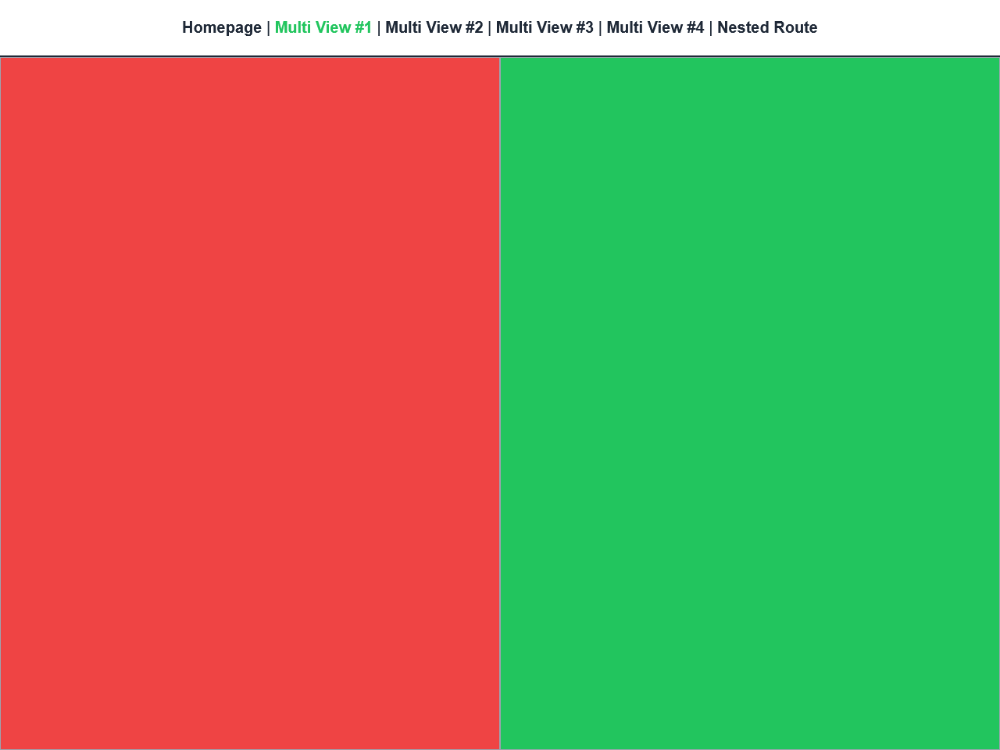
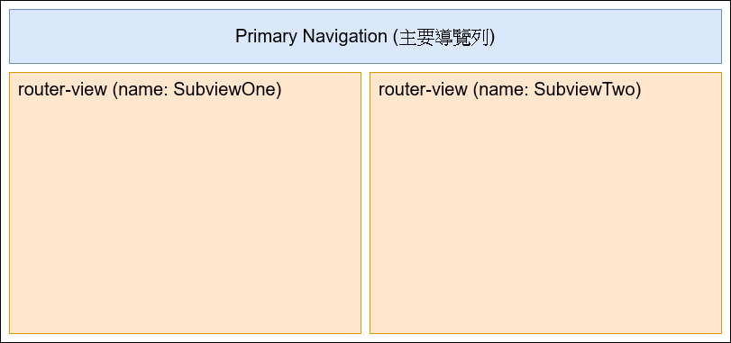

參考範例：[https://github.com/erase2004/vue-router-demo](https://github.com/erase2004/vue-router-demo)

<figure>



<figcaption>頁面預覽</figcaption>
</figure>

<figure>



<figcaption>頁面結構</figcaption>
</figure>

在一個顯示元件下，可以同時存在不只一個 router-view 元件，為了能夠讓目標顯示內容，顯示在指定的 router-view 上，這時候可以給個別的 router-view 設定不同的 name 屬性值，並且在元件要顯示時，指定要顯示的 router-view。因為該元件有多個 router-view，又 router-view 可以被指定要顯示的內容，可以把該元件當作一個可重複使用的模板元件，讓類似顯示結構的頁面都使用該元件，並設定好要顯示的內容。

```html title="wp-unconverted: core/code"
<!-- wp:code -->
<pre title="src/App.vue" class="wp-block-code"><code lang="markup" class="language-markup">...
&lt;div class="flex flex-grow md:flex-row flex-col flex-nowrap"&gt;
  &lt;router-view class="flex-grow" /&gt;
  &lt;router-view
    name="SubviewOne"
    class="flex-grow"
  /&gt;
  &lt;router-view
    name="SubviewTwo"
    class="flex-grow"
  /&gt;
&lt;/div&gt;
...</code></pre>
<!-- /wp:code -->
```

這是 App.vue 裡一部分的 template 結構，當中有三個 router-view，其中有兩個 router-view 有手動設定 name 屬性值，其實，router-view 在未手動設定 name 屬性值的情況下，其會使用預設值 <mark>default</mark> 作為屬性值。

```html title="wp-unconverted: core/code"
<!-- wp:code -->
<pre title="src/router/index.js" class="wp-block-code"><code lang="javascript" class="language-javascript">...
import MultiComponentOne from '@/components/multiple/ComponentOne'
import MultiComponentTwo from '@/components/multiple/ComponentTwo'

const routes = [
  ...,
  {
    path: '/multi/first',
    name: 'multi-first',
    components: {
      SubviewOne: MultiComponentOne,
      SubviewTwo: MultiComponentTwo
    }
  },
  ...
]</code></pre>
<!-- /wp:code -->
```

在 Multi View #1 這個頁面底下，為了滿足 App.vue 底下的 router-view 顯示指定的內容的需求，我們在 router 的設定裡，對 Multi View #1 的 router 物件設定 componenets 屬性，並在當中指定對應的 key-value pair，key 所代表的是指定的 router-view 的 name，value 則是所要呈現的顯示元件。由於 SubviewOne 指定為 MultiComponentOne，SubviewTwo 指定為 MultiComponentTwo，在進到 Multi View #1 的頁面時，router-view (name: SubviewOne) 的部份就會顯示 MultiComponentOne 的內容，而 router-view (name: SubviewTwo) 的部份則會顯示 MultiComponentTwo 的內容。

App.vue 底下還有一個未手動設定 name 屬性值的 router-view (name: default)，在 Multi View #1 路由的設定也為對其指定要顯示的元件，因此，在進到 Multi View #1 頁面時，該 router-view 則不會有顯示內容。

```html title="wp-unconverted: core/code"
<!-- wp:code -->
<pre class="wp-block-code"><code lang="javascript" class="language-javascript">{
  path: '/',
  name: 'home',
  component: () =&gt; import('@/views/HomePage.vue')
}</code></pre>
<!-- /wp:code -->
```

```html title="wp-unconverted: core/code"
<!-- wp:code -->
<pre class="wp-block-code"><code lang="javascript" class="language-javascript">{
  path: '/',
  name: 'home',
  components: {
    default: () =&gt; import('@/views/HomePage.vue')
  }
},</code></pre>
<!-- /wp:code -->
```

由於 router-view 的 name 預設值是 default，其實上述兩種 route 物件的寫法是可以產生相同效果的。
