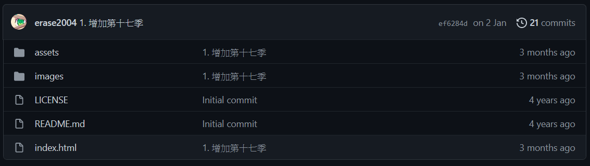
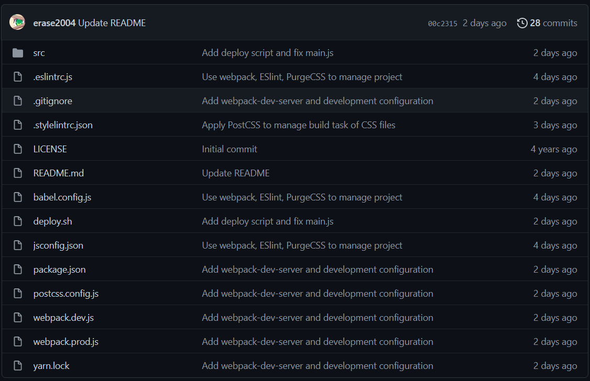
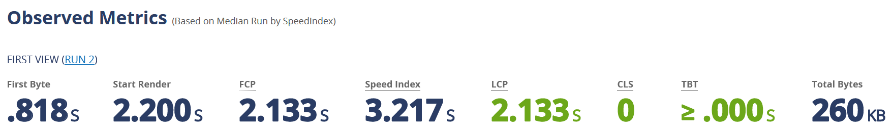
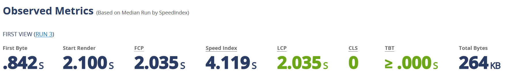
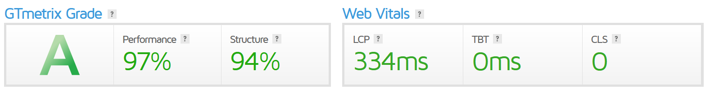
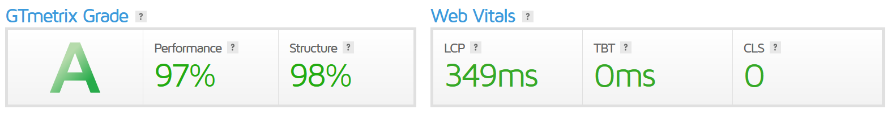
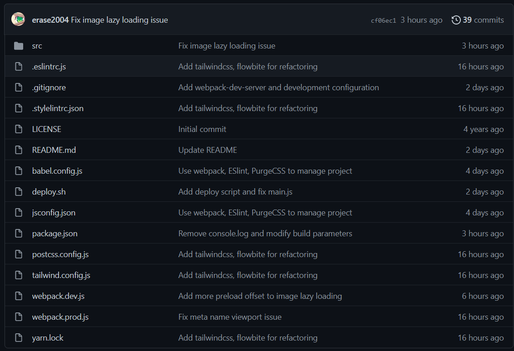

這次將 ACGN股市歷史博物館`wp-unconverted: [ref]<a href="https://museum.acgn-stock.com/" data-type="URL" data-id="https://museum.acgn-stock.com/" target="_blank" rel="noreferrer noopener">ACGN股市歷史博物館</a>[/ref]` 的頁面，從原先只有單純的 HTML、CSS和JavaScript，逐一導入 webpack 和 loader 套件，鋪設基礎建設後，使其更利於未來的開發與維護。

<figure>



<figcaption>導入前的專案目錄截圖，<a href="https://github.com/erase2004/museum-landmark/tree/ef6284d0e6e99def41456fcc0b87a53a28f9a3b2">commit 連結</a></figcaption>
</figure>

這次執行過程，主要是受到這篇文章`wp-unconverted: [ref]<a rel="noreferrer noopener" href="https://www.sitepoint.com/bundle-static-site-webpack/" data-type="URL" data-id="https://www.sitepoint.com/bundle-static-site-webpack/" target="_blank">How to Bundle a Simple Static Site Using Webpack</a>[/ref]`的啟發，同時，也參考該篇文章的操作流程，進行專案導入 webpack 的處理，也藉由操作的過程，更加熟悉 webpack 生態系。以下，將依序介紹這次導入的相關工具，以及他們的使用場景。

### Yarn

專案套件管理的基礎，在後續處理專案安全漏洞問題時，使用 Yarn 提供的 Selective dependency resolutions`wp-unconverted: [ref]<a rel="noreferrer noopener" href="https://classic.yarnpkg.com/lang/en/docs/selective-version-resolutions/" data-type="URL" data-id="https://classic.yarnpkg.com/lang/en/docs/selective-version-resolutions/" target="_blank">Selective dependency resolutions | Yarn</a>[/ref]` 功能，在 package.json 檔裡設定 resolution，有限地解決部份安全漏洞。

### webpack 5

專案打包工具，將專案依照設定，打包成滿足特定情境需求的版本，由於 webpack 5 有提供 Asset Modules`wp-unconverted: [ref]<a rel="noreferrer noopener" href="https://webpack.js.org/guides/asset-modules/" target="_blank">Asset Modules</a>[/ref]` 的功能，不用再像以往，需要使用 raw-loader, url-loader 和 file-loader 之類。

#### ．babel-loader

將 ES6+ 的 JavaScript 原始碼轉譯成 ES5

#### ．css-loader、mini-css-extract-plugin

前者是處理在 JavaScript 檔案中，import CSS 檔案的載入處理。後者是將載入後的 CSS 內容，輸出成獨立的檔案。

#### ．html-webpack-plugin

將初始的 index.html 轉為輸出成目標 HTML 的模板使用，該 plugin 預設使用 EJS 的模板語言，藉由在模板中撰寫模板語法，減少在重複 DOM 元素上的重複作業，提昇開發效率。

#### ．favicon-webpack-plugin

使用該 plugin 來處理 favicon 的產生與插入到目標 HTML 的任務。

#### ．Asset Modules

這次是用 asset/resource 來處理 JavaScript 檔案中，動態載入的圖片，確保輸出的結果能夠確實存取到這些圖片。

#### ．webpack-dev-server

供專案開發時使用的網頁伺服器，並利用其 HMR (`wp-unconverted: [ref]<a rel="noreferrer noopener" href="https://webpack.js.org/concepts/hot-module-replacement/" data-type="URL" data-id="https://webpack.js.org/concepts/hot-module-replacement/" target="_blank">Hot Module Replacement | webpack</a>[/ref]`) 特性，讓程式碼在被修改後，能夠立即在網頁上呈現，進而提昇開發效率。

## browserlist

使用該套件統一管理專案中，需要使用目標瀏覽器資訊套件的設定。

### PostCSS

將輸入的 CSS 檔案，按照設定的任務依序處理，輸出處理後的 CSS 內容。

#### ．autoprefixer

依照 package.json 內的 browserlist 設定，對 CSS style 加上瀏覽器專有的 prefix。

#### ．PurgeCSS

讀取專案原始碼並進行分析，移除未被使用的 CSS style，以達成對 CSS 的瘦身。

#### ．CSSNANO

對 CSS 進行壓縮，以達成最後輸出的 CSS 檔案大小最小化。

### ESLint、babel-eslint

依照設定的規則，檢查 JavaScript 原始碼的程式語法，並提出修改建議，以達成程式碼美化與風格上的統一。規劃未來將 babel-eslint 替換成 @babel/eslint-parser`wp-unconverted: [ref]<a href="https://babeljs.io/blog/2020/07/13/the-state-of-babel-eslint" data-type="URL" data-id="https://babeljs.io/blog/2020/07/13/the-state-of-babel-eslint" target="_blank" rel="noreferrer noopener">The State of babel-eslint | BABEL</a>[/ref]`。

## Stylelint

針對 CSS 的原始碼程式語法與風格檢查工具。

<figure>



<figcaption>導入後的專案目錄截圖，<a href="https://github.com/erase2004/museum-landmark/tree/00c2315699819402ec33edc0d68ff3c5955f3c9f">commit 連結</a></figcaption>
</figure>

原先根目錄底下的 index.html 搬移到 src 目錄底下管理，同時，assets 目錄底下的 JavaScript 和 CSS 的程式碼，以及 favicon 檔案都也搬移到 src 目錄底下管理。又 images 底下的圖片檔也搬移到 src 目錄底下管理。專案根目錄多了 public 和 dist 目錄，前者用作開發時 devServer 使用，後者用作部屬版本的輸出目錄使用。

新版本的專案要部屬前，先在正式環境上，參考教學`wp-unconverted: [ref]<a rel="noreferrer noopener" href="https://www.freecodecamp.org/news/a-b-testing-with-nginx-in-40-lines-of-code-d4f94397130a/" data-type="URL" data-id="https://www.freecodecamp.org/news/a-b-testing-with-nginx-in-40-lines-of-code-d4f94397130a/" target="_blank">A/B testing with NGINX in under 40 lines of code | freeCodeCamp</a>[/ref]``wp-unconverted: [ref]<a href="https://www.nginx.com/blog/performing-a-b-testing-nginx-plus/" data-type="URL" data-id="https://www.nginx.com/blog/performing-a-b-testing-nginx-plus/" target="_blank" rel="noreferrer noopener">Performing A/B Testing with NGINX and NGINX Plus</a>[/ref]`來修改 NGINX 設定，使其能夠同時服務新舊兩個版本，以利做 A/B 測試做對照。

<figure>



<figcaption>舊版本的測試結果，<a href="https://www.webpagetest.org/result/220328_AiDc9T_CXP/">詳細資訊</a></figcaption>
</figure>

<figure>



<figcaption>新版本的測試結果，<a href="https://www.webpagetest.org/result/220328_AiDcPF_CMY/">詳細資訊</a></figcaption>
</figure>

<figure>



<figcaption>舊版本的測試結果，<a href="https://gtmetrix.com/reports/museum.acgn-stock.com/UBovCjwE/">詳細資訊</a></figcaption>
</figure>

<figure>



<figcaption>新版本的測試結果，<a href="https://gtmetrix.com/reports/museum.acgn-stock.com/PqmQATlN/">詳細資訊</a></figcaption>
</figure>

基本上網頁在載入的表現上差異不大，符合預期。

---

第一階段的工作基本上到這邊就結束了，接下來建立在這個基礎建設上，對網站進行重構，使其呈現效果與使用者操作上更加友好。

首先，導入 image-webpack-loader，來處理以往圖片壓縮處理人工操作的部份，在輸入檔案總共 62 MB 的情況下，原先人工操作的部份可以壓縮到 24 MB，使用該 plugin 來處理的話，則會壓縮到 32 MB，考量到自動化以及圖片並非全部一次載入，plugin 帶來的優劣還是可以接受的。

接著，導入 Tailwind CSS`wp-unconverted: [ref]<a rel="noreferrer noopener" href="https://tailwindcss.com/" data-type="URL" data-id="https://tailwindcss.com/" target="_blank">Tailwind CSS</a>[/ref]` 與 Flowbite`wp-unconverted: [ref]<a rel="noreferrer noopener" href="https://flowbite.com/" data-type="URL" data-id="https://flowbite.com/" target="_blank">Flowbite</a>[/ref]`，讓 CSS style 在撰寫與管理上更加清楚明瞭，並善用 html-webpack-loader 與 EJS`wp-unconverted: [ref]<a rel="noreferrer noopener" href="https://ejs.co/#promo" data-type="URL" data-id="https://ejs.co/#promo" target="_blank">EJS</a>[/ref]` 語法對 index.html 進行重構，最後，參考教學`wp-unconverted: [ref]<a rel="noreferrer noopener" href="https://css-tricks.com/the-complete-guide-to-lazy-loading-images/#aa-method-1-trigger-the-image-load-using-javascript-events" data-type="URL" data-id="https://css-tricks.com/the-complete-guide-to-lazy-loading-images/#aa-method-1-trigger-the-image-load-using-javascript-events" target="_blank">The Complete Guide to Lazy Loading&nbsp;Images | CSS-TRICKS</a>[/ref]`撰寫 image lazy-loading 處理。

重構完成後的網站，帶來以下好處：

- 由於網站清單和圖片清單資料都抽出來獨立成檔案來管理，未來在新增對應資訊上的處理更加便捷。
- 網站清單的呈現與操作在桌面端與移動端上更加友好。
- 圖片可以完整的呈現，點擊圖片也能開啟對應賽季公司的詳細資訊頁。
- 圖片顯示區塊有要載入圖片的**主要顏色**`wp-unconverted: [ref]<a href="https://onlinejpgtools.com/find-dominant-jpg-colors" data-type="URL" data-id="https://onlinejpgtools.com/find-dominant-jpg-colors" target="_blank" rel="noreferrer noopener">主要顏色的分析工具</a>[/ref]`作墊底顯示。
- 圖片顯示區塊有載入動畫，能讓使用者更清楚圖片正在載入狀態。

<figure>



<figcaption>最終的專案目錄截圖</figcaption>
</figure>

```html title="wp-unconverted: core/gallery"
<!-- wp:gallery {"linkTo":"none"} -->
<figure class="wp-block-gallery has-nested-images columns-default is-cropped"><!-- wp:image {"id":288,"sizeSlug":"medium","linkDestination":"none"} -->
<figure class="wp-block-image size-medium"></figure>
<!-- /wp:image -->

<!-- wp:image {"id":289,"sizeSlug":"medium","linkDestination":"none"} -->
<figure class="wp-block-image size-medium"></figure>
<!-- /wp:image --><figcaption class="blocks-gallery-caption">PageSpeed Insight 的分析結果</figcaption></figure>
<!-- /wp:gallery -->
```
